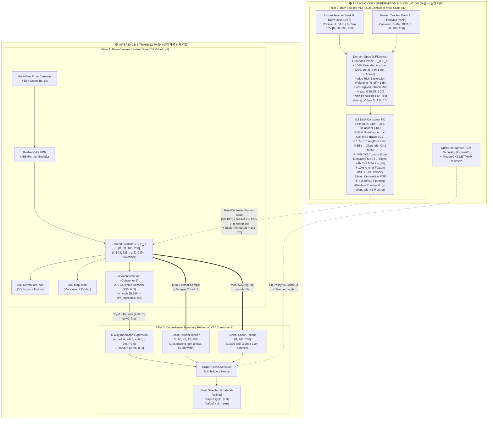
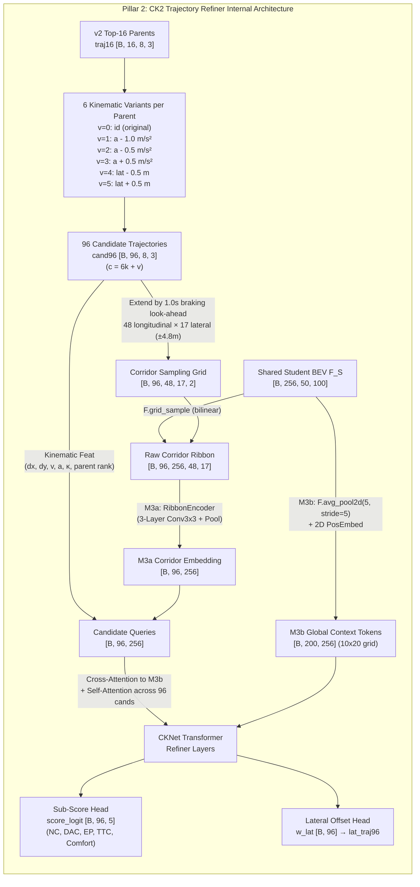
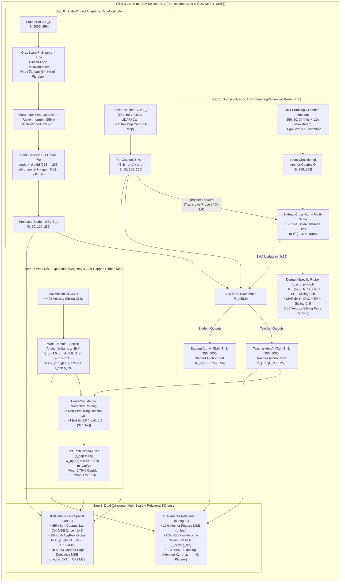

# PARA-SSR v2 + CK2 Refiner + BEV Selector v13 전체 아키텍처 상세 명세서 (`arch.md`)

본 문서는 현재 학습 및 실험 중인 **`fusion_v13_main` (`PARA-SSR v2` + `CK2 Trajectory Refiner E2E` + `BEV Selector v13`)** 전체 프레임워크의 구조를 완벽히 이해하고, **논문/발표용 아키텍처 다이어그램(Figure)을 그리기 위한 설계 청사진(Blueprint)**으로 활용할 수 있도록 작성되었습니다.

- **핵심 코드 위치**:
  - 에이전트 및 전체 파이프라인: [`navsim/agents/para_ssr/para_ssr_agent.py`](file:///workspace/byounggun/SSR/navsim/agents/para_ssr/para_ssr_agent.py), [`navsim/agents/para_ssr/para_ssr_model.py`](file:///workspace/byounggun/SSR/navsim/agents/para_ssr/para_ssr_model.py)
  - Base 플래너 (`v2`): [`navsim/agents/para_ssr/heads/planner_head.py`](file:///workspace/byounggun/SSR/navsim/agents/para_ssr/heads/planner_head.py)
  - Downstream Refiner (`CK2` / `CKE2E2`): [`navsim/agents/ck/e2e2/cke2e2_agent.py`](file:///workspace/byounggun/SSR/navsim/agents/ck/e2e2/cke2e2_agent.py), [`navsim/agents/ck/corridor.py`](file:///workspace/byounggun/SSR/navsim/agents/ck/corridor.py), [`navsim/agents/ck/refiner_net.py`](file:///workspace/byounggun/SSR/navsim/agents/ck/refiner_net.py)
  - BEV Selector v13 (`distill_selector_v13`): [`navsim/agents/para_ssr/distill/anchor_distill.py`](file:///workspace/byounggun/SSR/navsim/agents/para_ssr/distill/anchor_distill.py), [`navsim/agents/para_ssr/distill/planning_probe.py`](file:///workspace/byounggun/SSR/navsim/agents/para_ssr/distill/planning_probe.py), [`navsim/agents/para_ssr/distill/distillation.py`](file:///workspace/byounggun/SSR/navsim/agents/para_ssr/distill/distillation.py)
  - 관련 분석 문서: [`docs/bev_selector_v13.md`](file:///workspace/byounggun/SSR/docs/bev_selector_v13.md)

---

## 1. 한눈에 보는 전체 시스템 구조 (3-Pillar Architecture)

우리의 `v13` 시스템은 크게 **3개의 기둥(Pillar)**으로 구성됩니다. 아키텍처 그림을 그릴 때 가장 중요한 핵심은 **"추론(Inference) 시 작동하는 경로(실선)"**와 **"학습(Training) 시에만 작동하고 추론 시 완전히 제거되는 증류/감독 경로(점선)"**를 명확히 분리하는 것입니다.

1. **Pillar 1 — Base Camera Student (`ParaSSRModel` / `v2`)**:
   - 전방 카메라 영상과 자차 상태(Ego Status + Navigation Command)만 입력받아 **단일 공유 Student BEV 특징 맵 $F_S \in \mathbb{R}^{B \times 50 \times 100 \times 256}$**을 생성하고, 256개 앵커 중 상위 16개 부모 궤적(`Top-16 Parent Trajectories`)을 1차 선발합니다.
2. **Pillar 2 — Downstream Trajectory Refiner (`CK2` / `CKE2E2`)**:
   - `v2`가 뽑은 상위 16개 궤적을 가감속/횡방향 변형하여 **96개 후보 궤적(`cand96`)**으로 확장한 뒤, 공유 Student BEV $F_S$에서 **국소 주행 회랑(`M3a Corridor Ribbon`, $48 \times 17$)**과 **전역 문맥(`M3b Global 5x5 Pool`, $10 \times 20$)**을 직접 읽어 최종 궤적을 정밀 스코어링 및 횡방향 보정(`w_lat`)합니다.
3. **Pillar 3 — Training-Only Dual-Consumer BEV Distillation (`BEV Selector v13`)**:
   - **오직 학습 시에만 존재**하며(추론 시 연산량/파라미터 오버헤드 `0`), 이기종 Frozen 멀티모달 교사 2개(**Bank 0: LiDAR+Camera 3D Detection `BEVFusion`**, **Bank 1: Camera HD-Map `ResMap`**)의 BEV 표현을 Student BEV $F_S$로 증류합니다.
   - 특히 `v13`은 단순히 `v2` 1차 플래너만 돕는 것이 아니라, **Downstream Consumer 1 (`v2 AnchorPlanner`)과 Consumer 2 (`CK2 Refiner`의 `M3a/M3b` + `w_lat`)가 BEV를 읽는 다중 스케일/기하학적 연산과 1:1로 정렬(Align)된 증류 손실**을 제공합니다.

---

## 2. 아키텍처 작도를 위한 텐서 차원 & 좌표계 치트 시트 (Cheat Sheet)

논문 그림에 표기할 정확한 수치와 텐서 Shape 요약표입니다.

| 모듈 / 텐서 이름 | 기호 | 텐서 Shape | 물리적 해상도 및 의미 |
| :--- | :--- | :--- | :--- |
| **자차 상태 및 명령** | `status_feature` | `[B, 14]` | 4-class 주행 명령(One-hot 4) + 속도/가속도/Yaw rate 등 자차 동역학 상태 |
| **공유 Student BEV (`S`-Grid)** | $F_S$ | `[B, 50, 100, 256]` (또는 `[B, 5000, 256]`) | **전방 반구 ROI**: 좌우 $x \in [-32\text{m}, +32\text{m}]$ (`W=100`), 전방 $y \in [0\text{m}, +32\text{m}]$ (`H=50`), 셀 크기 **`0.64m × 0.64m`**, 채널 $C=256$ |
| **Frozen Teacher BEV (Bank 0, 1)** | $T_0, T_1$ | `[B, 50, 100, 256]` | `T_0`: `bevfusion` (LiDAR+Cam DET), `T_1`: `resmap` (Cam HD-Map). Student와 동일한 `[50, 100]` $S$-grid로 정렬 및 채널별 Z-정규화됨 |
| **기본 앵커 보캐불러리 (`v2`)** | $\mathcal{A}_{\text{base}}$ | `[256, 8, 3]` | K-means로 클러스터링된 256개 대표 궤적 (4.0초 미래, $0.5\text{s}$ 간격 8개 시점의 $(x, y, \theta)$) |
| **제동 연장 앵커 (`v13 Probe`)** | $\mathcal{A}_{\text{ext}}$ | `[256, 10, 3]` | 4.0초 종단 속도/헤딩으로 **+0.5s, +1.0s (총 5.0초) 전방 외삽**한 10개 시점 앵커 (`CK2 M3a` 제동 시야와 일치) |
| **속도 형제 쌍 (Velocity Siblings)** | $\mathcal{P}_{\text{sib}}$ | `[406, 2]` | 기하학적 경로 모양은 거의 같으나(`shape_dist < 1.8m`) 종단 거리가 `3.5m` 이상 차이 나는 $(i_{\text{slow}}, j_{\text{fast}})$ 앵커 쌍 406개 |
| **`v2` 상위 16개 부모 궤적** | `traj16` | `[B, 16, 8, 3]` | `v2`의 256개 앵커(+오프셋) 중 `v2_final` 점수 기준 상위 16개($k \in \{0\dots 15\}$) |
| **`CK2` 96개 확장 후보 궤적** | `cand96` | `[B, 96, 8, 3]` | 상위 16개 부모 $\times$ 6개 변형($v \in \{0\dots 5\}$: `id, a-1.0, a-0.5, a+0.5, l-0.5, l+0.5`), 인덱스 $c = 6k + v$ |
| **`CK2 M3a` 주행 회랑 리본** | `ribbon_feat` | `[B, 96, 48, 17, 256]` | 96개 후보 각각에 대해 전방 48개 지점($S_{\text{look}}$ 포함) $\times$ 좌우 17개 오프셋($[-4.8\text{m}, +4.8\text{m}]$, `0.6m` 간격)에서 Bilinear 샘플링한 BEV 리본 |
| **`CK2 M3b` 전역 문맥 토큰** | `global_tokens` | `[B, 200, 256]` | `[50, 100]` BEV를 `5×5 AvgPool (stride=5)`로 압축한 **`10 × 20` 격자** (패치 당 **`3.2m × 3.2m`** 물리 영역) |
| **`v13` Soft-Capped 중요도 맵** | $w_{\text{pgp}}^{\text{v13}}$ | `[B, 50, 100]` (`[B, 5000]`) | 평균 `1.0`, 배경 하한 `0.75x`, 주행 회랑 고원(Plateau) `1.2x ~ 2.3x`를 갖는 2D 공간 가중치 맵 |

---

## 3. Pillar별 상세 구조 설명

### 3.1 Pillar 1: Base Camera Student (`ParaSSRModel` / `v2`)
코드: [`para_ssr_model.py`](file:///workspace/byounggun/SSR/navsim/agents/para_ssr/para_ssr_model.py), [`planner_head.py`](file:///workspace/byounggun/SSR/navsim/agents/para_ssr/heads/planner_head.py)

1. **Image Backbone & BEVFormer Encoder**:
   - 다중 카메라 이미지를 `ResNet-34` + `FPN`으로 인코딩한 뒤, `BEVFormer`의 Spatial Cross-Attention 및 Temporal Self-Attention을 통해 전방 `[50, 100]` 격자의 공유 BEV 특징 $F_S \in \mathbb{R}^{B \times 5000 \times 256}$을 생성합니다.
   - 여기서 행(Row) $r \in \{0\dots 49\}$는 전방 거리 $y \in [0\text{m}, 32\text{m}]$에 대응하고, 열(Col) $c \in \{0\dots 99\}$는 좌우 폭 $x \in [-32\text{m}, +32\text{m}]$에 대응합니다.
2. **Multi-Task Parallel Heads & Closed-Loop Gradient Balancer**:
   - 공유 BEV $F_S$ 위에는 3개의 병렬 헤드가 올라갑니다:
     - **`AnchorPlanner` (주행 계획 헤드)**: $K=256$개 앵커 쿼리가 BEV 특징 및 보조 태스크 쿼리(`Det`, `Map` 쿼리와의 Cross-Attention)와 상호작용하여 각 앵커의 **모방 학습 로짓 `im_logits` `[B, 256]`**, **5대 PDM 서브 메트릭 로짓 `sim_logits` `[B, 5, 256]` (`NC, DAC, EP, TTC, Comfort`)**, 그리고 **궤적 잔차 오프셋 `offsets` `[B, 256, 8, 3]`**을 예측합니다.
     - **`DetMotionHead` (3D 객체 검출 및 모션 예측 보조 헤드)**: 주변 차량/보행자/장애물의 3D 바운딩 박스와 미래 궤적을 예측합니다.
     - **`MapHead` (벡터화 HD-Map 보조 헤드)**: `road`, `walkway`, `centerline`, `crosswalk` 4개 클래스의 맵 폴리라인(벡터 당 20개 점)을 예측합니다.
   - **Task Gradient Balancing (`grad_balance_target = [0.4, 0.3, 0.3]`)**: 학습 중 `Plan : Det : Map` 3개 태스크가 공유 BEV $F_S$에 흘려보내는 역전파 그래디언트 노름 비율을 `40% : 30% : 30%`로 자동 조절하여 보조 태스크가 플래닝을 압도하지 못하게 막습니다.
3. **`v2` Composite Anchor Scoring (`v2_final`)**:
   - 256개 앵커 각각에 대해 로그 공간에서 모방 확률과 PDM 서브 스코어를 결합하여 1차 점수를 계산하고, 상위 16개 부모 궤적(`traj16`)을 선발해 `CK2`로 넘깁니다:
     $$\log S_{\text{v2}}(k) = 0.1 \log p_{\text{im}}(k) + \log \text{NC}(k) + \log \text{DAC}(k) + 0.75 \log \text{TTC}(k) + \log \Big(5\,\text{EP}(k) + 5\,\text{TTC}(k) + 2\,\text{C}(k)\Big)$$

---

### 3.2 Pillar 2: Downstream Trajectory Refiner & Selector (`CK2` / `CKE2E2`)
코드: [`cke2e2_agent.py`](file:///workspace/byounggun/SSR/navsim/agents/ck/e2e2/cke2e2_agent.py), [`corridor.py`](file:///workspace/byounggun/SSR/navsim/agents/ck/corridor.py), [`refiner_net.py`](file:///workspace/byounggun/SSR/navsim/agents/ck/refiner_net.py)

`v2`가 256개 앵커 전체를 훑는 거시적 탐색기(Coarse Proposal Generator)라면, **`CK2`는 상위 16개 유망 궤적 주변의 속도/횡방향 변형을 정밀 검사하는 미시적 검증기(Fine-Grained Corridor Verifier)**입니다.

1. **6-Way Kinematic Candidate Expansion (`16 × 6 = 96`)**:
   - 각 부모 궤적 $k \in \{0\dots 15\}$에 대해 종단 가속도 변형 3종(`a-1.0`, `a-0.5`, `a+0.5` $\text{m/s}^2$)과 횡방향 차선 내 시프트 2종(`l-0.5`, `l+0.5` $\text{m}$)을 적용해 `cand96` `[B, 96, 8, 3]`을 생성합니다.
2. **Dual-Pathway BEV Readout (`M3a` + `M3b`)**:
   - **`M3a` Local Corridor Ribbon Sampler (`corridor.py:sample_corridor_ribbons`)**:
     - 각 후보 궤적의 4.0초 종단 지점 $S_8$에서 종단 속도 $v_{\text{end}}$에 비례하는 **제동 안전거리 $S_{\text{look}} = S_8 + \max(8.0\text{m}, 1.0\text{s} \cdot v_{\text{end}})$**만큼 전방으로 연장합니다.
     - 이 연장된 중심선을 따라 **종방향 48개 지점 $\times$ 횡방향 17개 오프셋($[-4.8\text{m}, +4.8\text{m}]$, `0.6m` 간격)**의 곡선 격자(Curvilinear Grid)를 만들고, Student BEV `[50, 100]`에서 `F.grid_sample`로 `[48, 17]` 리본 특징을 뽑습니다.
     - 뽑힌 `[48, 17]` 리본은 **3층 `Conv3x3` 네트워크(`RibbonEncoder`)**를 통과하며 궤적 주변의 **차선 경계(DAC edge) 및 장애물 측면 간격(Lateral clearance gradient)**을 추출합니다.
   - **`M3b` Global Scene Context (`corridor.py:global_tokens`)**:
     - Student BEV `[B, 256, 50, 100]`에 **`F.avg_pool2d(kernel_size=5, stride=5)`**를 적용해 **`[B, 200, 256]` (`10 × 20` 격자, 각 토큰이 `3.2m × 3.2m` 영역 요약)** 전역 문맥 토큰을 생성하고, 96개 후보 쿼리가 이에 Cross-Attention합니다.
3. **Final Trajectory Selection (`default` vs `ck_noim`) & Lateral Refinement (`w_lat`)**:
   - `CKNet`이 예측한 5개 서브 스코어로부터 후보 $c=6k+v$의 복합 안전/진행 점수 $\log S_{\text{ck}}(c)$를 계산합니다:
     - **`ck_noim` Rule (순수 물리/안전 기반 선택)**: $c^* = \arg\max_c \log S_{\text{ck}}(c)$
     - **`default` Rule (`im_weight = 0.1` 포함)**: $c^* = \arg\max_{c=6k+v} \big[\log S_{\text{ck}}(c) + 0.1 \log p_{\text{im}}(k)\big]$
   - 선택된 후보 $c^*$에 대해 `CKNet`의 `w_lat` 헤드가 예측한 연속적인 횡방향 보정량(`lat_traj96`)을 더해 최종 주행 궤적 `[B, 8, 3]`을 출력합니다.
4. **Online On-Policy Supervision (`Labeler2`)**:
   - 학습 중 매 스텝마다 백그라운드 **48-워커 공식 PDM 시뮬레이터(`Labeler2`)**가 현재 Student가 만든 실시간 `cand96` 96개 후보 전체를 시뮬레이션하여 정확한 온폴리시(On-policy) GT 점수를 부여하고, 동시에 Frozen CK2 DET/MAP 교사(`ck2T10dep`, `ck2M10dep`)의 로짓을 증류합니다.

---

### 3.3 Pillar 3: Training-Only BEV Selector v13 (`distill_selector_v13`)
코드: [`anchor_distill.py`](file:///workspace/byounggun/SSR/navsim/agents/para_ssr/distill/anchor_distill.py), [`planning_probe.py`](file:///workspace/byounggun/SSR/navsim/agents/para_ssr/distill/planning_probe.py), [`distillation.py`](file:///workspace/byounggun/SSR/navsim/agents/para_ssr/distill/distillation.py)

논문에서 **Method Figure (Figure 2)**로 크게 확대해서 그려야 할 핵심 모듈입니다. `BEV Selector v13`은 두 이기종 교사 은행(`Bank 0: BEVFusion DET`, `Bank 1: ResMap MAP`) 각각에 대해 동일한 구조의 파이프라인($b \in \{0, 1\}$)을 병렬로 수행합니다.

#### ① Step 0: Scale-Pinned Student Adapter & Closed-Loop `RatioController`
- **교사 Z-정규화 (`Per-Channel Z-Norm`)**: `BEVFusion` (`Bank 0`)과 `ResMap` (`Bank 1`)의 사전 추출된 `[50, 100, 256]` 특징은 전체 데이터셋 통계량($\mu_b, \sigma_b \in \mathbb{R}^{256}$)으로 채널별 평균 `0`, 분산 `1`이 되도록 정규화됩니다.
- **Scale-Pinned Student Adapter**:
  - Student BEV $F_S$가 증류 손실을 줄이기 위해 특징 크기를 인위적으로 부풀리거나 축소하는 **스케일 치팅(Scale Cheating)**을 원천 차단하기 위해, **학습 가능한 아핀 파라미터($\gamma, \beta$)가 없는 순수 `F.layer_norm(F_S, (256,))`**으로 Student 토큰의 분산을 항상 `1.0`으로 고정(Pin)한 뒤, 은행별 $1\times 1$ 선형 투영기 `student_proj[b]` (`Linear(256, 256)`)를 통과시켜 $S_b \in \mathbb{R}^{B \times 50 \times 100 \times 256}$을 만듭니다.
  - `v13`에서는 초반 워밍업 종료 시점에 BEV 백본이 투영기 노이즈로 흔들리지 않도록 `student_proj[b]`를 **Near-Zero Orthogonal (`gain=0.02`)**로 초기화하고 `2.0x LR` (`weight_decay=0.0`)로 빠르게 적응시킵니다.
- **Closed-Loop `RatioController`**:
  - 첫 10 에폭(`5,300 step`) 동안은 `ramp = 0`으로 두어 먼저 교사 프로브($P_b$)와 Student의 기본 플래닝 헤드를 안정화하고, 이후 5 에폭(`2,650 step`) 동안 선형 램프업합니다.
  - `GradScale` 커스텀 Autograd 함수를 통해 **각 교사 은행($b=0, 1$)이 Student BEV $F_S$로 흘려보내는 역전파 그래디언트 노름을 실시간 플래닝 그래디언트 노름(`gnorm/plan`)의 정확히 `5.0%` (`DET 5% + MAP 5% = 총 10%`)**로 폐루프 고정합니다.

#### ② Step 1: 10-Point Braking Look-Ahead Planning-Grounded Probe ($P_b$)
- **왜 프로브(Probe)를 쓰는가?**: 교사 BEV $T_b$의 5,000개 셀 중 **"어느 셀이 주행 안전(NC/TTC/DAC)과 진행(EP)을 판가름하는 핵심 영역인가?"**를 교사 스스로 지목하게 만들기 위해, 교사 BEV 위에 가벼운 단일 층 Cross-Attention 플래닝 프로브 $P_b$ (`PlanningGroundedProbe`)를 온라인으로 학습시킵니다 (`3.0x LR`).
- **10-Point Extended Trajectory Queries (`[256, 10, 3]`, 5.0s Look-Ahead)**:
  - 기존 `v12` 프로브는 4.0초(8개 점) 앵커만 보았기 때문에, `CK2 M3a`가 고속 주행 시 추가로 검사하는 **+1.0초 제동 안전거리 구간($20\text{m} \sim 32\text{m}$)**의 BEV 셀에 어텐션을 주지 못했습니다.
  - `v13`은 256개 앵커를 4.0초 종단 속도 벡터로 **+0.5초, +1.0초 외삽한 10개 시점(`[256, 10, 3]`)**으로 확장하여 쿼리 임베딩과 **8-Head 다중 스케일 가우시안 거리 바이어스($\sigma \in \{2, 4, 8, 16\}\text{m}$)**를 구성합니다:
    $$B_h(k, u) = -\gamma_h \frac{\min_{t \in \{1\dots 10\}} \|p_{k, t} - x_u\|_2^2}{2\sigma_h^2}$$
- **Domain-Specific PDM Supervision + Velocity-Sibling Cliff Ranking**:
  - 두 교사가 각자의 전문 분야에 맞는 주행 단서만 날카롭게 찾도록 프로브 감독 신호를 분리합니다:
    - **DET Probe ($P_0$, `bevfusion`)**: 동적 충돌 및 전방 안전 여유에 직결되는 **`NC` + `TTC` + `EP`** BCE 손실 + 모방/오프셋 손실 + **406개 속도 형제 쌍 $(i_{\text{slow}}, j_{\text{fast}})$ 간의 `NC * TTC` 우열 순위 마진 손실(`Sibling Cliff Ranking Loss`)**.
    - **MAP Probe ($P_1$, `resmap`)**: 도로 경계 이탈 및 차선 주행에 직결되는 **`DAC` + `EP`** BCE 손실 + 모방/오프셋 손실 + **406개 속도 형제 쌍 간의 `DAC * EP` 우열 순위 마진 손실**.
  - 학습된 Live 프로브의 가중치를 지수이동평균(**EMA, $\alpha=0.99$**)으로 복사한 $P_b^{\text{EMA}}$를 사용해, 교사 BEV $T_b$와 Student 투영 BEV $S_b$로부터 각각 흔들림 없는 어텐션 맵 $A_{T,b}, A_{S,b} \in \mathbb{R}^{B \times 8 \times 256 \times 5000}$과 앵커 특징 $h_{T,b}, h_{S,b} \in \mathbb{R}^{B \times 256 \times 256}$을 추출합니다.

#### ③ Step 2: Wide Risk-Exploration Anchor Weighting & Soft-Capped Ribbon Map ($w_{\text{pgp}}^{\text{v13}}$)
- **Wide Risk-Exploration Anchor Weights ($w_{b, k} \in \Delta^{255}$)**:
  - `v2`가 뽑는 상위 16개 부모 궤적과 `CK2`가 확장하는 96개 변형 후보들을 빠짐없이 커버하기 위해, 소프트맥스 온도를 넓게 설정($\tau_{\text{gt}}=4.5, \tau_{\text{risk}}=8.0$, **유효 탐색 앵커 수 $N_{\text{eff}} \approx 132 \sim 138$개 / 256개**)하고 **양방향 속도 형제 절벽 위험도(`cliff_det`, `cliff_map`)**가 높은 경계선 앵커들에 가중치를 집중합니다:
    $$w_{b, k} = \lambda_{\text{gt}, b}\, p_{\text{gt}, b}(k) + \lambda_{\text{cov}, b}\,\frac{1}{256} + \lambda_{\text{risk}, b}\, p_{\text{risk}, b}(k)$$
    - `DET` ($b=0$): $(\lambda_{\text{gt}}, \lambda_{\text{cov}}, \lambda_{\text{risk}}) = (0.45, 0.20, 0.35)$
    - `MAP` ($b=1$): $(\lambda_{\text{gt}}, \lambda_{\text{cov}}, \lambda_{\text{risk}}) = (0.35, 0.20, 0.45)$
- **Non-Penalizing Far-Field Horizon Boost ($g_{\text{v13}}(y)$)**:
  - 근거리($0 \sim 10\text{m}$) 셀의 가중치를 전혀 깎지 않고(`1.0x` 유지), 고속 주행 시 3~4초 궤적 종단 및 제동 시야가 위치하는 중·원거리($10\text{m} \sim 32\text{m}$) 셀의 중요도를 최대 `1.5x`까지 부드럽게 증폭합니다:
    $$g_{\text{v13}}(y_u) = 1.0 + 0.50 \cdot \text{clamp}\!\left(\frac{y_u - 10.0}{22.0},\; 0.0,\; 1.0\right) \in [1.0,\; 1.5]$$
- **Soft-Capped Corridor Ribbon Map ($w_{\text{pgp}}^{\text{v13}}(u)$)**:
  - 헤드 확신도 가중 평균 어텐션 $\bar{A}_{T, b}(k, u)$와 앵커 가중치 $w_{b, k}$, 원거리 부스트 $g_{\text{v13}}(y_u)$를 결합하여 원시 공간 중요도 $M_{\text{spatial}}(u) = \sum_{k=1}^{256} w_{b, k} \bar{A}_{T, b}(k, u) \cdot g_{\text{v13}}(y_u)$를 구한 뒤, **$\tanh$ 소프트 상한($\tau_{\text{cap}} = 4.0$)과 배경 바닥 가중치($\alpha_{\text{floor}} = 0.75$)**를 적용합니다:
    $$m_{\text{cap}}(u) = 4.0 \cdot \tanh\!\left(\frac{M_{\text{spatial}}(u) / \overline{M}_{\text{spatial}}}{4.0}\right), \qquad w_{\text{pgp}}^{\text{v13}}(u) = 0.75 + 0.25 \cdot \frac{m_{\text{cap}}(u)}{\overline{m}_{\text{cap}}}$$
  - **물리적 효과**: 기존 `v12`에서 궤적 중심선 몇 개 픽셀만 `44배`로 치솟고 주변 회랑이 죽어버리던 현상을 완벽히 해결하여, **배경 전체는 최소 `0.75x`로 보장하면서 `CK2`의 $\pm 4.8\text{m}$ 주행 회랑(`M3a` 리본) 전체를 고른 고원(Plateau, `1.2x ~ 2.3x`)으로 조밀하게 감독**합니다.

#### ④ Step 3: Dual-Consumer Multi-Scale + Relational KD Loss
`v13`의 은행별 최종 손실 $\mathcal{L}_{\text{bank}, b}^{\text{v13}}$은 **Downstream Consumer 1 (`v2 AnchorPlanner`)과 Consumer 2 (`CK2 Refiner`)의 연산 구조에 정확히 매칭된 6개 항목**으로 구성됩니다:

$$\mathcal{L}_{\text{bank}, b}^{\text{v13}} = 10.0 \cdot \Big(\underbrace{0.55\,\mathcal{L}_{\text{cell\_1x1}} + 0.15\,\mathcal{L}_{\text{global\_5x5}} + 0.10\,\mathcal{L}_{\text{edge\_3x3}}}_{\text{80\% Multi-Scale Spatial Grid KD}} + \underbrace{0.10\,\mathcal{L}_{\text{feat}} + 0.10\,\mathcal{L}_{\text{sibling\_diff}}}_{\text{20\% Anchor Relational KD}}\Big) + 0.20 \cdot 5.0\,\mathcal{L}_{\text{attn}}$$

---

## 4. 핵심 요약: `BEV Selector v13`의 각 손실 항이 Downstream 모듈과 연결되는 방식

아키텍처 다이어그램에서 **"왜 `v13`이 이 손실들을 사용하는가?"**를 화살표로 연결해 설명할 때 아래의 **1:1 대응 관계표**를 그대로 사용하시면 됩니다.

| `BEV Selector v13` 구성 요소 | 비중 / 계수 | 수식 요약 | 1:1로 대응되는 Downstream 소비자 모듈 | 물리적 / 기하학적 역할 |
| :--- | :---: | :--- | :--- | :--- |
| **① Soft-Capped `1×1` Cell MSE** ($\mathcal{L}_{\text{cell\_1x1}}$) | Grid의 **55%** | $\frac{1}{HW}\sum_u w_{\text{pgp}}^{\text{v13}}(u) \|S_b(u) - T_b(u)\|_2^2$ | **`v2` Base BEV & `CK2 M3a` Bilinear Sampler** | 기본 `0.64m × 0.64m` 해상도에서 배경(`0.75x`)을 잃지 않으면서 $\pm 4.8\text{m}$ 주행 회랑(`1.2x~2.3x`)의 셀 단위 정밀도 향상 |
| **② `5×5 AvgPool` Global Context MSE** ($\mathcal{L}_{\text{global\_5x5}}$) | Grid의 **15%** | $\|\text{AvgPool}_{5\times 5}(S_b) - \text{AvgPool}_{5\times 5}(T_b)\|_2^2$ | **`CK2 M3b` Global Context Tokens (`[B, 200, 256]`)** | `CK2`의 `corridor.py:global_tokens`와 **완전히 동일한 `5×5` 풀링 연산자**로 $10 \times 20$ 전역 패치 토큰의 표현을 직접 정렬 |
| **③ `3×3` Corridor Spatial-Derivative Edge MSE** ($\mathcal{L}_{\text{edge\_3x3}}$) | Grid의 **10%** | $w_{\text{pgp}}$ 가중 종방향($\Delta_r$) 및 횡방향($\Delta_c$) 인접 셀 차분 MSE | **`CK2 M3a` 3-Layer `Conv3x3` & `w_lat` 횡방향 보정 헤드** | 차선 경계선(DAC) 및 장애물 측면의 **공간적 변화율(Spatial Gradient / Edge)**을 보존하여 `l-0.5 / id / l+0.5` 구별 및 `w_lat` 정밀도 극대화 |
| **④ Anchor Token Feature MSE** ($\mathcal{L}_{\text{feat}}$) | Grid 스케일의 **10%** | $\sum_{k=1}^{256} w_{b,k} \|h_{S,b}(k) - h_{T,b}(k)\|_2^2$ | **`v2 AnchorPlanner` 256-Anchor Token Representation** | 각 주행 앵커가 BEV에서 풀링해 온 256차원 문맥 임베딩 자체를 교사 프로브 임베딩과 정렬 |
| **⑤ Velocity-Sibling Contrastive Diff MSE** ($\mathcal{L}_{\text{sibling\_diff}}$) | Grid 스케일의 **10%** | 406개 속도 형제 쌍 $(i_{\text{slow}}, j_{\text{fast}})$ 간의 $(h(j_{\text{fast}}) - h(i_{\text{slow}}))$ 차분 벡터 MSE | **`CK2` 속도 변형 후보 (`a-1.0, a-0.5, id, a+0.5`) 스코어러** | 동일한 경로 위에서 **"가속 시 전방 충돌/이탈이 발생하는가 vs 감속 시 안전한가"**를 가르는 **전방 진행 방향 특징 차이(Differential Feature)**를 직접 주입 |
| **⑥ Planning Attention Routing KL** ($\mathcal{L}_{\text{attn}}$) | `0.20 × 5.0` | $\sum_{k=1}^{256} w_{b,k} D_{\text{KL}}\big(A_{T,b}(k, \cdot) \,\|\, A_{S,b}(k, \cdot)\big)$ | **`v2 AnchorPlanner` Cross-Attention Routing** | Student의 256개 앵커 쿼리가 교사 프로브와 동일한 전방 위험/차선 영역을 바라보도록 시선(Attention Routing) 정렬 |

---

## 5. 논문/발표용 아키텍처 그림(Figure) 작도 가이드

실제 일러스트레이터(Illustrator), PowerPoint, 또는 TikZ로 그림을 그리실 때 다음과 같은 **2-Figure 구성**을 추천합니다:

### Figure 1: Overall Framework (End-to-End Dual-Consumer Architecture)
- **좌측 (Input & Shared BEV Encoder)**:
  - 멀티뷰 카메라 이미지 $\rightarrow$ `ResNet-34 + FPN + BEVFormer` $\rightarrow$ 중앙에 큼직한 3D 큐브 형태로 **Shared Student BEV $F_S$ (`50 × 100 × 256`, `0.64m/cell`)** 배치.
- **우측 상단 (Consumer 1: `v2 AnchorPlanner` & Aux Heads)**:
  - $F_S$에서 화살표가 나뉘어 `DetMotionHead`, `MapHead`, `v2 AnchorPlanner (256 Anchors)`로 연결되고, 세 헤드에서 역전파되는 화살표가 **`Task Gradient Balancer (0.4 : 0.3 : 0.3)`** 게이트를 거쳐 $F_S$로 들어가는 모습 표현.
  - `v2 AnchorPlanner` 출력에서 **`Top-16 Parent Trajectories`**가 우측 하단 `CK2` 블록으로 내려감.
- **우측 하단 (Consumer 2: `CK2 Trajectory Refiner`)**:
  - `Top-16` $\rightarrow$ **`6-Way Kinematic Expansion (96 Candidates)`**.
  - 중앙의 $F_S$ 큐브에서 두 개의 굵은 화살표가 `CK2`로 들어감:
    1. **`M3a Corridor Ribbon Sampler`**: 궤적을 따라 휘어진 `[48 × 17]` 격자 리본(+1.0s 제동 시야 연장 표시) + `3-Layer Conv3x3`.
    2. **`M3b Global Context Pool`**: `5×5 AvgPool`로 만들어진 `[10 × 20]` 전역 패치 그리드.
  - 최종 출력으로 **`5 PDM Sub-Scores + Lateral Offset w_lat`** $\rightarrow$ **Final Trajectory**.
- **하단 점선 박스 (Training-Only: `BEV Selector v13` & `Online PDM Simulator`)**:
  - 좌하단에 **Frozen Multi-Modal Teachers (`BEVFusion LiDAR+Cam DET` & `ResMap Cam MAP`)** 배치.
  - 중앙 하단에 **`BEV Selector v13`** 블록을 두고, 여기서 나온 **Multi-Scale (`1x1 + 5x5 + 3x3 Edge`) & Sibling-Contrastive KD** 화살표가 **`RatioController (Pinned 5% + 5% = 10% of Plan Grad)` + `Scale-Pinned LN + 1x1 Proj`**를 거쳐 중앙의 $F_S$ 큐브를 타격하는 구조로 시각화.

### Figure 2: Deep-Dive into `BEV Selector v13` (Method Detail Figure)
- **상단: Domain-Specific 10-Point Probe ($P_{\text{DET}}, P_{\text{MAP}}$) & Wide Risk Exploration**:
  - 8개 점(4.0초, 파란색 점) 끝에 **2개 제동 연장 점(+0.5s, +1.0s, 빨간색 별표)**이 붙은 **10-Point Extended Anchor** 시각화.
  - 같은 곡선 모양이지만 길이가 다른 **Velocity-Sibling Pair $(i_{\text{slow}}, j_{\text{fast}})$** 그림과 함께, `v12`(좁은 중심선 스파이크 `44x`, 파란색 뾰족한 산 모양) 대비 **`v13` Soft-Capped Ribbon Map $w_{\text{pgp}}^{\text{v13}}$ (`0.75x` 바닥 + `1.2x~2.3x` 넓은 주행 회랑 고원 + 원거리 Horizon Boost $g_{\text{v13}}(y)$)** 히트맵 비교를 배치하면 직관성이 극대화됩니다.
- **하단: Dual-Consumer Multi-Scale Alignment (`1x1 Cell` + `5x5 M3b Pool` + `3x3 M3a Edge` + `Sibling Diff`)**:
  - `[50 × 100]` 격자에서 **① `1x1` 픽셀**, **② `5x5` 패치 블록(`M3b` 매칭)**, **③ 인접 픽셀 간 화살표 차분 $\Delta_r, \Delta_c$(`M3a Conv3x3` 매칭)** 세 가지 스케일이 동시에 정렬되는 모습을 나란히 그리면 심사위원/독자가 왜 `v13`이 `v2`와 `CK2` 모두에서 성능을 끌어올리는지 단번에 이해할 수 있습니다.
