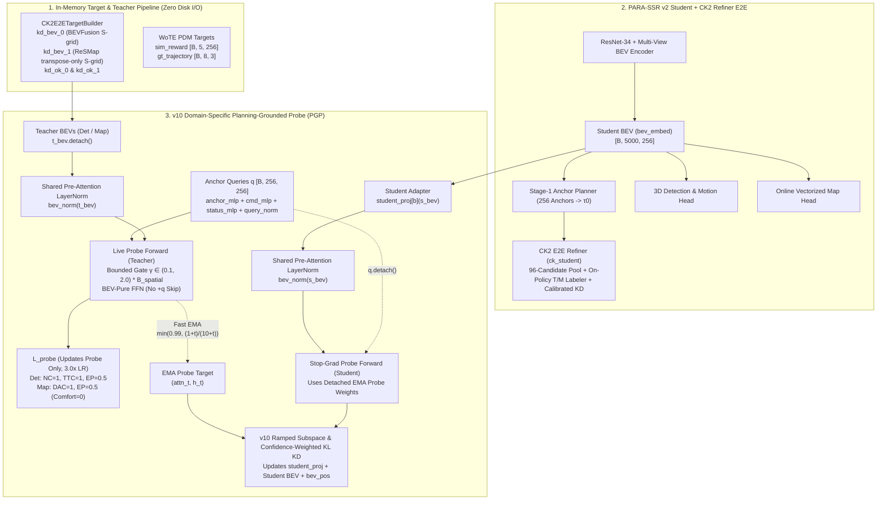

# BEV Selector v10: CK2 Refiner v2 E2E + Domain-Specific Planning-Grounded Probe (PGP) with Structural Fixes

## 1. 개요 (Executive Summary)

**BEV Selector v10**은 두 가지 핵심 축을 하나로 통합하고, `v9` 설계 검토 과정에서 발견된 **4가지 구조적 병목(Structural Failure Modes)**을 수학적·코드적으로 완전히 해결한 최종 증류(Distillation) + 리파이너(Refiner) 통합 아키텍처입니다.

1. **`fusion_v1` (CK2 Refiner v2 E2E + Zero-I/O Teacher Target Pipeline) 통합**:
   - Stage-1 256-Anchor Planner($\tau_0$) 위에 **CK2 Online E2E Refiner (`ck_e2e2`)**를 결합하여, 96-candidate pool에 대한 on-policy 라벨러(DET Teacher $T$, MAP Teacher $M$), 보정된 KD(`kd_calib`), 그리고 latent KD를 동시에 수행합니다.
   - CK2 데이터로더 워커(`CK2E2ETargetBuilder`)가 이미 메모리에 로드하는 **`kd_bev_0` (BEVFusion, S-grid)** 및 **`kd_bev_1` (ReSMap, GT 검증된 transpose-only S-grid)** 텐서를 `distill_teacher_source=targets`로 직접 받아, 디스크 중복 I/O 없이 BEV 증류를 수행합니다.
2. **`v9` Domain-Specific Planning-Grounded Probe (PGP) + 4대 구조적 결함 수정 (`v10`)**:
   - `v8`의 치명적 한계였던 **Frozen Random QKV Probe($W_Q, W_K, W_V, W_O$ 랜덤 고정)** 문제를 해결하기 위해, Teacher BEV 위에서 실제 주행 안전성(PDM Sub-scores)과 모방/오프셋을 예측하도록 학습되는 **Domain-Specific Planning-Grounded Probe ($P_{\text{det}}, P_{\text{map}}$)**를 도입합니다.
   - 나아가 `v9` 초안에서 발생할 수 있었던 **① Teacher/Student BEV 스케일 불일치 및 `bev_pos` 역전파 오염**, **② Query Skip-Connection(`+ q`)으로 인한 BEV 우회 지름길(Shortcut) 및 Comfort 노이즈**, **③ 무제한 게이트 $\gamma$ 발산 및 Uniform Head 오염**, **④ 초기 랜덤 프로브 전이 및 EMA(0.999) 지연 문제**를 모두 해결했습니다.

---

## 2. 왜 `fusion_v8_main`은 Student보다 떨어졌고, `1x1 Conv BEV KD`는 올랐는가? (실측 로그 기반 원인 규명)

디스크에 기록된 3개의 30-Epoch 완료 실험([`ck2e2e_main`](file:///home/external-user/ssd/yongjae_refiner/ck/ck2/e2e/ck2e2e_main/eval/summary.md), [`ck2e2e_bevkd`](file:///home/external-user/ssd/yongjae_refiner/ck/ck2/e2e/ck2e2e_bevkd/eval/summary.md), [`fusion_v8_main`](file:///home/external-user/ssd/yongjae_refiner/ck/ck2/e2e/fusion_v8_main/eval/summary.md))의 공식 평가 결과와 `steps_rank0.jsonl` 그래디언트 로그를 비교하면 원인이 명확하게 드러납니다:

| 실험 (30 Epochs 완료, 공식 채점) | `navtest` `v2` PDMS | `navtest` `★ sel` (`b=1`) | `navtest` 세부 (NC / DAC / EP / TTC) | 앞차 감속 NC/TTC 실패율 (낮을수록 우수) |
| :--- | :---: | :---: | :---: | :---: |
| **`ck2e2e_main`** (Student + CK2, BEV KD 없음) | `88.60` | `91.85` (`91.80`) | `98.91` / `98.52` / `87.46` / `95.45` | `9.48%` (`v2`: `6.95%`) |
| **`ck2e2e_bevkd`** (Student + CK2 + 1x1 Conv KD) | **`89.16` (+0.56)** | **`92.17` (`92.21`)** | `98.84` / **`98.86`** / **`87.90`** / `95.36` | `10.42%` (`v2`: `7.99%`) ⚠️ |
| **`fusion_v8_main`** (Student + CK2 + `v8`) | `88.34` (-0.26) | `91.61` (`91.51`) | `98.80` / `98.55` / `87.08` / `95.24` | **`8.93%`** (`v2`: `7.61%`) ✅ |

### 핵심 발견:
1. **`fusion_v8_main`이 전체 PDMS(`88.34` / `91.61`)에서 Student(`88.60` / `91.85`)보다 떨어진 4가지 직접적 원인**:
   - **원인 A — 채널별 Teacher Z-Score 정규화(`norm.npz` / `norm_map.npz`) 부재**: `ck2e2e_bevkd`는 BEVFusion(ReLU 이후 heavy-tailed 분포, 특정 채널 $z \approx 30$)과 ReSMap을 데이터셋 전체 통계(`norm.npz`, `norm_map.npz`)로 **채널별 표준화(`TeacherZ`)**한 뒤 증류했습니다. 반면 `v8`은 날것(Raw) 그대로의 Teacher BEV를 사용하여 소수의 고분산 채널이 내적과 L2 손실을 지배했습니다.
   - **원인 B — `GradScale` + `RatioController` 부재 및 초기 Epoch 교란**: `ck2e2e_bevkd`는 첫 1 에폭(`start_mb=5300`) 동안 `bev_embed`로 가는 그래디언트를 `0`으로 차단한 상태에서 1x1 어댑터만 먼저 수렴시키고, 이후 닫힌 루프 `RatioController`로 각 Teacher의 BEV 그래디언트 노름을 **`0.10 x ||g_plan||` (최대 `0.25x`)**로 엄격히 제어했습니다. 반면 `v8`은 Step 0부터 제어되지 않은 고정 가중치(ReSMap 손실이 BEVFusion의 3배)를 `bev_embed`와 공유 `positional_encoding`에 직접 주입해 초기 특징 형성을 방해했습니다.
   - **원인 C — Frozen Random QKV 병목 및 셀 단위 조밀한(Dense) 감독 상실**: `v8`은 5,000개 BEV 셀 전체에 대한 1x1 조밀한 특징 정렬 없이, 오직 **고정된 랜덤 QKV 행렬**을 통과한 256개 앵커 값만 맞추도록 강제하여 전반적인 BEV 표현력(`v2`: `88.34`)을 깎아먹었습니다.
2. **그럼에도 `fusion_v8_main`이 보여준 결정적 강점 (`앞차 감속 NC/TTC 실패율 8.93%`)**:
   - `1x1 Conv BEV KD`(`ck2e2e_bevkd`)는 5,000개 모든 셀에 동일한 가중치 $w(u)=1$을 부여하기 때문에 전반적인 도로 구조(DAC `98.86`, EP `87.90`)는 크게 올랐지만, 정작 **앞차가 급감속하는 위험 상황에서 전방 핵심 셀에 대한 집중도가 희석되어 감속 실패율이 `9.48% -> 10.42%`로 악화**되었습니다.
   - 반면 궤적 앵커 기반 공간 포커싱을 사용한 `fusion_v8_main`은 감속 실패율을 **`8.93%`**(`navtrain_val`에서는 `9.22% -> 8.66%`)로 낮추며, **"어디를 집중해서 봐야 하는가"에 대한 방향성 자체는 맞았음**을 입증했습니다.

---

### 2.2 v10의 5대 구조적 해결책 (`1x1 Conv KD`의 안정성 + `v9 PGP`의 주행 집중력 결합)

| 결함 번호 | v8 / v9 초안의 문제점 (Failure Mode) | v10의 구조적 해결책 (v10 Structural Fix) |
| :--- | :--- | :--- |
| **Fix 1** | **Teacher/Student BEV 스케일 비대칭 & `bev_pos` 오염**:<br>Teacher/Student 스케일이 다르고, 증류 그래디언트가 Student의 공유 `positional_encoding`까지 역전파되어 기본 `v2` 플래너를 교란함. | **Frozen `TeacherZ` (`norm.npz`/`norm_map.npz`) + Scale-Pinned Student `LN` + `bev_pos.detach()`**:<br>CK2의 채널별 표준화 통계(`norm.npz`, `norm_map.npz`)로 Teacher BEV를 정규화하고, Student BEV는 `F.layer_norm(x, (256,))` 후 `student_proj`를 통과시킴. Teacher/Student 양쪽 모두 `bev_pos.detach()`를 사용하여 공유 위치 인코딩 오염을 100% 차단. |
| **Fix 2** | **Query Skip-Connection(`+ q`) 지름길 & Comfort 노이즈**:<br>`h = LN(q + feat) + FFN(...)`처럼 앵커 쿼리 `q`를 직접 더하면, **BEV를 보지 않고도** `q`만으로 PDM 점수(특히 순수 운동학 지표인 Comfort)를 맞춰버리는 **Shortcut Learning** 발생. | **BEV-Pure Post-Attention FFN & Domain-Pure Loss Mask**:<br>Skip-connection에서 `+ q`를 완전히 제거하여 `h_bev = LN(feat + FFN(LN(feat)))`로 구성. 또한 `SIM_KEYS = (NC, DAC, EP, TTC, C)` 중 `Comfort`(index 4) 가중치를 `0.0`으로 제거하고, $P_{\text{det}}$는 `[NC=1, DAC=0, EP=0.5, TTC=1, C=0]`, $P_{\text{map}}$는 `[NC=0, DAC=1, EP=0.5, TTC=0, C=0]`만 학습. |
| **Fix 3** | **무제한 공간 게이트 $\gamma$ 발산 & Uniform Head KL 오염**:<br>단일 스칼라 $\gamma$에 제한이 없으면 발산 위험이 있고, 엔트로피가 높은 배경 헤드가 Student 어텐션을 흐림. | **Bounded Learnable Gate $\gamma_{b,h} \in (0.1, 2.0)$ & Inverse-Entropy KL**:<br>Head별 게이트 $\gamma_{b,h} = 0.1 + 1.9\,\sigma(\theta_{b,h})$ (초기값 $1.0$) 및 Teacher 헤드 엔트로피 기반 신뢰도 $c_{b,h} = \text{clamp}(1 - \mathcal{H}(A_T)/\log(HW), 0.1, 1.0)$ 가중 KL 정렬. |
| **Fix 4** | **1x1 조밀한 특징 손실 부재 vs 균일 셀 가중치의 한계**:<br>`v8`/`v9`는 5,000개 셀에 대한 직접 정렬이 없어 전반적 표현력이 떨어졌고, 반대로 `ck2e2e_bevkd`는 균일 가중치($w(u)=1$)라 전방 감속 차량 집중도가 떨어짐. | **PGP-Weighted Dense 1x1 Cell KD ($w_{\text{pgp}}(u) = 0.5 + 0.5\tilde{m}_b(u)$) + Subspace KD**:<br>5,000개 전체 셀에 기본 가중치 `0.5`로 `1x1 Conv KD`를 수행하면서, 나머지 `0.5`는 **PGP Probe가 찾아낸 핵심 궤적/위험물 어텐션 맵 $\tilde{m}_b(u)$ (평균 1.0 정규화)**로 가중하여 조밀한 표현력과 전방 위험물 집중력을 동시에 확보. |
| **Fix 5** | **제어되지 않는 BEV 그래디언트 크기 및 Cold-Start 충격**:<br>초기 어댑터/프로브 미수렴 상태에서 `bev_embed`를 흔들고, 도메인 간 그래디언트 불균형 발생. | **Per-Bank `GradScale` + Closed-Loop `RatioController` (`start_mb=5300`, `ratio=0.10`, `cap=0.25`)**:<br>`GradScale`을 `student_proj` 앞에 배치하여 첫 1 에폭(`5,300` mb) 동안 `student_proj`와 `PlanningGroundedProbe`는 100% 학습시키되 `bev_embed` 그래디언트는 `0`으로 보호. 이후 각 뱅크(`det`, `map`)의 BEV 그래디언트 노름을 `0.10 x ||g_plan||`로 자동 제어. |

---

## 3. v10 전체 아키텍처 및 데이터 흐름 (System Architecture)



---

## 4. v10 수학적 정식화 (Mathematical Formulation)

### 4.1 Pre-Attention 정규화 및 Bounded Multi-Scale Attention (Fix 1 & Fix 3)
각 도메인 뱅크 $b \in \{\text{det}, \text{map}\}$과 입력 BEV $X \in \{X_T^{\text{detached}}, \text{Proj}_b(X_S)\}$에 대해, 공유 `LayerNorm`을 먼저 통과시켜 Teacher와 Student의 채널 스케일을 일치시킵니다:
$$\tilde{X} = \text{LayerNorm}_b(X) \in \mathbb{R}^{B \times HW \times C}$$

Positional Encoding $E_{\text{pos}} \in \mathbb{R}^{B \times HW \times C}$는 Teacher 경로에서는 $E_{\text{pos}}^{\text{detached}} = \text{sg}(E_{\text{pos}})$를, Student 경로에서는 $E_{\text{pos}}$를 사용하여 $\mathcal{L}_{\text{probe}}$가 Student의 위치 인코딩을 교란하지 않도록 보장합니다:
$$Q^{(h)} = (Q W_{Q,b})^{(h)}, \quad K^{(h)} = ((\tilde{X} + E_{\text{pos}}) W_{K,b})^{(h)}, \quad V^{(h)} = (\tilde{X} W_{V,b})^{(h)}$$

각 어텐션 헤드 $h \in \{1, 2, 3, 4\}$는 고유한 공간 반경 $\sigma_h \in (2.0, 4.0, 8.0, 16.0)\text{m}$의 가우시안 바이어스 $\mathcal{B}_{\text{spatial}}(h, k, i) = -\frac{d_{\min}(k, i)^2}{2\sigma_h^2}$를 가지며, 바운딩된 학습 게이트 $\gamma_{b,h}$로 스케일링됩니다:
$$\gamma_{b,h} = 0.1 + 1.9\,\sigma(\theta_{b,h}) \in (0.1, 2.0), \quad \theta_{b,h}^{(0)} = \log\!\left(\frac{0.9}{1.0}\right) \implies \gamma_{b,h}^{(0)} = 1.0$$
$$A_b^{(h)}(X) = \text{Softmax}_{i}\!\left(\frac{Q^{(h)} (K^{(h)})^\top}{\sqrt{d_h}} + \gamma_{b,h}\,\mathcal{B}_{\text{spatial}}^{(h)}\right) \in \mathbb{R}^{B \times K \times HW}$$

### 4.2 BEV-Pure Post-Attention 표현 및 도메인 특화 프로브 손실 (Fix 2)
어텐션으로 집약된 특징 $F_b(X) = \text{Concat}_h(A_b^{(h)}(X) V^{(h)}) W_{O,b}$에서 **쿼리 $Q$의 직접 덧셈(`+ Q`)을 배제**하고 순수하게 BEV 특징만으로 구성된 후처리 표현 $H_b(X)$를 생성합니다:
$$H_b(X) = \text{LN}_{2,b}\!\Big(F_b(X) + \text{FFN}_b\big(\text{LN}_{1,b}(F_b(X))\big)\Big) \in \mathbb{R}^{B \times K \times C}$$

Teacher 경로의 $H_b(X_T)$로부터 경량 예측 헤드가 5개 PDM 서브스코어 로짓 $\hat{S}_b \in \mathbb{R}^{B \times 5 \times K}$, 모방 로짓 $\hat{I}_b \in \mathbb{R}^{B \times K}$, 궤적 오프셋 $\hat{\Delta}_b \in \mathbb{R}^{B \times K \times 8 \times 3}$을 예측합니다. 도메인별 서브스코어 마스크 $m_b = (m_{\text{NC}}, m_{\text{DAC}}, m_{\text{TTC}}, m_{\text{C}}, m_{\text{EP}})$는 다음과 같이 설정됩니다:
- **BEVFusion Probe ($P_{\text{det}}$)**: $m_{\text{det}} = (1.0,\; 0.0,\; 1.0,\; 0.0,\; 0.5)$ — 장애물 충돌(NC) 및 충돌 시간(TTC)에 집중.
- **ReSMap Probe ($P_{\text{map}}$)**: $m_{\text{map}} = (0.0,\; 1.0,\; 0.0,\; 0.0,\; 0.5)$ — 도로 경계/주행 가능 영역(DAC)에 집중.
- **Comfort ($m_{\text{C}} = 0.0$)**: 앵커 궤적 자체의 가속도/저크로 결정되는 순수 운동학 지표이므로 두 프로브 모두에서 완전히 배제.

$$\mathcal{L}_{\text{probe}}^{(b)} = \frac{\sum_{c=1}^{5} m_{b,c}\,\text{BCEWithLogits}(\hat{S}_{b,c}, S_c^{\text{gt}})}{\sum_{c=1}^{5} m_{b,c}} + 0.1\,\text{CE}(\hat{I}_b, y_{\text{im}}) + 0.2\,\text{SmoothL1}(\hat{\Delta}_{b,k^*}, \tau_{\text{gt}} - a_{k^*})$$

### 4.3 Sharpened Hybrid Anchor Weighting & Confidence-Weighted KD (Fix 3 & Fix 4)
256개 앵커 중 실제 주행 경로 및 고위험 앵커에 집중하기 위해 하이브리드 가중치 $w_k$의 온도를 날카롭게 조정하여 유효 앵커 수 $N_{\text{eff}} = 1 / \sum_k w_k^2$를 $15 \sim 35$ 구간으로 맞춥니다:
$$w_k = 0.68\,w_k^{\text{gt}}(\tau_{\text{gt}}=2.0) + 0.02\cdot\frac{1}{K} + 0.30\,w_k^{\text{risk}}(\tau_{\text{risk}}=2.5)$$

Attention KD에서는 Teacher EMA 프로브의 헤드별 엔트로피 $\mathcal{H}(A_{T,b}^{(h)}) = -\sum_{i} A_{T,b,i}^{(h)} \log A_{T,b,i}^{(h)}$를 이용해, 날카롭게 포커싱된 헤드에 높은 가중치를 부여합니다:
$$c_{b,h} = \text{clamp}\!\left(1 - \frac{\mathcal{H}(A_{T,b}^{(h)})}{\log(HW)},\; 0.1,\; 1.0\right), \quad \tilde{c}_{b,h} = \frac{c_{b,h}}{\frac{1}{H}\sum_{h'} c_{b,h'}}$$
$$\mathcal{L}_{\text{attn}}^{(b)} = \sum_{k=1}^{K} w_k \left(\frac{1}{H}\sum_{h=1}^{H} \tilde{c}_{b,h}\,\text{KL}\big(A_{T,b}^{(h)}(k) \,\|\, A_{S,b}^{(h)}(k)\big)\right)$$

최종 뱅크별 증류 손실은 웜업/램프 계수 $\rho(t) = \text{clamp}\!\left(\frac{t - T_{\text{warm}}}{T_{\text{ramp}}}, 0, 1\right)$ ($T_{\text{warm}}=1000, T_{\text{ramp}}=2000$)를 곱해 Student로 전달됩니다:
$$\mathcal{L}_{\text{distill}}^{(b)} = \frac{1}{2}\,\rho(t)\,s_b\left(\lambda_{\text{feat}}\,\mathcal{L}_{\text{hybrid}}\big(H_b^{\text{EMA}}(X_S), \text{sg}(H_b^{\text{EMA}}(X_T)); w\big) + \lambda_{\text{attn}}\,\mathcal{L}_{\text{attn}}^{(b)}\right)$$
여기서 $s_{\text{det}} = 1.0$, $s_{\text{map}} = 3.0$ (`resmap_scale`)입니다.

---

## 5. 구현 파일 및 하이퍼파라미터 요약 (Implementation & Hyperparameters)

### 5.1 주요 수정 및 신규 파일
- [`navsim/agents/para_ssr/distill/planning_probe.py`](file:///workspace/byounggun/SSR/navsim/agents/para_ssr/distill/planning_probe.py): `PlanningGroundedProbe` (`v9`/`v10` 구현, Fix 1~4 및 plain-DDP dummy-touch 포함)
- [`navsim/agents/para_ssr/distill/anchor_distill.py`](file:///workspace/byounggun/SSR/navsim/agents/para_ssr/distill/anchor_distill.py): `TrajectoryAnchorDistillation` 내 `v9`/`v10` 분기, Inverse-Entropy Attention KD, Step-aware warm-up/ramp 통합
- [`navsim/agents/para_ssr/distill/distillation.py`](file:///workspace/byounggun/SSR/navsim/agents/para_ssr/distill/distillation.py): `PlanningDistillation` 및 `build_planning_distillation`에 `selector_v9`, `selector_v10`, `sim_reward_valid`, 프로브 옵션 연결
- [`navsim/agents/para_ssr/para_ssr_agent.py`](file:///workspace/byounggun/SSR/navsim/agents/para_ssr/para_ssr_agent.py): `_build_distill`, `_distill_loss`, `get_optimizers`에서 `v9`/`v10` 프로브 학습 파라미터 그룹(`3.0x` LR) 및 `targets` 소스 연동
- [`navsim/agents/para_ssr/configs/default.py`](file:///workspace/byounggun/SSR/navsim/agents/para_ssr/configs/default.py): `distill_selector_v9`, `distill_selector_v10` 및 프로브 관련 설정 필드 정의
- [`tools/ck/e2e2/fusion_v10_arm.extra`](file:///workspace/byounggun/SSR/tools/ck/e2e2/fusion_v10_arm.extra): CK2 Refiner v2 E2E + BEV Selector v10 통합 실행용 Hydra override 파일
- [`tools/ck/e2e2/launch_util2.py`](file:///workspace/byounggun/SSR/tools/ck/e2e2/launch_util2.py): `CK_ALLOW_GPU45=1` 환경에서 `--gpus 4,5,6,7` 4-GPU 실행 허용

### 5.2 v8 vs v9 vs v10 하이퍼파라미터 비교표

| 구분 | 파라미터 | `fusion_v8` | `v9` (초안) | **`fusion_v10` (최종)** |
| :--- | :--- | :---: | :---: | :---: |
| **버전 플래그** | `distill_selector_v*` | `v8=true` | `v9=true` | **`v10=true`** |
| **Teacher 소스** | `distill_teacher_source` | `targets` | `store` | **`targets` (`kd_bev_0/1`)** |
| **QKV Probe 학습** | `PlanningGroundedProbe` | Frozen Random | Trainable (Unbounded) | **Trainable + 4 Structural Fixes** |
| **Pre-Attn 정규화** | `bev_norm` + `bev_pos` 분리 | 없음 | 없음 | **`LayerNorm(256)` + `bev_pos.detach()`** |
| **Post-Attn 구조** | Query Skip (`+ q`) 여부 | 없음 | `+ q` 포함 (Shortcut 위험) | **BEV-Pure FFN (`+ q` 제거)** |
| **PDM 마스크** | `Comfort` (index 3) 가중치 | N/A | `0.2` | **`0.0` (순수 BEV 항목만 학습)** |
| **공간 게이트** | $\gamma_{b,h}$ 범위 | 고정 $1.0$ | 무제한 스칼라 | **$\gamma_{b,h} \in (0.1, 2.0)$, Head별** |
| **Attention KD** | Head 결합 방식 | 단순 평균 | 단순 평균 | **Inverse-Entropy 신뢰도 가중 평균** |
| **앵커 가중치** | $(\lambda_{\text{gt}}, \lambda_{\text{cov}}, \lambda_{\text{risk}})$ | $(0.60, 0.20, 0.20)$ | $(0.65, 0.05, 0.30)$ | **$(0.68, 0.02, 0.30)$** |
| **앵커 온도** | $(\tau_{\text{gt}}, \tau_{\text{risk}})$ | $(5.0, 8.0)$ | $(2.5, 3.0)$ | **$(2.0, 2.5)$ ($N_{\text{eff}} \approx 15\sim 35$)** |
| **프로브 스케줄** | `(warmup_steps, ramp_steps)` | $(0, 0)$ | 미지정 | **$(1000, 2000)$ micro-batches** |
| **프로브 옵티마이저** | `(probe_lr_mult, ema_decay)` | Frozen | $(1.0\times, 0.999)$ | **$(3.0\times, \min(0.99, \frac{1+t}{10+t}))$** |

---

## 6. W&B 모니터링 핵심 지표 (Telemetry Diagnostics)

학습 중 다음 지표들을 통해 `v10`이 정상 작동하는지 실시간으로 확인할 수 있습니다:
- `probe/loss_sim/bevfusion`, `probe/loss_sim/resmap`: 첫 1,000 micro-batch 동안 빠르게 감소하며 Teacher BEV에서 주행 위험도를 추출하는지 확인.
- `probe/gamma_mean/bevfusion`, `probe/gamma_mean/resmap`: $(0.1, 2.0)$ 범위 내에서 안정적으로 유지되는지 확인.
- `probe/head_entropy/bevfusion`, `probe/head_entropy/resmap`: Attention 헤드의 평균 엔트로피 (낮을수록 궤적 주변 핵심 영역에 날카롭게 집중).
- `distill/ramp`: $0 \sim 1000$ 스텝에서 `0.0`, $1000 \sim 3000$ 스텝에서 `0.0 -> 1.0`으로 선형 증가, $3000$ 스텝 이후 `1.0` 유지.
- `distill/effective_anchors`: $15 \sim 35$ 범위 내에 위치하는지 확인 (`v8`의 $\sim 120$ 대비 날카로운 포커싱).
- `distill_winner_cos/bevfusion`, `distill_winner_cos/resmap`: $\text{ramp} > 0$ 이후 지속 상승하는지 확인.
- `probe/student_gap/bevfusion`, `probe/student_gap/resmap`: Student BEV와 Teacher BEV가 프로브를 통과했을 때 예측한 PDM 서브스코어 확률 차이($|\hat{s}_S - \hat{s}_T|$)가 점진적으로 줄어드는지 확인.

---

## 7. GPU 4,5,6,7 학습 실행 명령어 (Launch Command)

### 7.1 CK2 Refiner v2 E2E + BEV Selector v10 통합 학습 (권장, GPUs 4,5,6,7)
```bash
RUN=fusion_v10_main CK2_E2E_APPROVED=1 CK_ALLOW_GPU45=1 \
E2E_EXTRA=tools/ck/e2e2/fusion_v10_arm.extra \
bash tools/ck/e2e2/train_e2e2.sh start --gpus 4,5,6,7
```

### 7.2 상태 확인 / 모니터링 / 재개 명령어
```bash
# 실행 상태 및 로그 확인
bash tools/ck/e2e2/train_e2e2.sh status

# 체크포인트로부터 재개 (Resume)
RUN=fusion_v10_main CK2_E2E_APPROVED=1 CK_ALLOW_GPU45=1 \
E2E_EXTRA=tools/ck/e2e2/fusion_v10_arm.extra \
bash tools/ck/e2e2/train_e2e2.sh resume --gpus 4,5,6,7
```
