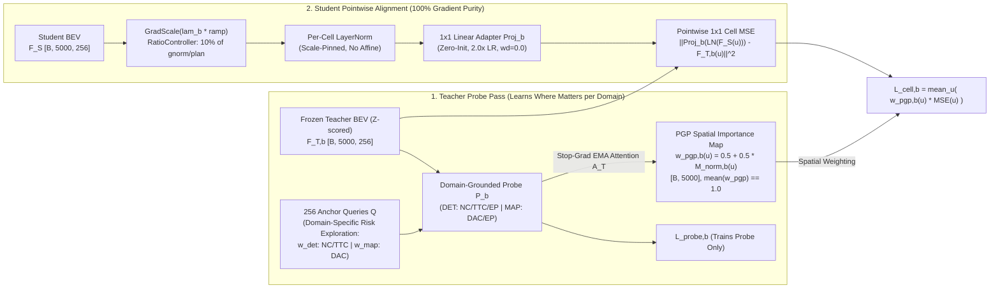

# BEV Selector v11: Pure PGP-Weighted Pointwise 1x1 Cell Distillation & Domain-Specific Risk Exploration

---

## 1. Executive Summary & `fusion_v10_main` Post-Mortem

`fusion_v10_main` (CK2 Refiner v2 E2E + BEV Selector v10) completed 30 epochs on `navtrain` and was evaluated on the full `navtest` split (12,146 tokens).

### 1.1 Full `navtest` (12,146 Tokens) Benchmark Comparison

| Metric / Variant | `ck2e2e_main` (No BEV KD) | `fusion_v8_main` (Selector v8) | `ck2e2e_bevkd` (Uniform 1x1 KD) | `fusion_v10_main` (Selector v10) | `v10` vs `v8` | `v10` vs `bevkd` |
| :--- | :---: | :---: | :---: | :---: | :---: | :---: |
| **`v2` (Base Trajectory)** | 88.60 | 88.34 | **89.16** | **88.91** | **+0.57** | -0.25 |
| **`v2_lat` (Base + Lat)** | 90.07 | 89.84 | **90.42** | **90.27** | **+0.43** | -0.15 |
| **`oracle16`** | 97.27 | 97.14 | 97.29 | **97.30** | **+0.16** | **+0.01** |
| **`oracle96`** | 98.97 | 98.95 | 98.97 | **99.00** | **+0.05** | **+0.03** |
| **`oracle96_lat`** | 99.02 | 99.00 | 99.03 | **99.05** | **+0.05** | **+0.02** |
| **`sel` (`default`, $w_{\text{im}}=0.1$, $b=0.5$)** | 91.85 | 91.61 | **92.17** ($b=0.75$: 92.25) | **92.20** | **+0.59** | +0.03 (-0.05 vs best $b$) |
| **`sel` (`noim`, $w_{\text{im}}=0.0$, `all lat=on`)** | 92.69 | 92.51 | **93.02** | **92.83** (`noaccel`: 92.96) | **+0.32** | -0.19 |
| **`sel` (`plugin`, $(0,1,1,1)$, `all lat=on`)** | 92.81 | 92.75 | **93.24** | **92.98** (`no_latvar`: 93.00) | **+0.23** | -0.26 |
| **`lead_fail_nc_ttc` (`v2`, $n=1814$)** | 6.95% | 7.61% | 7.99% | **6.67%** (Lowest) | **-0.94%p** | **-1.32%p** |
| **`lead_fail_nc_ttc` (`sel b=0.5`, $n=1814$)** | 9.48% | 8.93% | 10.42% | **8.49%** (Lowest) | **-0.44%p** | **-1.93%p** |

### 1.2 Key Takeaways from `fusion_v10_main`
1. **What Worked (Planning-Grounded Spatial Focus Along Ego's Path)**:
   - Compared to `fusion_v8_main`, `v10` improved Base `v2` by **+0.57 PDMS** (`88.34 -> 88.91`) and Selected (`default`) by **+0.59 PDMS** (`91.61 -> 92.20`).
   - Crucially, `v10` achieved the **highest Oracle ceiling (`oracle96_lat = 99.05`)** and the **lowest lead-vehicle deceleration NC/TTC failure rate (`6.67%` base / `8.32%~8.49%` selected)** across all models — significantly safer than uniform 1x1 KD (`ck2e2e_bevkd`: `7.99%` base / `10.42%` selected).
2. **What Failed (Why Overall PDMS Stopped at `88.91` Base / `92.83` No-Imitation vs `89.16` / `93.02` in `ck2e2e_bevkd`)**:
   - At Epoch 29, per-cell Z-scored 1x1 MSE (`distill_cell_mse`) in `fusion_v10_main` only converged to **`1.291` (DET) / `0.766` (MAP)**, whereas `ck2e2e_bevkd` converged to **`0.774` (DET) / `0.588` (MAP)** (~40% less converged cell-level alignment).
   - Furthermore, while lead-vehicle safety right on the GT path (`dist ≈ 0`) improved dramatically, surrounding obstacles in adjacent lanes and road/lane boundary compliance did not see the same boost.

---

## 2. Three Root Causes Identified in `v10`

### Root Cause 1: Gradient Budget Cannibalization & Spatial Blurring via Pooled `feat_loss` / `attn_loss`

In `v10`, the projected student BEV tokens $S_b = \text{Proj}_b(\text{LN}(F_S)) \in \mathbb{R}^{B \times HW \times C}$ were passed into **both** the pointwise cell loss $\mathcal{L}_{\text{cell}, b}$ **and** the student probe forward pass `probe.forward_student` ($\mathcal{L}_{\text{feat}, b} + \mathcal{L}_{\text{attn}, b}$):

$$\mathcal{L}_{\text{bank}, b}^{(\text{v10})} = d_b \cdot \Big( \underbrace{10.0 \cdot \mathcal{L}_{\text{cell}, b}}_{\text{Pointwise 1x1 Cell MSE}} + \underbrace{5.0 \cdot \mathcal{L}_{\text{feat}, b}}_{\text{Pooled Probe Feature Loss}} + \underbrace{5.0 \cdot \mathcal{L}_{\text{attn}, b}}_{\text{Probe Attention KL Loss}} \Big)$$

This combined loss was normalized by `RatioController` so that the **total** gradient norm into `student_bev` was fixed to $10\%$ of `gnorm/plan`. Measuring the exact gradient norm of each term with respect to $S_b$ revealed:

| Loss Term in `v10` | Loss Coefficient | $\left\|\nabla_{S_b} \mathcal{L}\right\|_2$ | Share of Gradient Budget | Effective `RatioController` Budget |
| :--- | :---: | :---: | :---: | :---: |
| **`cell_loss` (Pointwise 1x1 KD)** | `10.0` | `0.0177` | **26.3%** | **2.6% of `gnorm/plan`** |
| **`feat_loss` (Pooled Probe Feature)** | `5.0` | `0.0406` | **60.2%** | **6.0% of `gnorm/plan`** |
| **`attn_loss` (Probe Attention KL)** | `5.0` | `0.0091` | **13.5%** | **1.4% of `gnorm/plan`** |

1. **Stack of 3 LayerNorms Amplifies Probe Gradients**: Inside `PlanningGroundedProbe._encode_with_params`, $S_b$ passes through `bev_norm`, `ffn_norm`, and `head_norm`, plus another `F.layer_norm` inside `_feature_pair_loss`. Because $\nabla_x \text{LN}(x) \propto 1/\sigma_x$, backward gradients from `feat_loss` + `attn_loss` consumed **73.7%** of the gradient budget, starving pointwise `cell_loss` down to **2.6%** of `gnorm/plan`.
2. **Spatial Blurring (Jensen's Inequality)**: In `feat_loss`, each anchor query averages features across ~660 BEV cells ($h_S = \sum_{u=1}^{5000} A_{k,u} V(S_b(u))$) before computing the loss, allowing positive and negative cell errors to cancel out and blurring spatial resolution.
3. **Scale/Shift Contradiction on `student_proj`**: `cell_loss` requires `s_bev` to match the exact Z-scored amplitude of $\tilde{F}_{T,b}$, whereas `probe.bev_norm(s_bev)` is scale/shift-invariant, sending conflicting gradients into `student_proj`.

---

### Root Cause 2: Suboptimal `student_proj` Initialization & Optimizer Hyperparameters

| Adapter Property | `ck2e2e_bevkd` (`BEVFeatureKD`) | `fusion_v10_main` (`v10`) | `fusion_v11_main` (`v11` Fix) |
| :--- | :---: | :---: | :---: |
| **Weight Init (`proj.weight`)** | **Zero Init (`W = 0`)** | Identity Init (`W = I`) | **Zero Init (`W = 0`)** |
| **Bias Init (`proj.bias`)** | `b = 0` | `b = 0` | **`b = 0`** |
| **Learning Rate (`lr`)** | **`2.0x base_lr` (`2e-4`)** | `1.0x base_lr` (`1e-4`) | **`2.0x base_lr` (`2e-4`)** |
| **Weight Decay (`weight_decay`)** | **`0.0`** | `0.01` (default group) | **`0.0`** |

With **Identity Init (`W = I`)**, channel $i$ of Student BEV is arbitrarily forced to match channel $i$ of BEVFusion and ReSMap at step 0. With **Zero Init (`W = 0, b = 0`)** + **`2.0x LR`** + **`weight_decay = 0.0`**, the step-0 gradient into Student BEV is identically zero ($\nabla_{F_S} \mathcal{L} = W^\top r = 0$), and the adapter learns the true $256 \times 256$ cross-covariance mapping rapidly during the 5,300-step warm-up window.

---

### Root Cause 3: Over-Concentration of Anchor Weights on the Free-Space GT Trajectory & Missing Domain Separation (`w_det` vs `w_map`)

In `v10`, [`_compute_anchor_weights`](file:///workspace/byounggun/SSR/navsim/agents/para_ssr/distill/anchor_distill.py#L288-L343) computed a **single shared weight vector** $w \in \mathbb{R}^{B \times 256}$ using `dist = ||a - g||_2` (the 16-dimensional L2 sum across all 8 waypoints, where $\text{dist} \approx \sqrt{8} \times \bar{d}_{\text{meter}}$ and median `dist = 24.4m`) with `lambda_gt = 0.68, lambda_cov = 0.02, lambda_risk = 0.30, tau_gt = 2.0, tau_risk = 2.5`.

Measuring this on 2,000 real `navtrain` scenes (`raw256` PDM labels) exposed three structural flaws:
1. **GT Trajectory Monopoly (`1.69m` Radius)**:
   - Because `tau_gt = 2.0` and `tau_risk = 2.5` were applied to the 8-step L2 sum, the effective per-waypoint temperature was only **$0.71\text{m}$ / $0.88\text{m}$**.
   - **Top-1 GT anchor** took **26.5%** of all weight; **Top-5 GT anchors** took **52.7%**; and the weighted average distance from GT was only **`1.69m` per waypoint** (less than half of a single 3.5m lane).
   - Because the GT trajectory by definition passes through **free space (`NC=1, TTC=1, DAC=1`)**, focusing 68% of the weight on GT caused the probe to mostly attend to empty asphalt ahead of ego rather than exploring surrounding obstacles and lane boundaries.
2. **Missing `TTC` in Risk Calculation**:
   - `v10` defined `safety = nc * dac`, completely omitting **TTC (`sim_reward[:, 3, :]`)**, which is the primary indicator of close dynamic obstacle interactions.
3. **No Domain Separation Between DET (`bevfusion`) and MAP (`resmap`)**:
   - In **DET (`bevfusion`)**, anchors should explore **on-road obstacles & near-collisions (`NC < 1` or `TTC < 1`)**.
   - In **MAP (`resmap`)**, anchors should explore **drivable area / lane boundary crossings (`DAC < 1`)**.
   - Mixing them into a single `1 - nc * dac` caused off-road empty-sidewalk anchors (`DAC=0, NC=1`) to weight DET, and in-lane rear-end collision anchors (`NC=0, DAC=1`) to weight MAP.

---

## 3. BEV Selector v11 Architecture & Mathematical Formulation

**BEV Selector v11** resolves all three root causes via **Fix 1 (Pure PGP-Weighted Pointwise 1x1 Cell KD)**, **Fix 2 (Zero-Init Adapter + `2.0x LR` + `wd=0.0`)**, and **Fix 3 (Domain-Specific Risk Exploration Anchor Weighting `w_det` vs `w_map`)**:



### 3.1 Fix 3: Domain-Specific Risk Exploration Anchor Weighting ($w_{\text{det}}$ vs $w_{\text{map}}$)
For each domain $b \in \{\text{bevfusion}, \text{resmap}\}$, we compute domain-specific risk factors from the 256-anchor PDM labels $(\text{NC}_k, \text{DAC}_k, \text{TTC}_k)$:

$$\text{risk}_{\text{det}, k} = \big(1 - \text{NC}_k \cdot \text{TTC}_k\big) \cdot \big(0.5 + 0.5 \cdot \text{DAC}_k\big), \qquad \text{risk}_{\text{map}, k} = 1 - \text{DAC}_k$$

$$r_{b, k} = \frac{\text{softmax}_k(-d_k / \tau_{\text{risk}}) \cdot \text{risk}_{b, k}}{\sum_{j=1}^{256} \text{softmax}_j(-d_j / \tau_{\text{risk}}) \cdot \text{risk}_{b, j}}$$

$$w_{b, k} = \lambda_{\text{gt}} \cdot \text{softmax}_k(-d_k / \tau_{\text{gt}}) + \lambda_{\text{risk}} \cdot r_{b, k} + \lambda_{\text{cov}} \cdot \frac{1}{256}$$

with $\lambda_{\text{gt}} = 0.30$, $\lambda_{\text{risk}} = 0.55$, $\lambda_{\text{cov}} = 0.15$, $\tau_{\text{gt}} = 4.0$, $\tau_{\text{risk}} = 8.0$:

| Metric on 2,000 Real `navtrain` Scenes | `v10` Shared $w_k$ | `v11` $w_{\text{det}, k}$ (BEVFusion) | `v11` $w_{\text{map}, k}$ (ReSMap) |
| :--- | :---: | :---: | :---: |
| **Effective Exploring Anchors ($N_{\text{eff}} / 256$)** | `28.2` | **`112.2`** | **`106.2`** |
| **Top-5 GT Anchor Concentration** | `52.7%` | **`21.2%`** | **`23.6%`** |
| **Mean Exploration Radius from GT (per waypoint)** | `1.69m` | **`4.84m`** (adjacent lanes/intersections) | **`5.42m`** (road/lane boundaries) |
| **Weight Share on Obstacle-Risk Anchors (`NC/TTC < 1`)** | `41.7%` | **`76.5%`** | `59.3%` |
| **Weight Share on Boundary-Risk Anchors (`DAC < 1`)** | `22.6%` | `30.5%` | **`67.1%`** |

### 3.2 Fix 1 & Fix 2: Detached PGP Spatial Map & 100% Pointwise 1x1 Cell Alignment
From the EMA Teacher Probe attention map $A_{T,b} \in \mathbb{R}^{B \times H \times K \times HW}$, we marginalize over anchors using the domain-specific weights $w_{b,k}$:

$$M_{\text{spatial}, b}(u) = \sum_{k=1}^{256} w_{b, k} \left( \frac{1}{H} \sum_{h=1}^{H} \tilde{\alpha}_{b,h,k} A_{T,b,h,k}(u) \right), \qquad \tilde{M}_{\text{spatial}, b}(u) = \frac{HW \cdot M_{\text{spatial}, b}(u)}{\sum_{v=1}^{HW} M_{\text{spatial}, b}(v)}$$

$$w_{\text{pgp}, b}(u) = \text{stop\_grad}\Big( 0.5 + 0.5 \cdot \tilde{M}_{\text{spatial}, b}(u) \Big), \qquad \frac{1}{HW}\sum_{u=1}^{HW} w_{\text{pgp}, b}(u) = 1.0$$

The **entire** student distillation loss for bank $b$ is the PGP-weighted pointwise cell MSE:

$$\mathcal{L}_{\text{cell}, b} = \frac{1}{B \cdot HW} \sum_{n=1}^{B} \sum_{u=1}^{HW} w_{\text{pgp}, b}^{(n)}(u) \cdot \frac{1}{C} \left\| \text{Proj}_b\big(\text{LN}(x_{\text{unit}, b}^{(n)}(u))\big) - \tilde{F}_{T,b}^{(n)}(u) \right\|_2^2$$

where $\text{Proj}_b$ is **zero-initialized (`W=0, b=0`)** and optimized with **`2.0x LR` (`2e-4`) and `weight_decay = 0.0`**, and $x_{\text{unit}, b} = \text{GradScale}(F_S, \text{ramp}(t) \cdot \lambda_b(t))$ delivers **100%** of `RatioController`'s $10\%$ `gnorm/plan` budget directly into pointwise BEV feature alignment.

---

## 4. Implementation Summary

1. **[`navsim/agents/para_ssr/configs/default.py`](file:///workspace/byounggun/SSR/navsim/agents/para_ssr/configs/default.py#L515-L526)**:
   - Added `distill_selector_v11: bool = False` and `distill_proj_lr_mult: float = 2.0`.
2. **[`navsim/agents/para_ssr/distill/distillation.py`](file:///workspace/byounggun/SSR/navsim/agents/para_ssr/distill/distillation.py#L22-L108)**:
   - Wired `selector_v11: bool = False` into [`PlanningDistillation`](file:///workspace/byounggun/SSR/navsim/agents/para_ssr/distill/distillation.py#L22-L108) and [`build_planning_distillation`](file:///workspace/byounggun/SSR/navsim/agents/para_ssr/distill/distillation.py#L919-L960) (`version = "v11"`).
3. **[`navsim/agents/para_ssr/distill/anchor_distill.py`](file:///workspace/byounggun/SSR/navsim/agents/para_ssr/distill/anchor_distill.py)**:
   - **Fix 1**: Detached student `feat_loss` and `attn_loss` inside `with torch.no_grad():` and routed 100% of `raw_bank_loss` through `self.loss_scale * cell_loss`.
   - **Fix 2**: Zero-initialized `self.student_proj` weights and biases when `self.version == "v11"`.
   - **Fix 3**: Updated [`_compute_anchor_weights`](file:///workspace/byounggun/SSR/navsim/agents/para_ssr/distill/anchor_distill.py#L288-L355) to compute domain-specific risk weights (`domain="bevfusion"` uses `(1 - nc * ttc) * (0.5 + 0.5 * dac)`; `domain="resmap"` uses `1 - dac`) and applied per-domain `weights_b` in `forward`.
4. **[`navsim/agents/para_ssr/para_ssr_agent.py`](file:///workspace/byounggun/SSR/navsim/agents/para_ssr/para_ssr_agent.py#L1112-L1127)**:
   - Placed `student_proj` (`proj_params`) in a dedicated AdamW group with `lr = 2.0 * base_lr` and `weight_decay = 0.0`.
5. **Config & Launch Files**:
   - [`tools/ck/e2e2/fusion_v11_arm.extra`](file:///workspace/byounggun/SSR/tools/ck/e2e2/fusion_v11_arm.extra)
   - [`navsim/planning/script/config/common/agent/para_ssr_selector_v11_agent.yaml`](file:///workspace/byounggun/SSR/navsim/planning/script/config/common/agent/para_ssr_selector_v11_agent.yaml)

---

## 5. Launch, Monitoring & Evaluation Commands

All outputs and logs for `fusion_v11_main` are stored under `/workspace/byounggun/ssr_outputs/ck2_e2e/fusion_v11_main/` (`E2E_ROOT=/workspace/byounggun/ssr_outputs/ck2_e2e` in [`tools/ck/e2e2/train_e2e2.sh`](file:///workspace/byounggun/SSR/tools/ck/e2e2/train_e2e2.sh#L61)):
- **Training Log**: `/workspace/byounggun/ssr_outputs/ck2_e2e/fusion_v11_main/launch/train.log`
- **Labeler Log**: `/workspace/byounggun/ssr_outputs/ck2_e2e/fusion_v11_main/labeler/labeler.log`
- **Step / Epoch Telemetry**: `/workspace/byounggun/ssr_outputs/ck2_e2e/fusion_v11_main/ck_e2e2/{steps_rank0.jsonl,epochs.jsonl}`
- **Checkpoints**: `/workspace/byounggun/ssr_outputs/ck2_e2e/fusion_v11_main/train/`

### 5.1 Start 30-Epoch `fusion_v11_main` Training on GPUs 4,5,6,7
```bash
RUN=fusion_v11_main CK2_E2E_APPROVED=1 CK_ALLOW_GPU45=1 \
E2E_EXTRA=tools/ck/e2e2/fusion_v11_arm.extra \
bash tools/ck/e2e2/train_e2e2.sh start --gpus 4,5,6,7
```

### 5.2 Check Status & Tail Live Logs
```bash
# Check training / labeler status and ETA
RUN=fusion_v11_main bash tools/ck/e2e2/train_e2e2.sh status

# Tail live training log
tail -f /workspace/byounggun/ssr_outputs/ck2_e2e/fusion_v11_main/launch/train.log

# Tail live labeler log
tail -f /workspace/byounggun/ssr_outputs/ck2_e2e/fusion_v11_main/labeler/labeler.log
```

### 5.3 Evaluate `fusion_v11_main` on `navtest` Only
```bash
RUN_DIR=/workspace/byounggun/ssr_outputs/ck2_e2e/fusion_v11_main
CK_ALLOW_GPU45=1 PYTHONPATH=$PWD OMP_NUM_THREADS=1 MKL_NUM_THREADS=1 \
/venv/ssr/bin/python tools/ck/e2e2/eval_e2e2.py \
  --run-dir "$RUN_DIR" --split navtest --ckpt last --gpus 4,5,6,7 --workers-label 48
```
