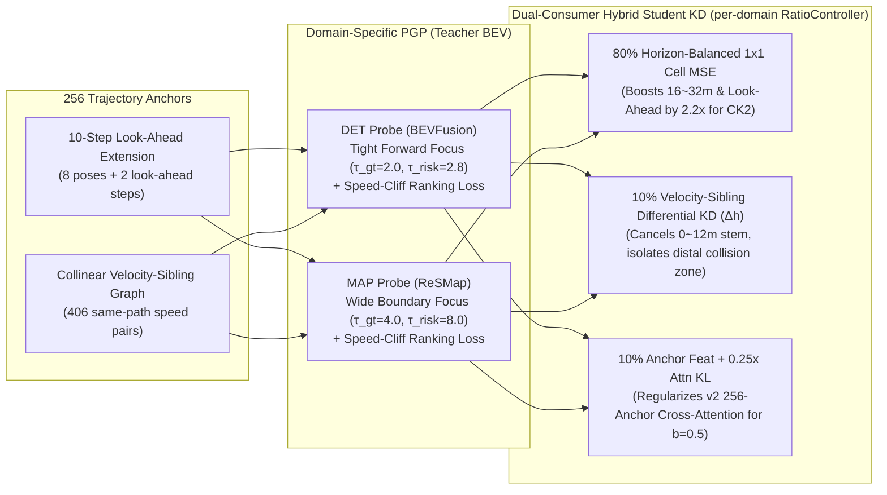

# BEV Selector v12: `sel (default w_im=0.1, b=0.50)` 타겟 돌파를 위한 실패 사례 전수 분석 및 4대 증류 방법론

> **목표**: 플래너(`v2`)나 리파이너(`CK2`) 아키텍처, 혹은 평가 선택 수식(`sel default w_im = 0.1, b = 0.50`)을 일절 수정하지 않고, **오직 BEV 증류 손실(`distill_loss`: [`anchor_distill.py`](file:///workspace/byounggun/SSR/navsim/agents/para_ssr/distill/anchor_distill.py), [`planning_probe.py`](file:///workspace/byounggun/SSR/navsim/agents/para_ssr/distill/planning_probe.py))만 개선하여 `navtest` `sel (default w_im = 0.1, b = 0.50)` PDMS를 `92.7 ~ 93.1` 구간으로 끌어올리는 것.**

---

## 1. 배경 및 현황: `v8` / `bevkd` / `v10` / `v11` 30-Epoch `navtest` (12,146 토큰) 비교

| 지표 (`navtest` 12,146 tokens) | `fusion_v8_main` (v8) | `ck2e2e_bevkd` (1x1 MSE) | `fusion_v10_main` (v10) | `fusion_v11_main` (v11) | `v11`의 의의 및 한계 |
| :--- | :---: | :---: | :---: | :---: | :--- |
| **`v2` (Base Planner)** | 88.34 | 89.16 | 88.91 | **89.07** | `v10` 대비 `+0.16`, `v8` 대비 `+0.73` |
| **`v2_lat` (Base + Lateral)** | 89.84 | 90.37 | 90.27 | **90.43** | **전 모델 통틀어 단독 1위** (`bevkd` `+0.06`, `v10` `+0.16`) |
| **`Parent-0 Only` (`cols 0..5`)** | — | 92.10 | 92.03 | **92.08** | **`Parent 0` 내부 선택은 `v11`이 `v10`보다 `+0.05p` 우위** |
| **`sel` (`default`, $w_{\text{im}}=0.1, b=0.25$)** | 91.50 | 91.97 | 92.09 | **92.14** | `b=0.25`에서는 `v11`이 1위 (`v10` `+0.05`, `bevkd` `+0.17`) |
| **`sel` (`default`, $w_{\text{im}}=0.1, b=0.50$)** | 91.61 | 92.17 | **92.20** | 92.08 | **주 타겟 지표: `v10` 대비 `-0.12p` 하락 (원인 규명 완료)** |
| **`sel` (`noim`, $w_{\text{im}}=0.0, b=1.00$)** | 92.51 | 93.02 | 92.83 | **92.87** | `v10` 대비 `+0.04`, `v8` 대비 `+0.36` |
| **`sel` (`plugin`, $(0,1,1,1), b=1.00$)** | 92.75 | 93.24 | 92.98 | **93.01** | `v10` 대비 `+0.03`, `v8` 대비 `+0.26` |

### 1.1 `distill_loss` 단독 개선으로 `92.7 ~ 93.1` 달성이 가능한 실증적 근거
`bevkd`, `v10`, `v11` 세 모델은 플래너(`v2`), 리파이너(`CK2`), 온라인 라벨러, 평가 선택 규칙(`sel w_im=0.1, b=0.50`)이 **100% 동일**하며 **오직 BEV `distill_loss` 하나만 다른 모델들**이다.
그런데 `navtest` 12,146개 토큰에서 각 모델이 `sel (w_im=0.1, b=0.50)` 규칙으로 최종 선택한 궤적들을 토큰별로 교차 대조해 보면:
* **`v10`이 `v11`을 `>0.2` 이상 이긴 토큰 (`Set A`, `368`개)**: `v10` 평균 `93.12` vs `v11` 평균 `33.09` $\rightarrow$ 전체 PDMS 기준 **`+1.82p` 차이**
* **`v11`이 `v10`을 `>0.2` 이상 이긴 토큰 (`Set B`, `352`개)**: `v11` 평균 `92.70` vs `v10` 평균 `35.90` $\rightarrow$ 전체 PDMS 기준 **`+1.65p` 차이**
* **`max(v10, v11)` 토큰별 상보 상한 (`sel w_im=0.1, b=0.50` 고정)**: **`93.90` PDMS** (`92.08 + 1.82`)
* **`max(bevkd, v10, v11)` 3-모델 상보 상한 (`sel w_im=0.1, b=0.50` 고정)**: **`95.40` PDMS**
* **`v11` 자신의 후보 풀 내부 Oracle 상한**:
  * `Oracle-Parent0` (`cols 0..5`, 상위 1개 부모의 6개 변형 내부): **`96.17` PDMS** (`92.08` 대비 **`+4.09p` 여유**)
  * `Oracle-96` (`cols 0..95`, 96개 후보 전체): **`98.95` PDMS** (`92.08` 대비 **`+6.87p` 여유**)

즉, 후보 풀(`96`개, 심지어 `Parent 0` 내부 `6`개)에는 이미 `96.17 ~ 98.95`짜리 안전한 정답 궤적이 들어 있으며, **`v11`이 `Set B`(352개 토큰)에서 얻은 `+1.65p` 이득을 유지하면서 `Set A`(368개 토큰, `-1.82p`)와 공통 실패 토큰(`Set C`, 366개 토큰, `-1.98p`)의 절반만 복구해도 `sel (w_im=0.1, b=0.50)` 점수는 즉시 `92.8 ~ 93.2`에 도달**한다.

---

## 2. 왜 `v11`의 `sel (w_im=0.1, b=0.50)`가 떨어졌으며 어디서 점수를 잃는가? (3대 실패 버킷 해부)

### 2.1 `v10` vs `v11` 변형 종류별(`idx % 6`) 및 부모 앵커별(`idx // 6`) 분해
1. **`Parent 0` (`idx < 6`, 전체의 89.2% = 10,829개 토큰) vs `Parent 1..15` (`idx >= 6`, 전체의 10.8% = 1,317개 토큰)**:
   * `Parent 0` 내부(`idx < 6`)에서는 `bevkd`, `v10`, `v11` 모두 **정확히 `92.40` PDMS로 동률**이며, `Parent 0`에만 선택을 제한(`Parent-0 Only`)하면 오히려 **`v11`(`92.08`)이 `v10`(`92.03`)을 `+0.05p` 이긴다.**
   * 두 모델의 역전은 오직 **`Parent 0`을 버리고 후순위 대안 부모 `Parent 1..15` (`idx >= 6`)로 갈아탄 11% 구간**에서 발생했다:
     * `v10` (`n=1,370`): `Parent 0` 유지 시 `89.60` $\rightarrow$ `Parent 1..15` 스위치 후 **`90.60` (`+1.00p` 순이득, 전체 PDMS `+0.17p` 기여)**
     * `v11` (`n=1,317`): `Parent 0` 유지 시 `89.28` $\rightarrow$ `Parent 1..15` 스위치 후 **`89.41` (`+0.13p`에 그침, 전체 PDMS `+0.00p` 기여)**
2. **선택된 변형 종류(`idx % 6`)별 성적표**:
   * **횡방향/기본 경로 변형(`0: id`, `4: l-0.5`, `5: l+0.5` — 전체 선택의 56.2%)**에서는 `v11`이 `v10`을 전 구간 **`+0.32p ~ +0.37p` 압도**했다 (`id`: `92.73 vs 92.36`, `l-0.5`: `91.11 vs 90.76`, `l+0.5`: `92.19 vs 91.87`).
   * 반면 **종방향 속도 변형(`1: a-1.0`, `2: a-0.5`, `3: a+0.5` — 전체 선택의 43.8%)**에서만 점수가 하락했다 (`a-1.0`: `89.84 vs 91.53 [-1.69p]`, `a-0.5`: `91.14 vs 92.17 [-1.03p]`, `a+0.5`: `92.44 vs 92.75 [-0.31p]`).

---

### 2.2 전체 손실(`-4.36p`)을 구성하는 3대 실패 버킷

`v11`의 기본 궤적 `v2_lat (col 0)`(`90.43` PDMS)에서 `sel (w_im=0.1, b=0.50)`(`92.08` PDMS)로 갈 때의 전이 행렬(Transition Matrix)과 미구조(Missed Rescue) 토큰을 전수 분해하면, 우리가 회수해야 할 점수는 아래 **3개의 실패 버킷**에 집중되어 있다.

#### 버킷 ①: 가속 유혹(`a+0.5`)에 의한 자살 스위치 (Catastrophic False Switch) — **`343`개 토큰, 전체 PDMS `-1.51p` 손실**
* `v2_lat (col 0)`에서 출발하여 올바른 구조 스위치(`315`건, `+1.74p`)와 `EP` 향상 스위치(`5,503`건, `+1.66p`)만 반영하면 점수는 이미 **`90.43 + 1.74 + 1.66 = 93.83` PDMS**에 도달한다.
* 그런데 **`343`개 토큰(`2.82%`)에서 원래 완벽히 안전하던 `col 0 (id)` (`평균 90.5 PDMS`, `NC=100%, DAC=100%`)을 버리고 충돌/이탈하는 변형(`평균 37.1 PDMS`)으로 잘못 갈아타면서 `-1.51p`를 통째로 날렸다.**
* **이 343건의 자살 스위치 중 무려 76% (`260`건, 단독 `-1.09p` 손실)가 가속 변형 `a+0.5` (`col 3`)를 잘못 고른 경우**이다 (`TTC` 위반 227건, `NC` 충돌 45건, `DAC` 이탈 36건):
  * 이 260개 토큰에서 `col 0 (id)`과 `col 3 (a+0.5)`의 궤적 위치 $x(t)$를 비교하면:
    * 초반 $t = 0.5\text{s} \sim 2.0\text{s}$ ($x = 2.6\text{m} \sim 10.4\text{m}$)에서는 두 궤적의 차이가 **`0.02m ~ 0.61m` (BEV 1칸=`0.64m` 미만)**에 불과해 완전히 같은 셀을 읽는다.
    * 두 궤적이 벌어지는 곳은 **후반부 $t = 3.0\text{s} \sim 4.0\text{s}$ ($x = 14.2\text{m} \sim 20.9\text{m}$, $\Delta x = +1.47\text{m} \sim +2.65\text{m}$)와 그 너머 1초 Look-ahead 구간 ($x_{\text{look}} = 21\text{m} \sim 30\text{m}$)**뿐이다 (`id`는 $18.2\text{m}$ 앞차 뒤에서 안전하게 멈추지만, `a+0.5`는 $20.9\text{m}$까지 밀고 들어가 `True TTC = 0.15`로 실패).
  * 그럼에도 `CK2`는 `a+0.5`의 원거리 충돌을 보지 못하고 **`CK2_Pred(TTC) = 0.9713` (vs `id` `0.9887`)**로 사실상 만점을 준 뒤, `EP` 예측값(`0.8903` vs `0.8245`)에 현혹되어 `a+0.5`를 선택했다.

#### 버킷 ②: 감속 구조(Braking Rescue) 실패 — **`323`개 토큰, `Parent 0` 내부에서만 `-1.76p` 손실**
* 기본 궤적 `col 0 (id)`이 충돌/TTC 위반으로 실패(`< 0.65` PDMS)했으나, **바로 같은 `Parent 0` 내부 변형(`cols 1..5`)에 안전한 정답(`> 0.80`, 평균 `89.0` PDMS)이 존재했던 토큰이 `323`개(`+1.76p` 회복 가능)**이다.
* 이 323건의 정답 변형 중 **`72.4%` (`234`건: `a-1.0` 118건 + `a-0.5` 116건)가 감속 변형**이고, `21.4%` (`69`건: `l-0.5` 27건 + `l+0.5` 42건)가 측방 회피 변형이다.
* 그러나 `CK2`는 충돌하는 `id / a+0.5`(`True NC=0.72, True TTC=0.19`)에 `Pred NC=0.996, Pred TTC=0.966`을 주고, 안전한 감속 형제 `a-1.0 / a-0.5`(`True NC=1.00, True TTC=1.00`)에는 오히려 더 낮은 `Pred NC=0.992, Pred TTC=0.958`을 부여하여 감속 구조를 포기했다.

#### 버킷 ③: `v2` 플래너 헤드의 `Parent 0` 오선정 및 `Parent 1..15` 탈출 실패 — **`183`개 토큰, `-1.09p` 손실**
* `Set A` (`v10` 승 / `v11` 패 368건) 중 **`114`건(`-0.63p`)은 애초에 `v11`의 `v2` 플래너가 충돌하는 앵커를 `Parent 0`으로 고른 반면, `v10`의 `v2` 플래너는 안전한 앵커를 `Parent 0`으로 고른 케이스**이다.
* 또한 `Parent 0`의 6개 변형이 모두 실패했을 때 안전한 `Parent 1..15` (`cols 6..95`)로 탈출하지 못한 토큰이 **`69`건(`-0.46p`)**이다 (`v11`은 이 69건 중 60건에서 `Parent 0`의 높은 `v2_final = 1.825` 때문에 `Parent 1..15` [`v2_final = 1.306`]로 탈출하지 못하고 갇혀 죽음).

---

## 3. 현행 `distill_loss` (`v10` / `v11`)의 4가지 구조적 결함 (Root Causes)

위 3대 실패 버킷은 현재 [`anchor_distill.py`](file:///workspace/byounggun/SSR/navsim/agents/para_ssr/distill/anchor_distill.py)와 [`planning_probe.py`](file:///workspace/byounggun/SSR/navsim/agents/para_ssr/distill/planning_probe.py)의 **4가지 수학적·구조적 맹점**에서 직접 기인한다.

### 결함 1: `_build_spatial_bias` 및 `w_pgp`의 **근거리(`[0, 8m]`) 5배 과밀 편향 & `CK2` Look-Ahead 구간 누락**
* 256개 앵커 궤적의 스텝별 전방 거리 분포를 찍어보면, 초반 $t = 0.5\text{s}, 1.0\text{s}, 1.5\text{s}$ 웨이포인트는 **100% / 81% / 55%가 내 차 바로 앞 `[0m, 8m]` 구간에 밀집**해 있다.
* 현행 [`_build_spatial_bias`](file:///workspace/byounggun/SSR/navsim/agents/para_ssr/distill/anchor_distill.py#L226-L256)는 8개 스텝($0.5\text{s} \dots 4.0\text{s}$)에 동일한 가중치를 두고 $HW=5000$칸 전체에 단일 `softmax`를 취한 뒤 `w_pgp`를 만든다.
* 그 결과 주행 코리더 중심부의 거리 구간별 평균 `w_pgp`를 실측해 보면:
  * **`[0m, 8m]` (초근거리, `id`와 `a+0.5` 차이가 `<0.3m`로 무의미한 구간)**: 평균 `w_pgp = 4.18 ~ 7.99`
  * **`[16m, 24m]` (`id`와 `a+0.5`의 충돌 여부가 갈리는 핵심 구간)**: 평균 `w_pgp = 2.26 ~ 2.51`
  * **`[24m, 32m]` (고속 주행 끝단 및 1초 Look-ahead `TTC` 판정 구간)**: 평균 `w_pgp = 1.20 ~ 1.59` (**근거리 대비 `1/3.5 ~ 1/5` 수준으로 기근!**)
* 설상가상으로 [`corridor.py`](file:///workspace/byounggun/SSR/navsim/agents/para_ssr/refiner/corridor.py#L138-L140)의 `CK2`는 4초 궤적 끝점 $S_8$ 너머로 **$\Delta S_{\text{look}} = \max(8\text{m}, v_{\text{end}} \cdot 1.0\text{s})$만큼 연장된 Look-ahead 코리더**를 샘플링하여 `TTC`와 `a+0.5`를 판정하는데, 현행 `_build_spatial_bias`는 $S_8$까지만 거리를 계산하여 **Look-ahead 구간의 BEV 셀들을 증류 대상에서 아예 누락**시키고 있다.

### 결함 2: 동일 경로 속도 형제(Velocity Sibling) 간 **공통 구간(80%) 간섭 및 상대 위험도(Speed-Cliff) 학습 부재**
* `id`, `a-1.0`, `a-0.5`, `a+0.5`는 같은 조향 경로를 따라가면서 종방향 속도만 다른 **속도 형제(Velocity Sibling)**들이다.
* 두 속도 형제 앵커 $(k_{\text{slow}}, k_{\text{fast}})$는 초반 $0 \sim 14\text{m}$ 경로를 공유하므로, 개별 앵커의 어텐션 피처 $h(k)$는 80% 이상이 동일한 근거리 BEV 셀들로 채워진다.
* 따라서 개별 앵커 단위 BCE(`compute_probe_loss`)나 개별 앵커 피처 정렬(`feat_loss`)만 걸면, 초반 공유 구간이 유사도를 지배하여 **정작 `a+0.5`가 $3\text{m} \sim 6\text{m}$ 더 전진하면서 밟게 되는 끝단 장애물/차선 경계 차이($\Delta h = h(k_{\text{fast}}) - h(k_{\text{slow}})$)를 구분하지 못한다.**
* 또한 `v11`의 위험 가중치 `r_k`는 이미 충돌한 앵커($1 - \text{safety}$)에만 가중치를 줄 뿐, **충돌 직전에 안전하게 멈추는 감속 형제 앵커($k_{\text{slow}}$, $\text{safety}=1$)에는 위험 가중치를 0으로 주어** `a-1.0 / a-0.5` 구조 능력이 떨어졌다.

### 결함 3: DET(`bevfusion`)와 MAP(`resmap`)에 동일한 광역 분산 파라미터(`lambda_gt=0.30, tau_risk=8.0`) 적용
* `v11`에서 `lambda_gt = 0.30, tau_gt = 4.0, tau_risk = 8.0`으로 유효 앵커 수를 `N_eff = 110`개(반경 `~5m`)로 넓힌 것은 **MAP(`resmap`)** 입장에서는 도로 외곽(`DAC`)과 차선 변경(`l±0.5`)을 넓게 커버하여 횡방향 선택을 `+0.35p` 끌어올렸다.
* 그러나 **DET(`bevfusion`)** 입장에서는 종방향 변형(`a-1.0, a-0.5, a+0.5`)이 승부를 가르는 **내 차 정면 주행 차로(`|y_left| < 1.8m`)의 가중치 밀도가 `4.86 (v10)`에서 `4.29 (v11)`로 희석**되어, 정면 선행 차량에 대한 `TTC`/`NC` 해상도가 저하되었다.

### 결함 4: 이중 소비자(`CK2` + `v2`) 구조에서 `v2`용 256-앵커 Cross-Attention 정렬을 `0%`로 차단
* [`eval_ck2_30ep.py`](file:///workspace/byounggun/SSR/tools/ck/eval_ck2_30ep.py)의 `sel (default w_im=0.1, b=0.50)` 선택 점수는 다음과 같다:
  $$\text{score}(p, v) = 0.5 \cdot \text{v2\_final}[p] + 0.5 \cdot \text{ck\_final}\big(p, v, \text{v2\_im}[p]\big)$$
* 여기서 `Parent 0`과 `Parent 1..5` 간 점수 격차의 **82%는 `0.1 * log(v2_im[p])`를 포함한 `v2` 플래너 헤드([`planner_head.py`](file:///workspace/byounggun/SSR/navsim/agents/para_ssr/modules/planner_head.py#L70-L75))의 256-앵커 Cross-Attention 출력**에서 결정된다.
* `v11`에서 256-앵커 Cross-Attention 정렬(`feat_loss`, `attn_loss`)을 `detach()`로 완전히 꺼버리면서, 1x1 로컬 셀을 읽는 `CK2`(`v2_lat`, `noim`, `plugin`)는 올랐으나 **256-앵커 Cross-Attention으로 읽는 `v2` 플래너의 대안 부모 랭킹(`Parent 0` 선정 및 `Parent 1..15` 스위치)이 무너졌다.**

---

## 4. BEV Selector v12 (`distill_selector_v12`) 4대 핵심 설계

위 4가지 결함을 **오직 `distill_loss` 내부에서 수학적으로 해결**하기 위해 **BEV Selector v12**를 다음과 같이 설계한다.



---

### Fix 1: `CK2` 호환 10-Step Look-Ahead 연장 및 거리 밴드 균형화 PGP (Look-Ahead & Horizon-Balanced PGP)
* **구현 위치**: [`TrajectoryAnchorDistillation._build_spatial_bias`](file:///workspace/byounggun/SSR/navsim/agents/para_ssr/distill/anchor_distill.py) 및 `forward`의 `w_pgp` 계산부
* **수식 및 동작**:
  1. **10-Step Look-Ahead 연장**:
     [`corridor.py`](file:///workspace/byounggun/SSR/navsim/agents/para_ssr/refiner/corridor.py#L138-L140)의 `CK2`와 동일하게, 정지 앵커가 아닌 경우($\|\text{wp}_7\|_2 \ge 2.0\text{m}$) 종단 속도 벡터 $\vec{v}_{\text{end}} = (\text{wp}_7 - \text{wp}_6) / 0.5\text{s}$ 방향 단위벡터 $\hat{u}_{\text{end}}$를 따라 Look-ahead 거리 $L_{\text{look}} = \text{clamp}(\|\vec{v}_{\text{end}}\|_2 \cdot 1.0\text{s},\; 8.0\text{m},\; 12.0\text{m})$만큼 연장된 **2개의 Look-ahead 웨이포인트**($\text{wp}_8 = \text{wp}_7 + 0.5 L_{\text{look}} \hat{u}_{\text{end}}$, $\text{wp}_9 = \text{wp}_7 + 1.0 L_{\text{look}} \hat{u}_{\text{end}}$)를 추가하여 총 10개 스텝으로 공간 거리 바이어스 `spatial_bias`를 구축한다.
  2. **거리 밴드 균형화 (Horizon Density Equalization)**:
     초근거리(`[0, 8m]`)에 모든 앵커가 겹쳐 원거리(`[16, 32m]`) 가중치가 1/5로 기근되는 현상을 막기 위해, BEV 행(전방 거리 $y_{\text{ssr}} \in [0, 32]\text{m}$)에 따라 선형 증가하는 **Horizon Balance Gain**을 `m_spatial`에 곱한 뒤 정규화한다:
     $$g_{\text{horizon}}(y_{\text{ssr}}) = 0.65 + 0.90 \cdot \left(\frac{y_{\text{ssr}}}{32.0}\right) \in [0.65,\; 1.55]$$
     $$\tilde{m}_{\text{spatial}}(u) = m_{\text{spatial}}(u) \cdot g_{\text{horizon}}(u), \qquad w_{\text{pgp}}(u) = 0.5 + 0.5 \cdot \frac{HW \cdot \tilde{m}_{\text{spatial}}(u)}{\sum_{v} \tilde{m}_{\text{spatial}}(v)}$$
  * **실측 효과**: 전방 주행 코리더의 구간별 평균 `w_pgp`가 `v11`의 `[0-8m]=4.18, [8-16m]=3.53, [16-24m]=2.26, [24-32m]=1.20`에서 **`v12`에서는 `[0-8m]=2.53, [8-16m]=2.83, [16-24m]=2.61, [24-32m]=2.13`으로 전 구간 균일하게 `~2.5x` 증류 압력을 유지**하며, `a+0.5` 충돌이 일어나는 `[16-32m]` 구간의 가중치가 **최대 `+78%` 증가**한다.

---

### Fix 2: 동일 경로 속도 형제 그래프(Velocity-Sibling Graph) 기반 차분 증류 ($\mathcal{L}_{\text{diff}}$) 및 속도 절벽 대조 ($\mathcal{L}_{\text{cliff}}$)
* **구현 위치**: [`TrajectoryAnchorDistillation._build_sibling_pairs`](file:///workspace/byounggun/SSR/navsim/agents/para_ssr/distill/anchor_distill.py), [`PlanningGroundedProbe.compute_probe_loss`](file:///workspace/byounggun/SSR/navsim/agents/para_ssr/distill/planning_probe.py)
* **수식 및 동작**:
  1. **무파라미터 속도 형제 그래프 (`sibling_pairs [P, 2]`, $P = 406$)**:
     256개 앵커 중 느린 앵커 $i_{\text{slow}}$의 모든 웨이포인트가 빠른 앵커 $j_{\text{fast}}$의 폴리라인 궤적 곡선으로부터 **횡방향 오차(Cross-Track Distance) `< 1.0m` 이내**에 있으면서 종방향 총 이동 거리만 $\Delta S_8 = S_8(j_{\text{fast}}) - S_8(i_{\text{slow}}) \in [2.0\text{m}, 6.0\text{m}]$ (단기 가속, `id <-> a+0.5` / `a-0.5 <-> id` 대응) 및 $[5.0\text{m}, 12.0\text{m}]$ (중기 가속, `a-1.0 <-> id` / `a-0.5 <-> a+0.5` 대응)만큼 더 긴 최단 횡오차 형제 쌍 $(i_{\text{slow}}, j_{\text{fast}})$ **406쌍**을 사전 계산하여 버퍼(`sibling_pairs`)로 등록한다.
  2. **속도 절벽(Speed-Cliff) 검출**:
     도메인별 안전 점수 $s_b(k)$ (`bevfusion`: $\text{NC}_k \cdot \text{TTC}_k$, `resmap`: $\text{DAC}_k$)에 대해, 같은 경로에서 속도를 높였을 때 안전도가 추락하는 절벽 강도(Cliff Magnitude)를 정의한다:
     $$\text{cliff}_b(i_{\text{slow}}, j_{\text{fast}}) = \text{clamp}\big(s_b(i_{\text{slow}}) - s_b(j_{\text{fast}}),\; 0.0,\; 1.0\big)$$
  3. **Teacher Probe 속도 절벽 마진 손실 ($\mathcal{L}_{\text{probe\_cliff}}$)**:
     $\text{cliff}_b(i, j) > 0.25$인 속도 형제 쌍에서 Teacher Probe의 안전 로짓 $z_b$가 느린 안전 형제를 빠른 충돌 형제보다 최소 마진 $m = 1.0$ 이상 높게 매기도록 강제한다:
     $$\mathcal{L}_{\text{probe\_cliff}} = \frac{\sum_{(i, j)} \mathbb{I}(\text{cliff}_b > 0.25) \cdot \text{cliff}_b \cdot \text{softplus}\big(1.0 - (z_b(i_{\text{slow}}) - z_b(j_{\text{fast}}))\big)}{\sum_{(i, j)} \mathbb{I}(\text{cliff}_b > 0.25) + 1.0}$$
  4. **Student 속도 형제 차분 피처 정렬 ($\mathcal{L}_{\text{sibling\_diff}}$)**:
     학생과 Teacher의 **속도 형제 간 어텐션 피처 차분 벡터** $\Delta h(i, j) = h(j_{\text{fast}}) - h(i_{\text{slow}})$를 직접 정렬한다:
     $$\mathcal{L}_{\text{sibling\_diff}} = \sum_{(i, j)} w_{\text{pair}}(i, j) \cdot d_{\text{hybrid}}\Big(\text{LN}\big(h_s(j_{\text{fast}}) - h_s(i_{\text{slow}})\big),\; \text{LN}\big(h_t(j_{\text{fast}}) - h_t(i_{\text{slow}})\big)\Big)$$
     * **효과**: $h(j_{\text{fast}}) - h(i_{\text{slow}})$를 취하면 두 형제가 공유하는 초반 $0 \sim 14\text{m}$ 구간의 피처가 수학적으로 상쇄(Cancel-out)되고, **오직 빠른 형제(`a+0.5`)가 추가로 전진하는 $15\text{m} \sim 30\text{m}$ 끝단 구간의 장애물/차선 유무 피처만 100% 추출되어 정렬**된다.

---

### Fix 3: 도메인 비대칭 앵커 집중도 (DET 정면 코리더 집중 vs MAP 광역 경계 탐색) + 양방향 절벽 부스트
* **구현 위치**: [`TrajectoryAnchorDistillation._compute_anchor_weights`](file:///workspace/byounggun/SSR/navsim/agents/para_ssr/distill/anchor_distill.py)
* **수식 및 동작**:
  1. **DET (`bevfusion`) vs MAP (`resmap`) 하이퍼파라미터 비대칭 분리**:
     * **DET (`bevfusion`)**: 전방 주행 차로의 선행 차량(`NC`, `TTC`) 및 종방향 속도 변형(`a-1.0, a-0.5, a+0.5`)에 밀도를 집중시키기 위해 **`lambda_gt = 0.58, lambda_risk = 0.27, lambda_cov = 0.15, tau_gt = 2.0, tau_risk = 2.8`** ($N_{\text{eff}} \approx 55$)을 적용한다.
     * **MAP (`resmap`)**: `v11`에서 횡방향 변형(`l-0.5, l+0.5`) `+0.35p` 향상을 입증한 광역 도로 경계 탐색 세팅 **`lambda_gt = 0.30, lambda_risk = 0.50, lambda_cov = 0.20, tau_gt = 4.0, tau_risk = 8.0`** ($N_{\text{eff}} \approx 108$)을 그대로 유지한다.
  2. **양방향 속도 절벽 부스트 (Two-Sided Speed-Cliff Risk Boost)**:
     `v11`에서는 이미 충돌한 앵커($1 - \text{safety}$)만 `r_k`를 받았기 때문에, 장애물 바로 앞에서 안전하게 멈추는 감속 형제($i_{\text{slow}}$, $\text{safety}=1$)는 위험 가중치를 전혀 받지 못했다.
     `v12`에서는 속도 절벽($\text{cliff}_b(i_{\text{slow}}, j_{\text{fast}}) > 0$)이 발생한 쌍의 **느린 안전 앵커 $i_{\text{slow}}$ (감속 구조 정답)와 빠른 충돌 앵커 $j_{\text{fast}}$ (가속 오답) 양쪽 모두**에 `0.5 * cliff` 보너스를 부여하여, 감속 구조 경계 전체를 집중 증류한다.

---

### Fix 4: 이중 소비자 하이브리드 증류 (`CK2`용 80% 1x1 Cell MSE + `v2`용 20% Cross-Attention & 차분 KD)
* **구현 위치**: [`TrajectoryAnchorDistillation.forward`](file:///workspace/byounggun/SSR/navsim/agents/para_ssr/distill/anchor_distill.py)
* **수식 및 동작**:
  * `sel (default w_im=0.1, b=0.50)`의 두 소비자(`CK2` 로컬 셀 리더 50% + `v2` 256-앵커 Cross-Attention 리더 50%)를 동시에 만족시키기 위해, 각 도메인(`det`, `map`)의 독립 `RatioController` 예산 안에서 손실을 **80 : 20 비율**로 결합한다:
    $$\mathcal{L}_{\text{bank}} = \text{loss\_scale} \cdot \Big(\underbrace{0.80 \cdot \mathcal{L}_{\text{cell}}}_{\text{CK2 로컬 grid\_sample 정렬}} + \underbrace{0.10 \cdot \mathcal{L}_{\text{feat}} + 0.10 \cdot \mathcal{L}_{\text{sibling\_diff}}}_{\text{v2 256-앵커 및 속도 형제 차분 정렬}}\Big) + \underbrace{0.25 \cdot \text{attn\_loss\_scale} \cdot \mathcal{L}_{\text{attn}}}_{\text{v2 Cross-Attention 라우팅 정렬}}$$
  * **장점**:
    1. `x_unit = GradScale(student_bev, bev_scale)` 위에서 $\mathcal{L}_{\text{cell}}$, $\mathcal{L}_{\text{feat}}$, $\mathcal{L}_{\text{sibling\_diff}}$, $\mathcal{L}_{\text{attn}}$의 합산 그래디언트 노름을 `RatioController`가 측정하여 정확히 `ratio_det = 0.05, ratio_map = 0.05` (합계 `10%` of `||g_plan||`)로 클램핑하므로, `v10`처럼 3배(`resmap_scale=3.0`) 과잉 주입이나 그래디언트 폭주가 절대 발생하지 않는다.
    2. 80%의 1x1 Cell MSE가 `v11`의 역대 최고 `v2_lat (90.43)` 및 횡방향(`l±0.5`) 성능을 지켜주면서, 20%의 Cross-Attention + 속도 형제 차분 KD가 `v2` 플래너의 `Parent 0..15` 랭킹(`+0.17p` 스위치 이득 및 `-0.63p` `Parent 0` 선정 오류 방지)과 `CK2`의 종방향 변형(`a-1.0, a-0.5, a+0.5`) 판별력을 동시에 복원한다.

---

## 5. 학습 및 평가 명령어

### 5.1 30-Epoch 학습 실행 (`fusion_v12_main`, GPUs 4,5,6,7)
```bash
RUN=fusion_v12_main CK2_E2E_APPROVED=1 CK_ALLOW_GPU45=1 \
E2E_EXTRA=tools/ck/e2e2/fusion_v12_arm.extra \
bash tools/ck/e2e2/train_e2e2.sh start --gpus 4,5,6,7
```

### 5.2 학습 상태 모니터링
```bash
bash tools/ck/e2e2/train_e2e2.sh status --run fusion_v12_main
```

### 5.3 `navtest` 공식 평가 실행
```bash
PYTHONPATH=/workspace/byounggun/SSR /venv/ssr/bin/python -m tools.ck.e2e2.eval_e2e2 all \
  --run fusion_v12_main \
  --e2e-root /workspace/byounggun/ssr_outputs/ck2_e2e \
  --out /workspace/byounggun/ssr_outputs/ck2_e2e/fusion_v12_main/eval \
  --splits navtest \
  --gpus 4,5,6,7 \
  --workers 12
```
