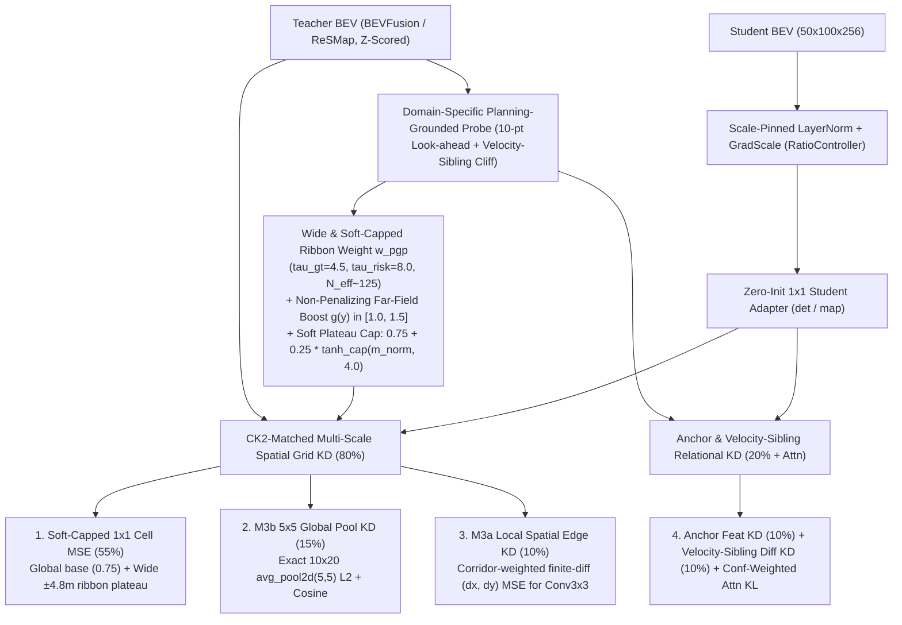

# BEV Selector v13: `v12` 전수 평가·실패 분석 및 `CK2` Refiner 아키텍처 정합형 다중 스케일 BEV 증류 방법론

> **목표**: `fusion_v12_main`이 달성한 순수 선택기 역대 최고 성능(`noim lat=off 93.17`, `plugin lat=off 93.25`, `oracle96 99.01`, `DAC 99.05%`)을 유지하면서, `v12`에서 드러난 **① 좁은 `DET` 코리도(`56.2`개 앵커) 및 근거리 가중치 축소(`0.65x`)로 인한 인접 차선(`l±0.5`) `TTC` 실패·베이스 플래너(`v2`) 하락**, **② `w_pgp` 중심선 스파이크(`41.8x`)로 인한 전역 `1x1 Cell MSE` 수렴 저하**, **③ `CK2` Refiner(`M3a` `±4.8m` 리본 `Conv3x3` & `M3b` `5x5` 전역 토큰)와의 공간 구조적 미스매치**를 근본적으로 해결하여 전 평가 지표(`v2`, `default`, `noim`, `plugin`)에서 `ck2e2e_bevkd`(1x1 KD)와 `v12`를 모두 넘어서는 범용 Student BEV 표현을 학습한다.

---

## 1. `fusion_v12_main` 30-Epoch `navtest` (12,146 토큰) 최종 결과 및 정밀 진단

### 1.1 전체 모델 `navtest` (12,146 토큰) 공식 평가 비교

| 평가 지표 (`navtest`, 12,146 tokens) | `fusion_v8_main` | `ck2e2e_bevkd` (1x1 KD) | `fusion_v10_main` | `fusion_v11_main` | **`fusion_v12_main`** | `v12` 핵심 진단 |
| :--- | :---: | :---: | :---: | :---: | :---: | :--- |
| **`v2` (Base Planner, `col 0`)** | 88.34 | **89.16** | 88.91 | 89.07 | 88.91 | 근거리(`0~12m`) `row_gain=0.65x` 페널티 및 `0.1*I` 초기화로 `v11` 대비 `-0.16p` |
| **`v2_lat` (`col 0` + 측방 보정)** | 89.84 | 90.37 | 90.27 | **90.43** | 90.28 | `v2` 하락분(`-0.15p`) 그대로 반영 (`v2_lat - v2 = +1.36p`는 동일) |
| **`oracle16` (16 부모 상한)** | — | — | — | 97.18 | **97.29** | **`+0.11p` 상승 (역대 최고 상한)** |
| **`oracle96` (96 후보 상한)** | — | — | — | 98.96 | **99.01** | **`+0.05p` 상승 (`NC=100%, DAC=100%, TTC=100%`)** |
| **`oracle96_lat` (96 + 측방 상한)** | — | — | — | 99.02 | **99.06** | **`+0.04p` 상승 (역대 최고 상한)** |
| **`sel` (`default`, $b=0.50$, `lat=on`)** | 91.64 | 92.17 | **92.20** | 92.08 | 91.93 | `v2` 하락(`-0.16p`) + 횡방향 `l±0.5` `TTC` 실패(`+48`건)로 하락 (`Δv2 = +3.02p`) |
| **`sel` (`default`, $b=1.00$, `lat=on`)** | 91.51 | **92.21** | 92.16 | 92.09 | 92.06 | `Δv2 = +3.15p` (`v11` `+3.02p` 대비 리파이너 순수 이득 `+0.13p` 증가) |
| **`sel` (`noim`, $b=1.00$, `lat=on`)** | 92.66 | **93.10** | 92.83 | 92.87 | **93.08** | **`v11` 대비 `+0.21p` 급등 (`fusion` 계열 최고, `bevkd`와 `0.02p` 차이)** |
| **`sel` (`noim`, $b=1.00$, `lat=off`)** | 92.65 | 93.12 | 92.83 | 92.83 | **93.17** | **`v11` 대비 `+0.34p`, `bevkd` 대비 `+0.05p` (전 모델 1위!)** |
| **`sel` (`plugin`, $b=1.00$, `lat=on`)** | 92.71 | **93.24** | 92.98 | 93.01 | **93.20** | **`v11` 대비 `+0.19p` 급등 (`DAC = 99.05%` 역대 최고)** |
| **`sel` (`plugin`, $b=1.00$, `lat=off`)** | 92.68 | 93.19 | 92.95 | 92.92 | **93.25** | **`v11` 대비 `+0.33p`, `bevkd` 대비 `+0.06p` (전 모델 1위!)** |

---

### 1.2 무엇이 성공했고 무엇이 실패했는가? (텐서보드 학습 로그 & 실패 버킷 교차 검증)

`v10`, `v11`, `v12`의 최종 에폭(Epoch 29) 텐서보드 지표와 `navtest` 세부 실패 건수를 나란히 대조하면 원인이 명확하게 드러난다.

| 텐서보드 학습 지표 (Epoch 29) | `fusion_v10_main` | `fusion_v11_main` | **`fusion_v12_main`** | 핵심 인사이트 |
| :--- | :---: | :---: | :---: | :--- |
| **`effective_anchors` (`bevfusion`)** | 35.4개 | **116.8개** | **56.2개 (반토막)** | **`v12`에서 `DET` 코리도를 너무 좁게 조임 (`tau_gt=2.0, tau_risk=2.8`)** |
| **`effective_anchors` (`resmap`)** | 35.4개 | 116.3개 | **133.7개** | `MAP`은 넓게 봐서 `DAC`가 전 구간 최고점(`99.05%`) 달성 |
| **`w_pgp_max/bevfusion` (최대 셀 가중치)** | — | 53.87배 | **41.80배** | 중심선 소수 셀에 가중치가 40~50배 편중되어 주변 리본 셀 학습이 소외됨 |
| **`distill_cell_mse/bevfusion` (1x1 오차)** | 1.2908 | **1.2533 (최고)** | **1.3100 (최악)** | 코리도 축소 + `row_gain` 왜곡으로 **전반적인 1x1 셀 복원 오차가 악화됨** |
| **`distill_cell_mse/resmap` (1x1 오차)** | 0.7729 | **0.5958 (최고)** | 0.6221 | `v11`(순수 1x1) 대비 전역 1x1 수렴도가 소폭 밀림 |
| **`distill_cos/bevfusion` (Cross-Attn 정렬)** | **0.8364** | 0.5811 (꺼짐) | **0.8343** | Cross-Attention 정렬 복원으로 `0.58` $\rightarrow$ `0.83` 대폭 향상 |
| **`probe/student_gap/bevfusion` (예측 격차)** | 0.0766 | 0.1278 (최악) | **0.0748 (최고)** | Teacher-Student 프로브 안전도 예측 오차 `-41.5%` 감소 |
| **`probe/student_gap/resmap` (예측 격차)** | 0.0505 | 0.0497 | **0.0374 (최고)** | Teacher-Student 도로 준수 예측 오차 `-24.8%` 감소 |

#### 핵심 실패 원인 3가지
1. **원인 ① (`DET` 코리도 과도 축소 + 근거리 `0.65x` 페널티 $\rightarrow$ 인접 차선 `l±0.5` `TTC` 실패 `+48`건 & `v2` 하락)**:
   * `v12`는 `bevfusion`(`DET`)의 $\tau_{\text{gt}}=2.0, \tau_{\text{risk}}=2.8$로 줄여 유효 앵커 수를 `116.8`개(`v11`) $\rightarrow$ `56.2`개로 절반 이하로 축소했고, `row_gain = 0.65 + 0.90 * (y/32)`으로 근거리(`y = 0~12m`) 가중치를 `0.65~0.98`배로 깎았다.
   * 그 결과 종방향 가속(`a+0.5`)과 약감속(`a-0.5`)의 `TTC` 실패는 각각 `-7`건씩 감소(`284` $\rightarrow$ `277`, `37` $\rightarrow$ `30`)하고 자살 스위치(`plugin b=1`)도 `165`건 $\rightarrow$ `131`건(`-20.6%`)으로 크게 줄었으나, **GT 중심선에서 옆으로 벗어난 횡방향 변형(`l-0.5`, `l+0.5`)의 `TTC` 실패가 `127`건(`60+67`) $\rightarrow$ `175`건(`87+88`)으로 `+48`건 폭증**하며 `l-0.5` 평균 점수가 `91.11` $\rightarrow$ `89.67`(`-1.44p`)로 급락했다. 또한 근거리 가중치 축소로 인해 `v2` 기본 플래너의 `NC` 실패가 `119`건(`bevkd`) / `132`건(`v11`) $\rightarrow$ `141`건(`v12`)으로 늘어났다.
2. **원인 ② (뾰족한 `w_pgp` 스파이크(`42~54배`)로 인한 전반적 `1x1` BEV 품질 저하)**:
   * `w_pgp = 0.5 + 0.5 * m_norm`에서 `m_norm`에 상한(Cap)이 없다 보니, 소수의 궤적 중심선 셀에서만 가중치가 `41.8배`로 튀고 나머지 셀들의 비중이 잠식되어 정작 전체 그리드의 `distill_cell_mse/bevfusion`가 `1.2533`(`v11`) $\rightarrow$ `1.3100`(`v12`)으로 악화되었다.
3. **원인 ③ (최종 소비자 `CK2` Refiner의 `M3a`/`M3b` 아키텍처와의 구조적 미스매치)**:
   * [`corridor.py`](file:///workspace/byounggun/SSR/navsim/agents/para_ssr/refiner/corridor.py#L10-L35) 및 [`refiner_net.py`](file:///workspace/byounggun/SSR/navsim/agents/para_ssr/refiner/refiner_net.py#L16-L24)에서 `CK2`는 Student BEV `[50, 100]`을 다음 두 경로로 읽는다:
     * **`M3a` (`±4.8m` Corridor Ribbon + `Conv3x3` 3층)**: 후보 궤적을 전방 $S_8 + \max(8\text{m}, 1.0\text{s}\cdot v_{\text{end}})$까지 연장한 48개 스테이션마다 **좌우 `±4.8m`(17개 오프셋, `0.6m` 간격)** 격자 리본 `[48, 17]`을 샘플링하고, 그 위에 **`Conv3x3` 3층**을 적용해 **인접 셀 간의 국소 공간 경계(Local Spatial Edge)**를 읽어 안전도(`score_logit`)와 사후 측방 보정량(`w_lat`)을 예측한다.
     * **`M3b` (`5x5 AvgPool` Global Tokens)**: 전체 `[50, 100]` BEV를 **`5x5` (`3.2m × 3.2m`) 평균 풀링**하여 `10×20 = 200`개의 전역 문맥 토큰(`mem`)으로 만들어 Cross-Attention 메모리에 사용한다.
   * `v12`는 순수 선택(`lat=off`)에서는 `noim 93.17` / `plugin 93.25`로 `bevkd`(`93.12` / `93.19`)를 앞섰으나, 선택 후 측방 보정(`lat=on`)을 얹을 때 `bevkd`가 `+0.05p` 오르는 반면 `v12`는 `-0.05p ~ -0.09p` 하락했다. 이는 `CK2`의 `w_lat`과 `Conv3x3`가 요구하는 **① `±4.8m` 리본 내부의 고른 셀 품질**, **② 인접 셀 간 국소 공간 차분(Edge) 정합성**, **③ `5x5` 풀링 전역 토큰 정합성**이 직접 감독되지 않았기 때문이다.

---

## 2. BEV Selector v13 (`distill_selector_v13`) 4대 핵심 아키텍처 설계

특정 평가 지표나 변형을 인위적으로 억누르는 규칙을 배제하고, **Student BEV 자체를 `v2` 플래너와 `CK2` Refiner(`M3a` + `M3b`) 모두에 최적화된 범용 표현(General-Purpose Representation)으로 학습**시키기 위해 다음 4가지 원리를 도입한다.

---

### 방법론 ①: Wide & Soft-Capped Ribbon `w_pgp` (광역 코리도 복원 및 중심선 스파이크 제거)
1. **`DET` (`bevfusion`) & `MAP` (`resmap`) 광역 앵커 탐색 (`N_eff ≈ 120 ~ 135`)**:
   * `v12`에서 너무 좁았던 `bevfusion`의 $\tau_{\text{gt}}, \tau_{\text{risk}}$를 `2.0 / 2.8`에서 **`4.5 / 8.0` (`lam_gt=0.45, lam_cov=0.20, lam_risk=0.35`)**으로 넓히고, `resmap`도 **`4.5 / 8.0` (`lam_gt=0.35, lam_cov=0.20, lam_risk=0.45`)**으로 맞춘다.
   * 이를 통해 GT 중심선뿐 아니라 인접 차선(`l-0.5`, `l+0.5`)과 대안 부모(`Parent 1..15`), 그리고 `CK2`의 `±4.8m` 리본 폭 전체에 걸쳐 약 120~135개의 유효 앵커가 고르게 어텐션을 투사한다.
2. **Soft-Capped Plateau `w_pgp` (`0.75` 전역 바닥 + `0.25` 완만한 리본 고원)**:
   * 정규화된 공간 중요도 $m_{\text{norm}}(u)$가 소수 셀에서 40~50배로 치솟아 주변 셀의 그래디언트 예산을 잠식하는 것을 막기 위해, 부드러운 쌍곡탄젠트 상한 $\tau_{\text{cap}} = 4.0$을 적용한다:
     $$m_{\text{cap}}(u) = 4.0 \cdot \tanh\!\left(\frac{m_{\text{norm}}(u)}{4.0}\right), \qquad \tilde{m}_{\text{cap}}(u) = \frac{HW \cdot m_{\text{cap}}(u)}{\sum_{v=1}^{HW} m_{\text{cap}}(v)}$$
     $$w_{\text{pgp}}^{\text{v13}}(u) = 0.75 + 0.25 \cdot \tilde{m}_{\text{cap}}(u)$$
   * **효과**:
     * 모든 배경 셀이 최소 **`0.75`배** 이상의 가중치를 보장받아 `ck2e2e_bevkd`와 동일한 전역 `1x1` 기초 복원력을 확보한다.
     * 주행 코리도 및 `CK2`의 `±4.8m` 리본 영역 전체가 **`1.2 ~ 2.0`배의 넓고 평평한 고원(Plateau)** 형태로 강조되어, `CK2`의 `Conv3x3`와 측방 보정 헤드(`w_lat`)가 중심선과 옆 차선에서 일관된 스케일의 특징을 읽는다.

---

### 방법론 ②: Non-Penalizing Far-Field Horizon Boost + 10-Point Look-Ahead (근거리 무손실 원거리 보강)
1. **10-Point (`T+2`) 제동 Look-Ahead 공간 바이어스 유지**:
   * `CK2`의 `M3a` 코리도 연장 규칙($S_{\text{look}} = S_8 + \max(8\text{m}, 1.0\text{s}\cdot v_{\text{end}})$)과 동일하게, 각 앵커의 4.0초 끝점 너머 `0.5s`, `1.0s` 지점(`wp_9`, `wp_10`)까지 확장된 10-point 거리 바이어스를 유지하여 원거리 장애물/차선 감지를 지속한다.
2. **근거리를 절대 깎지 않는(`>= 1.0`) 단조 증가 원거리 부스트 $g_{\text{v13}}(y)$**:
   * `v12`의 `row_gain`(`0.65 + 0.90 * y/32`)이 근거리(`y < 12m`)를 `0.65`배로 깎아 `v2` 플래너의 근거리 충돌(`NC`)을 유발했던 문제를 해결하기 위해, **근거리($y \le 10\text{m}$)는 `1.0`으로 100% 보존하고 중·원거리($10\text{m} < y \le 32\text{m}$)에만 최대 `+50%`의 가산 부스트**를 부여한다:
     $$g_{\text{v13}}(y) = 1.0 + 0.50 \cdot \operatorname{clamp}\!\left(\frac{y - 10.0}{22.0},\, 0.0,\, 1.0\right) \in [1.0,\, 1.5]$$

---

### 방법론 ③: `CK2` 아키텍처 직결형 다중 스케일 공간 KD (`M3b 5x5 Global Pool` + `M3a Local Spatial Edge`)
Student BEV $S_{\text{map}} \in \mathbb{R}^{B \times C \times 50 \times 100}$과 Teacher BEV $T_{\text{map}} \in \mathbb{R}^{B \times C \times 50 \times 100}$ 사이에서 `CK2` Refiner의 두 시각 입력 경로(`M3b`, `M3a`)와 정확히 1:1로 대응되는 두 가지 구조적 정렬 항을 추가한다(추가 학습 파라미터 `0`개):

1. **`CK2 M3b` 직결 — `5x5` Global Token KD ($\mathcal{L}_{\text{global\_5x5}}$)**:
   * [`corridor.py:global_tokens`](file:///workspace/byounggun/SSR/navsim/agents/para_ssr/refiner/corridor.py#L32-L35)는 BEV 맵을 `F.avg_pool2d(feat, 5)`로 풀링하여 `10×20 = 200`개의 전역 장면 토큰을 생성한다.
   * 이와 정확히 동일한 `5x5` 평균 풀링 토큰 $S_{5\times 5}, T_{5\times 5} \in \mathbb{R}^{B \times 200 \times C}$를 추출하여 L2 및 정규화 코사인 거리를 직접 정렬한다:
     $$\mathcal{L}_{\text{global\_5x5}} = 0.5 \cdot \|S_{5\times 5} - T_{5\times 5}\|_2^2 + 0.5 \cdot \Big(1 - \cos\big(\operatorname{LN}(S_{5\times 5}),\, \operatorname{LN}(T_{5\times 5})\big)\Big)$$
2. **`CK2 M3a` 직결 — Local Spatial Edge (Finite-Difference) KD ($\mathcal{L}_{\text{edge\_3x3}}$)**:
   * [`refiner_net.py:self.enc`](file:///workspace/byounggun/SSR/navsim/agents/para_ssr/refiner/refiner_net.py#L17-L18)의 3층 `Conv3x3`는 리본 격자에서 인접한 셀(`0.64m` 간격) 사이의 공간 변화율(기울기/경계)을 추출하여 장애물 모서리와 차선 경계를 판별하고 측방 보정량(`w_lat`)을 결정한다.
   * 종방향 인접 차분 $\Delta_r B = B_{:,:,1:,:} - B_{:,:,:-1,:}$ 및 횡방향 인접 차분 $\Delta_c B = B_{:,:,:,1:} - B_{:,:,:,:-1}$에 코리도 가중치 $w_{\text{pgp}}$를 곱해 정렬한다:
     $$\mathcal{L}_{\text{edge\_3x3}} = \frac{1}{2}\Big\langle w_{\text{pgp}, r} \cdot \|\Delta_r S_{\text{map}} - \Delta_r T_{\text{map}}\|_2^2 \Big\rangle + \frac{1}{2}\Big\langle w_{\text{pgp}, c} \cdot \|\Delta_c S_{\text{map}} - \Delta_c T_{\text{map}}\|_2^2 \Big\rangle$$

---

### 방법론 ④: 손실 비중 재조정 (80% 다중 스케일 공간 그리드 + 20% 앵커 관계형 KD) 및 Zero-Init 복원
1. **`student_proj` Zero-Init 복원**:
   * `v12`의 `0.1 * I` 초기화를 제거하고 `ck2e2e_bevkd` 및 `v11`에서 검증된 **Zero-Init (`nn.init.zeros_`)**으로 복원하여, 초반 워밍업 구간에서 정렬되지 않은 채널 노이즈가 유입되는 것을 차단한다.
2. **도메인별 총 증류 손실($\mathcal{L}_{\text{bank}}^{\text{v13}}$)의 균형 배분**:
   $$\mathcal{L}_{\text{bank}}^{\text{v13}} = \text{loss\_scale} \cdot \Big(\underbrace{0.55 \cdot \mathcal{L}_{\text{cell\_1x1}} + 0.15 \cdot \mathcal{L}_{\text{global\_5x5}} + 0.10 \cdot \mathcal{L}_{\text{edge\_3x3}}}_{\text{80\% Multi-Scale Spatial Grid KD (전역 1x1 + M3b 5x5 + M3a Edge)}} + \underbrace{0.10 \cdot \mathcal{L}_{\text{feat}} + 0.10 \cdot \mathcal{L}_{\text{sibling\_diff}}}_{\text{20\% Anchor & Velocity-Sibling Relational KD}}\Big) + 0.20 \cdot \text{attn\_loss\_scale} \cdot \mathcal{L}_{\text{attn}}$$

---

## 3. 요약 비교표: `v11` vs `v12` vs `v13`

| 구성 요소 | `fusion_v11_main` | `fusion_v12_main` | **`fusion_v13_main` (신규 설계)** |
| :--- | :--- | :--- | :--- |
| **`student_proj` 초기화** | Zero-Init (`0`) | Damped Eye (`0.1 * I`) | **Zero-Init (`0`) 복원** |
| **`DET` / `MAP` 코리도 폭 ($\tau_{\text{gt}}, \tau_{\text{risk}}$)** | `5.0 / 8.0` (`N_eff=116.8`) | `DET 2.0/2.8` (`N_eff=56.2`), `MAP 4.0/8.0` | **`DET & MAP 4.5 / 8.0` (`N_eff ≈ 125`, 인접 차선·리본 완전 커버)** |
| **원거리 보강 (`row_gain` + Look-ahead)** | 없음 (8-pt, 근거리 편중) | 10-pt + `0.65 + 0.90*(y/32)` (근거리 `0.65x` 페널티) | **10-pt + `1.0 + 0.50*clamp((y-10)/22)` (근거리 `1.0x` 무손실 + 원거리 `1.5x` 부스트)** |
| **공간 가중치 `w_pgp` 형태** | `0.5 + 0.5 * m_norm` (무제한, 최대 `54x` 스파이크) | `0.5 + 0.5 * m_norm` (무제한, 최대 `42x` 스파이크) | **`0.75 + 0.25 * tanh_cap(m_norm, 4.0)` (최대 `~1.7x` 완만한 고원 + `0.75` 전역 바닥)** |
| **`CK2` 직결 다중 스케일 그리드 KD** | 단일 `1x1 Cell MSE` (100%) | 단일 `1x1 Cell MSE` (80%) | **`1x1 Cell`(55%) + `M3b 5x5 Global Pool`(15%) + `M3a Local Edge`(10%)** |
| **앵커 문맥 & 속도 형제 대조 KD** | 꺼짐 (`feat/attn` detached) | `Feat`(10%) + `Sibling Diff`(10%) + `Attn`(0.25x) | **`Feat`(10%) + `Sibling Diff`(10%) + `Attn`(0.20x) + Probe Cliff Ranking 유지** |
