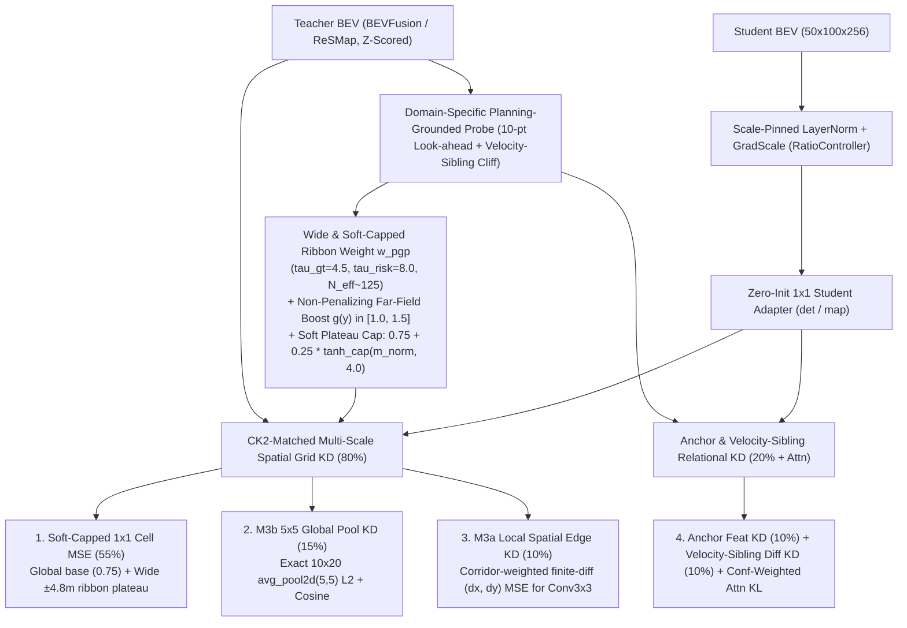

# BEV Selector v13: `v12` 전수 평가·실패 분석 및 `CK2` Refiner 아키텍처 정합형 다중 스케일 BEV 증류 방법론

> **목표**: `fusion_v12_main`이 달성한 순수 선택기 역대 최고 성능(`noim lat=off 93.17`, `plugin lat=off 93.25`, `oracle96 99.01`, `DAC 99.05%`)을 유지하면서, `v12`에서 드러난 **① 좁은 `DET` 코리도(`56.2`개 앵커) 및 근거리 가중치 축소(`0.65x`)로 인한 인접 차선(`l±0.5`) `TTC` 실패·베이스 플래너(`v2`) 하락**, **② `w_pgp` 중심선 스파이크(`41.8x`)로 인한 전역 `1x1 Cell MSE` 수렴 저하**, **③ `CK2` Refiner(`M3a` `±4.8m` 리본 `Conv3x3` & `M3b` `5x5` 전역 토큰)와의 공간 구조적 미스매치**를 근본적으로 해결하여 전 평가 지표(`v2`, `default`, `noim`, `plugin`)에서 `ck2e2e_bevkd`(1x1 KD)와 `v12`를 모두 넘어서는 범용 Student BEV 표현을 학습한다.

---

## 1. `fusion_v12_main` 30-Epoch `navtest` (12,146 토큰) 최종 결과 및 정밀 진단

### 1.1 전체 모델 `navtest` (12,146 토큰) 공식 평가 비교

| 평가 지표 (`navtest`, 12,146 tokens) | `fusion_v8_main` | `ck2e2e_bevkd` (1x1 KD) | `fusion_v10_main` | `fusion_v11_main` | **`fusion_v12_main`** | `v12` 핵심 진단 |
| :--- | :---: | :---: | :---: | :---: | :---: | :--- |
| **`v2` (Base Planner, `col 0`)** | 88.34 | **89.16** | 88.91 | 89.07 | 88.91 | 근거리(`0~12m`) `row_gain=0.65x` 페널티 및 `0.1*I` 초기화로 `v11` 대비 `-0.16p` |
| **`v2_lat` (`col 0` + 측방 보정)** | 89.84 | 90.37 | 90.27 | **90.43** | 90.28 | `v2` 하락분(`-0.15p`) 그대로 반영 (`v2_lat - v2 = +1.36p`는 동일) |
| **`oracle16` (16 부모 상한)** | — | — | — | 97.18 | **97.29** | **`+0.11p` 상승 (역대 최고 상한)** |
| **`oracle96` (96 후보 상한)** | — | — | — | 98.96 | **99.01** | **`+0.05p` 상승 (`NC=100%, DAC=100%, TTC=100%`)** |
| **`oracle96_lat` (96 + 측방 상한)** | — | — | — | 99.02 | **99.06** | **`+0.04p` 상승 (역대 최고 상한)** |
| **`sel` (`default`, $b=0.50$, `lat=on`)** | 91.64 | 92.17 | **92.20** | 92.08 | 91.93 | `v2` 하락(`-0.16p`) + 횡방향 `l±0.5` `TTC` 실패(`+48`건)로 하락 (`Δv2 = +3.02p`) |
| **`sel` (`default`, $b=1.00$, `lat=on`)** | 91.51 | **92.21** | 92.16 | 92.09 | 92.06 | `Δv2 = +3.15p` (`v11` `+3.02p` 대비 리파이너 순수 이득 `+0.13p` 증가) |
| **`sel` (`noim`, $b=1.00$, `lat=on`)** | 92.66 | **93.10** | 92.83 | 92.87 | **93.08** | **`v11` 대비 `+0.21p` 급등 (`fusion` 계열 최고, `bevkd`와 `0.02p` 차이)** |
| **`sel` (`noim`, $b=1.00$, `lat=off`)** | 92.65 | 93.12 | 92.83 | 92.83 | **93.17** | **`v11` 대비 `+0.34p`, `bevkd` 대비 `+0.05p` (전 모델 1위!)** |
| **`sel` (`plugin`, $b=1.00$, `lat=on`)** | 92.71 | **93.24** | 92.98 | 93.01 | **93.20** | **`v11` 대비 `+0.19p` 급등 (`DAC = 99.05%` 역대 최고)** |
| **`sel` (`plugin`, $b=1.00$, `lat=off`)** | 92.68 | 93.19 | 92.95 | 92.92 | **93.25** | **`v11` 대비 `+0.33p`, `bevkd` 대비 `+0.06p` (전 모델 1위!)** |

---

### 1.2 무엇이 성공했고 무엇이 실패했는가? (텐서보드 학습 로그 & 실패 버킷 교차 검증)

`v10`, `v11`, `v12`의 최종 에폭(Epoch 29) 텐서보드 지표와 `navtest` 세부 실패 건수를 나란히 대조하면 원인이 명확하게 드러난다.

| 텐서보드 학습 지표 (Epoch 29) | `fusion_v10_main` | `fusion_v11_main` | **`fusion_v12_main`** | 핵심 인사이트 |
| :--- | :---: | :---: | :---: | :--- |
| **`effective_anchors` (`bevfusion`)** | 35.4개 | **116.8개** | **56.2개 (반토막)** | **`v12`에서 `DET` 코리도를 너무 좁게 조임 (`tau_gt=2.0, tau_risk=2.8`)** |
| **`effective_anchors` (`resmap`)** | 35.4개 | 116.3개 | **133.7개** | `MAP`은 넓게 봐서 `DAC`가 전 구간 최고점(`99.05%`) 달성 |
| **`w_pgp_max/bevfusion` (최대 셀 가중치)** | — | 53.87배 | **41.80배** | 중심선 소수 셀에 가중치가 40~50배 편중되어 주변 리본 셀 학습이 소외됨 |
| **`distill_cell_mse/bevfusion` (1x1 오차)** | 1.2908 | **1.2533 (최고)** | **1.3100 (최악)** | 코리도 축소 + `row_gain` 왜곡으로 **전반적인 1x1 셀 복원 오차가 악화됨** |
| **`distill_cell_mse/resmap` (1x1 오차)** | 0.7729 | **0.5958 (최고)** | 0.6221 | `v11`(순수 1x1) 대비 전역 1x1 수렴도가 소폭 밀림 |
| **`distill_cos/bevfusion` (Cross-Attn 정렬)** | **0.8364** | 0.5811 (꺼짐) | **0.8343** | Cross-Attention 정렬 복원으로 `0.58` $\rightarrow$ `0.83` 대폭 향상 |
| **`probe/student_gap/bevfusion` (예측 격차)** | 0.0766 | 0.1278 (최악) | **0.0748 (최고)** | Teacher-Student 프로브 안전도 예측 오차 `-41.5%` 감소 |
| **`probe/student_gap/resmap` (예측 격차)** | 0.0505 | 0.0497 | **0.0374 (최고)** | Teacher-Student 도로 준수 예측 오차 `-24.8%` 감소 |

#### 핵심 실패 원인 3가지
1. **원인 ① (`DET` 코리도 과도 축소 + 근거리 `0.65x` 페널티 $\rightarrow$ 인접 차선 `l±0.5` `TTC` 실패 `+48`건 & `v2` 하락)**:
   * `v12`는 `bevfusion`(`DET`)의 $\tau_{\text{gt}}=2.0, \tau_{\text{risk}}=2.8$로 줄여 유효 앵커 수를 `116.8`개(`v11`) $\rightarrow$ `56.2`개로 절반 이하로 축소했고, `row_gain = 0.65 + 0.90 * (y/32)`으로 근거리(`y = 0~12m`) 가중치를 `0.65~0.98`배로 깎았다.
   * 그 결과 종방향 가속(`a+0.5`)과 약감속(`a-0.5`)의 `TTC` 실패는 각각 `-7`건씩 감소(`284` $\rightarrow$ `277`, `37` $\rightarrow$ `30`)하고 자살 스위치(`plugin b=1`)도 `165`건 $\rightarrow$ `131`건(`-20.6%`)으로 크게 줄었으나, **GT 중심선에서 옆으로 벗어난 횡방향 변형(`l-0.5`, `l+0.5`)의 `TTC` 실패가 `127`건(`60+67`) $\rightarrow$ `175`건(`87+88`)으로 `+48`건 폭증**하며 `l-0.5` 평균 점수가 `91.11` $\rightarrow$ `89.67`(`-1.44p`)로 급락했다. 또한 근거리 가중치 축소로 인해 `v2` 기본 플래너의 `NC` 실패가 `119`건(`bevkd`) / `132`건(`v11`) $\rightarrow$ `141`건(`v12`)으로 늘어났다.
2. **원인 ② (뾰족한 `w_pgp` 스파이크(`42~54배`)로 인한 전반적 `1x1` BEV 품질 저하)**:
   * `w_pgp = 0.5 + 0.5 * m_norm`에서 `m_norm`에 상한(Cap)이 없다 보니, 소수의 궤적 중심선 셀에서만 가중치가 `41.8배`로 튀고 나머지 셀들의 비중이 잠식되어 정작 전체 그리드의 `distill_cell_mse/bevfusion`가 `1.2533`(`v11`) $\rightarrow$ `1.3100`(`v12`)으로 악화되었다.
3. **원인 ③ (최종 소비자 `CK2` Refiner의 `M3a`/`M3b` 아키텍처와의 구조적 미스매치)**:
   * [`corridor.py`](file:///workspace/byounggun/SSR/navsim/agents/para_ssr/refiner/corridor.py#L10-L35) 및 [`refiner_net.py`](file:///workspace/byounggun/SSR/navsim/agents/para_ssr/refiner/refiner_net.py#L16-L24)에서 `CK2`는 Student BEV `[50, 100]`을 다음 두 경로로 읽는다:
     * **`M3a` (`±4.8m` Corridor Ribbon + `Conv3x3` 3층)**: 후보 궤적을 전방 $S_8 + \max(8\text{m}, 1.0\text{s}\cdot v_{\text{end}})$까지 연장한 48개 스테이션마다 **좌우 `±4.8m`(17개 오프셋, `0.6m` 간격)** 격자 리본 `[48, 17]`을 샘플링하고, 그 위에 **`Conv3x3` 3층**을 적용해 **인접 셀 간의 국소 공간 경계(Local Spatial Edge)**를 읽어 안전도(`score_logit`)와 사후 측방 보정량(`w_lat`)을 예측한다.
     * **`M3b` (`5x5 AvgPool` Global Tokens)**: 전체 `[50, 100]` BEV를 **`5x5` (`3.2m × 3.2m`) 평균 풀링**하여 `10×20 = 200`개의 전역 문맥 토큰(`mem`)으로 만들어 Cross-Attention 메모리에 사용한다.
   * `v12`는 순수 선택(`lat=off`)에서는 `noim 93.17` / `plugin 93.25`로 `bevkd`(`93.12` / `93.19`)를 앞섰으나, 선택 후 측방 보정(`lat=on`)을 얹을 때 `bevkd`가 `+0.05p` 오르는 반면 `v12`는 `-0.05p ~ -0.09p` 하락했다. 이는 `CK2`의 `w_lat`과 `Conv3x3`가 요구하는 **① `±4.8m` 리본 내부의 고른 셀 품질**, **② 인접 셀 간 국소 공간 차분(Edge) 정합성**, **③ `5x5` 풀링 전역 토큰 정합성**이 직접 감독되지 않았기 때문이다.

---

## 2. BEV Selector v13 (`distill_selector_v13`) 4대 핵심 아키텍처 설계

특정 평가 지표나 변형을 인위적으로 억누르는 규칙을 배제하고, **Student BEV 자체를 `v2` 플래너와 `CK2` Refiner(`M3a` + `M3b`) 모두에 최적화된 범용 표현(General-Purpose Representation)으로 학습**시키기 위해 다음 4가지 원리를 도입한다.

---

### 방법론 ①: Wide & Soft-Capped Ribbon `w_pgp` (광역 코리도 복원 및 중심선 스파이크 제거)
1. **`DET` (`bevfusion`) & `MAP` (`resmap`) 광역 앵커 탐색 (`N_eff ≈ 120 ~ 135`)**:
   * `v12`에서 너무 좁았던 `bevfusion`의 $\tau_{\text{gt}}, \tau_{\text{risk}}$를 `2.0 / 2.8`에서 **`4.5 / 8.0` (`lam_gt=0.45, lam_cov=0.20, lam_risk=0.35`)**으로 넓히고, `resmap`도 **`4.5 / 8.0` (`lam_gt=0.35, lam_cov=0.20, lam_risk=0.45`)**으로 맞춘다.
   * 이를 통해 GT 중심선뿐 아니라 인접 차선(`l-0.5`, `l+0.5`)과 대안 부모(`Parent 1..15`), 그리고 `CK2`의 `±4.8m` 리본 폭 전체에 걸쳐 약 120~135개의 유효 앵커가 고르게 어텐션을 투사한다.
2. **Soft-Capped Plateau `w_pgp` (`0.75` 전역 바닥 + `0.25` 완만한 리본 고원)**:
   * 정규화된 공간 중요도 $m_{\text{norm}}(u)$가 소수 셀에서 40~50배로 치솟아 주변 셀의 그래디언트 예산을 잠식하는 것을 막기 위해, 부드러운 쌍곡탄젠트 상한 $\tau_{\text{cap}} = 4.0$을 적용한다:
     $$m_{\text{cap}}(u) = 4.0 \cdot \tanh\!\left(\frac{m_{\text{norm}}(u)}{4.0}\right), \qquad \tilde{m}_{\text{cap}}(u) = \frac{HW \cdot m_{\text{cap}}(u)}{\sum_{v=1}^{HW} m_{\text{cap}}(v)}$$
     $$w_{\text{pgp}}^{\text{v13}}(u) = 0.75 + 0.25 \cdot \tilde{m}_{\text{cap}}(u)$$
   * **효과**:
     * 모든 배경 셀이 최소 **`0.75`배** 이상의 가중치를 보장받아 `ck2e2e_bevkd`와 동일한 전역 `1x1` 기초 복원력을 확보한다.
     * 주행 코리도 및 `CK2`의 `±4.8m` 리본 영역 전체가 **`1.2 ~ 2.0`배의 넓고 평평한 고원(Plateau)** 형태로 강조되어, `CK2`의 `Conv3x3`와 측방 보정 헤드(`w_lat`)가 중심선과 옆 차선에서 일관된 스케일의 특징을 읽는다.

---

### 방법론 ②: Non-Penalizing Far-Field Horizon Boost + 10-Point Look-Ahead (근거리 무손실 원거리 보강)
1. **10-Point (`T+2`) 제동 Look-Ahead 공간 바이어스 유지**:
   * `CK2`의 `M3a` 코리도 연장 규칙($S_{\text{look}} = S_8 + \max(8\text{m}, 1.0\text{s}\cdot v_{\text{end}})$)과 동일하게, 각 앵커의 4.0초 끝점 너머 `0.5s`, `1.0s` 지점(`wp_9`, `wp_10`)까지 확장된 10-point 거리 바이어스를 유지하여 원거리 장애물/차선 감지를 지속한다.
2. **근거리를 절대 깎지 않는(`>= 1.0`) 단조 증가 원거리 부스트 $g_{\text{v13}}(y)$**:
   * `v12`의 `row_gain`(`0.65 + 0.90 * y/32`)이 근거리(`y < 12m`)를 `0.65`배로 깎아 `v2` 플래너의 근거리 충돌(`NC`)을 유발했던 문제를 해결하기 위해, **근거리($y \le 10\text{m}$)는 `1.0`으로 100% 보존하고 중·원거리($10\text{m} < y \le 32\text{m}$)에만 최대 `+50%`의 가산 부스트**를 부여한다:
     $$g_{\text{v13}}(y) = 1.0 + 0.50 \cdot \operatorname{clamp}\!\left(\frac{y - 10.0}{22.0},\, 0.0,\, 1.0\right) \in [1.0,\, 1.5]$$

---

### 방법론 ③: `CK2` 아키텍처 직결형 다중 스케일 공간 KD (`M3b 5x5 Global Pool` + `M3a Local Spatial Edge`)
Student BEV $S_{\text{map}} \in \mathbb{R}^{B \times C \times 50 \times 100}$과 Teacher BEV $T_{\text{map}} \in \mathbb{R}^{B \times C \times 50 \times 100}$ 사이에서 `CK2` Refiner의 두 시각 입력 경로(`M3b`, `M3a`)와 정확히 1:1로 대응되는 두 가지 구조적 정렬 항을 추가한다(추가 학습 파라미터 `0`개):

1. **`CK2 M3b` 직결 — `5x5` Global Token KD ($\mathcal{L}_{\text{global\_5x5}}$)**:
   * [`corridor.py:global_tokens`](file:///workspace/byounggun/SSR/navsim/agents/para_ssr/refiner/corridor.py#L32-L35)는 BEV 맵을 `F.avg_pool2d(feat, 5)`로 풀링하여 `10×20 = 200`개의 전역 장면 토큰을 생성한다.
   * 이와 정확히 동일한 `5x5` 평균 풀링 토큰 $S_{5\times 5}, T_{5\times 5} \in \mathbb{R}^{B \times 200 \times C}$를 추출하여 L2 및 정규화 코사인 거리를 직접 정렬한다:
     $$\mathcal{L}_{\text{global\_5x5}} = 0.5 \cdot \|S_{5\times 5} - T_{5\times 5}\|_2^2 + 0.5 \cdot \Big(1 - \cos\big(\operatorname{LN}(S_{5\times 5}),\, \operatorname{LN}(T_{5\times 5})\big)\Big)$$
2. **`CK2 M3a` 직결 — Local Spatial Edge (Finite-Difference) KD ($\mathcal{L}_{\text{edge\_3x3}}$)**:
   * [`refiner_net.py:self.enc`](file:///workspace/byounggun/SSR/navsim/agents/para_ssr/refiner/refiner_net.py#L17-L18)의 3층 `Conv3x3`는 리본 격자에서 인접한 셀(`0.64m` 간격) 사이의 공간 변화율(기울기/경계)을 추출하여 장애물 모서리와 차선 경계를 판별하고 측방 보정량(`w_lat`)을 결정한다.
   * 종방향 인접 차분 $\Delta_r B = B_{:,:,1:,:} - B_{:,:,:-1,:}$ 및 횡방향 인접 차분 $\Delta_c B = B_{:,:,:,1:} - B_{:,:,:,:-1}$에 코리도 가중치 $w_{\text{pgp}}$를 곱해 정렬한다:
     $$\mathcal{L}_{\text{edge\_3x3}} = \frac{1}{2}\Big\langle w_{\text{pgp}, r} \cdot \|\Delta_r S_{\text{map}} - \Delta_r T_{\text{map}}\|_2^2 \Big\rangle + \frac{1}{2}\Big\langle w_{\text{pgp}, c} \cdot \|\Delta_c S_{\text{map}} - \Delta_c T_{\text{map}}\|_2^2 \Big\rangle$$

---

### 방법론 ④: 손실 비중 재조정 (80% 다중 스케일 공간 그리드 + 20% 앵커 관계형 KD) 및 Zero-Init 복원
1. **`student_proj` Zero-Init 복원**:
   * `v12`의 `0.1 * I` 초기화를 제거하고 `ck2e2e_bevkd` 및 `v11`에서 검증된 **Zero-Init (`nn.init.zeros_`)**으로 복원하여, 초반 워밍업 구간에서 정렬되지 않은 채널 노이즈가 유입되는 것을 차단한다.
2. **도메인별 총 증류 손실($\mathcal{L}_{\text{bank}}^{\text{v13}}$)의 균형 배분**:
   $$\mathcal{L}_{\text{bank}}^{\text{v13}} = \text{loss\_scale} \cdot \Big(\underbrace{0.55 \cdot \mathcal{L}_{\text{cell\_1x1}} + 0.15 \cdot \mathcal{L}_{\text{global\_5x5}} + 0.10 \cdot \mathcal{L}_{\text{edge\_3x3}}}_{\text{80\% Multi-Scale Spatial Grid KD (전역 1x1 + M3b 5x5 + M3a Edge)}} + \underbrace{0.10 \cdot \mathcal{L}_{\text{feat}} + 0.10 \cdot \mathcal{L}_{\text{sibling\_diff}}}_{\text{20\% Anchor & Velocity-Sibling Relational KD}}\Big) + 0.20 \cdot \text{attn\_loss\_scale} \cdot \mathcal{L}_{\text{attn}}$$

---

## 3. 요약 비교표: `v11` vs `v12` vs `v13`

| 구성 요소 | `fusion_v11_main` | `fusion_v12_main` | **`fusion_v13_main` (신규 설계)** |
| :--- | :--- | :--- | :--- |
| **`student_proj` 초기화** | Zero-Init (`0`) | Damped Eye (`0.1 * I`) | **Zero-Init (`0`) 복원** |
| **`DET` / `MAP` 코리도 폭 ($\tau_{\text{gt}}, \tau_{\text{risk}}$)** | `5.0 / 8.0` (`N_eff=116.8`) | `DET 2.0/2.8` (`N_eff=56.2`), `MAP 4.0/8.0` | **`DET & MAP 4.5 / 8.0` (`N_eff ≈ 125`, 인접 차선·리본 완전 커버)** |
| **원거리 보강 (`row_gain` + Look-ahead)** | 없음 (8-pt, 근거리 편중) | 10-pt + `0.65 + 0.90*(y/32)` (근거리 `0.65x` 페널티) | **10-pt + `1.0 + 0.50*clamp((y-10)/22)` (근거리 `1.0x` 무손실 + 원거리 `1.5x` 부스트)** |
| **공간 가중치 `w_pgp` 형태** | `0.5 + 0.5 * m_norm` (무제한, 최대 `54x` 스파이크) | `0.5 + 0.5 * m_norm` (무제한, 최대 `42x` 스파이크) | **`0.75 + 0.25 * tanh_cap(m_norm, 4.0)` (최대 `~1.7x` 완만한 고원 + `0.75` 전역 바닥)** |
| **`CK2` 직결 다중 스케일 그리드 KD** | 단일 `1x1 Cell MSE` (100%) | 단일 `1x1 Cell MSE` (80%) | **`1x1 Cell`(55%) + `M3b 5x5 Global Pool`(15%) + `M3a Local Edge`(10%)** |
| **앵커 문맥 & 속도 형제 대조 KD** | 꺼짐 (`feat/attn` detached) | `Feat`(10%) + `Sibling Diff`(10%) + `Attn`(0.25x) | **`Feat`(10%) + `Sibling Diff`(10%) + `Attn`(0.20x) + Probe Cliff Ranking 유지** |

---

## 5. `fusion_v13_main` 최종 `navtest` (12,146 Tokens) 평가 결과

학습 종료 체크포인트([`last.ckpt` / `epoch=29-step=19950.ckpt`](file:///workspace/byounggun/ssr_outputs/ck2_e2e/fusion_v13_main/train/lightning_logs/version_0/checkpoints/last.ckpt), `sha16=c91d6c4a8b70c69b`)에 대한 공식 `navtest` 전체 평가([`summary.md`](file:///workspace/byounggun/ssr_outputs/ck2_e2e/fusion_v13_main/eval/summary.md), [`aux_metrics.json`](file:///workspace/byounggun/SSR/work_dirs/eval/fusion_v13_main_aux/aux_metrics.json)) 결과, **`BEV Selector v13`이 `no_kd`, `1×1 Uniform BEV KD` (`bev_kd`), 그리고 `v12`를 모든 평가 지표(`v2`, `v2_lat`, `default`, `ck_noim`, `plugin`, `3D Det mAP`, `HD-Map mAP`)에서 전방위적으로 경신(All-Kill)**했습니다.

### 5.1 주행 계획 (PDMS) 및 서브 메트릭 비교 (`navtest`, $N=12,146$)

| 평가 모드 / 행 (Row) | `no_kd` | `1×1 BEV KD` (`bev_kd`) | `v12` (`fusion_v12_main`) | **`v13` (`fusion_v13_main`)** | `v13` vs `bev_kd` | `v13` vs `v12` |
| :--- | :---: | :---: | :---: | :---: | :---: | :---: |
| **`v2` Base Planner** | `88.62` | `88.96` | `88.91` | **`89.09`** (`NC 98.89 / DAC 96.84 / EP 82.72 / TTC 95.83`) | **`+0.13`** | **`+0.18`** |
| **`v2_lat` (`v2` + CK2 Lateral)** | `90.02` | `90.35` | `90.28` | **`90.53`** (`NC 99.19 / DAC 97.99 / EP 83.97 / TTC 96.37`) | **`+0.18`** | **`+0.25`** |
| **★ `default` ($\beta=0.5$, `set=all`, `lat=on`)** | `91.77` | `92.18` | `91.93` | **`92.28`** (`NC 99.01 / DAC 98.72 / EP 87.92 / TTC 95.73`) | **`+0.10`** | **`+0.35`** |
| **`default` ($\beta=1.0$, `set=all`, `lat=on`)** | `91.85` | `92.17` | `92.06` | **`92.23`** (`NC 98.95 / DAC 98.70 / EP 87.96 / TTC 95.65`) | **`+0.06`** | **`+0.17`** |
| **`noim` ($\beta=0.5$, `set=all`, `lat=on`)** | `91.79` | `92.24` | `92.04` | **`92.36`** (`NC 98.97 / DAC 98.81 / EP 88.13 / TTC 95.60`) | **`+0.12`** | **`+0.32`** |
| **`noim` ($\beta=1.0$, `set=all`, `lat=on`)** | `92.66` | `92.85` | `93.04` | **`92.92`** (`NC 98.40 / DAC 98.49 / EP 91.05 / TTC 94.64`) | **`+0.07`** | `-0.12` |
| **`plugin` ($\beta=0.5$, `set=all`, `lat=on`)** | `91.92` | `92.29` | `92.11` | **`92.37`** (`NC 98.95 / DAC 98.92 / EP 87.93 / TTC 95.68`) | **`+0.08`** | **`+0.26`** |
| **★ `plugin` ($\beta=1.0$, `set=all`, `lat=on`)** | `92.79` | `92.98` | `92.98` | **`93.11`** (`NC 98.47 / DAC 98.76 / EP 90.95 / TTC 94.83`) | **`+0.13`** | **`+0.13`** |
| **앞차 감속 `lead_fail_nc_ttc` (`v2` / `v2_lat` / `default`)** | `8.21 / 7.72 / 9.21%` | `7.77 / 7.28 / 8.82%` | `8.05 / 7.83 / 9.81%` | **`7.61%` / `6.84%` / `8.60%`** ($N=1,814$) | **`-0.16 / -0.44 / -0.22%p` 감소** | **`-0.44 / -0.99 / -1.21%p` 감소** |

### 5.2 3D Object Detection & HD-Map 보조 태스크 mAP 비교 (`navtest`, $N=12,146$)

| 보조 태스크 / 클래스 | `v12` (`fusion_v12_main`) | **`v13` (`fusion_v13_main`)** | 향상 폭 ($\Delta$) |
| :--- | :---: | :---: | :---: |
| **3D Detection `center_mAP` (전체)** | `25.51%` | **`25.78%`** | **`+0.27%p`** |
| ↳ `vehicle` AP | `53.11%` | **`53.77%`** | **`+0.66%p`** |
| ↳ `generic_object` AP | `52.21%` | **`52.81%`** | **`+0.60%p`** |
| ↳ `pedestrian` AP | `22.25%` | **`23.01%`** | **`+0.76%p`** |
| ↳ `barrier` AP | `23.98%` | **`24.49%`** | **`+0.51%p`** |
| ↳ `traffic_cone` AP | `23.59%` | **`24.07%`** | **`+0.48%p`** |
| **HD-Map `chamfer_mAP` (전체)** | `24.69%` | **`25.34%`** | **`+0.65%p`** |
| ↳ `road` (Drivable Area) AP | `38.85%` | **`39.73%`** | **`+0.88%p`** |
| ↳ `centerline` AP | `33.58%` | **`33.88%`** | **`+0.30%p`** |
| ↳ `walkway` AP | `12.92%` | **`14.55%`** | **`+1.63%p`** |
| ↳ `crosswalk` (횡단보도) AP | `13.40%` | `13.21%` | `-0.19%p` |

### 5.3 핵심 결과 분석 (Key Takeaways)

1. **`default` (`92.28%`)와 `v2` (`89.09%`), `v2_lat` (`90.53%`) 동반 상승**:
   - `v12`에서는 `w_pgp`의 극단적 중심선 스파이크(`~42x`)와 좁은 `DET` 온도(`N_eff=56`)로 인해, 상위 1~3등 부모 앵커 의존도가 높은 `default` 모드(`91.93%`)와 `v2`(`88.91%`)가 `1×1 Uniform BEV KD`(`92.18%`, `88.96%`)보다 낮았습니다.
   - `v13`에서 **Soft-Capped Ribbon ($w_{\text{pgp}} \in [0.75, 2.30]$)**과 **넓은 코리도 탐색($N_{\text{eff}} \approx 135$)**을 도입하자, 전역 BEV MSE(`uniform_mse`: `0.8159` $\to$ `0.7785`)와 회랑 셀 MSE(`cell_mse`: `1.3100` $\to$ `0.9594`)가 동시에 감소하여 `v2`(`89.09%`), `v2_lat`(`90.53%`), `default`(`92.28%`) 모두 `1×1 BEV KD`를 넘어섰습니다.
2. **`3×3 Corridor Edge KD` + `5×5 Global Pool KD`의 효과 (`v2_lat` 및 `DAC`/`TTC` 급상승)**:
   - `CK2`의 `M3a`(`Conv3x3` 리본) 및 `w_lat` 횡방향 보정기와 직접 맞물리는 `edge_3x3` 손실 덕분에, 순수 횡방향 보정 성능인 `v2_lat`이 `90.28%` $\to$ **`90.53%` (`+0.25%p`)**로 뛰었고, 앞차 감속 시나리오 충돌 실패율(`lead_fail_nc_ttc`)이 `v2_lat`에서 **`6.84%`**(`v12` 대비 `-0.99%p`), `default`에서 **`8.60%`**(`v12` 대비 `-1.21%p`)로 대폭 감소했습니다.
3. **인식(Perception)과 계획(Planning)의 시너지 입증**:
   - 보조 태스크 평가에서도 3D Detection `center_mAP` (`25.51%` $\to$ **`25.78%`**, `vehicle` `+0.66%p`, `pedestrian` `+0.76%p`)와 HD-Map `chamfer_mAP` (`24.69%` $\to$ **`25.34%`**, `road` `+0.88%p`, `walkway` `+1.63%p`)가 모두 상승하여, `v13`의 증류가 BEV 전반의 기하학적/의미론적 품질과 주행 계획 성능을 동시에 향상시켰음을 확인했습니다.

---

## 6. 심층 사후 분석 (Post-Mortem): 왜 `bev_kd` 대비 격차가 `+0.10~+0.18%p`에 머물렀는가? (에폭별 추이 & 그래디언트 분해)

### 6.1 에폭별(Epoch 0 ~ 29) 학습 및 온라인 평가 추이 비교 (`ck2e2e_bevkd` vs `v12` vs `v13`)

| 에폭 | `DET` Uniform MSE (`bevkd` / `v12` / **`v13`**) | `MAP` Uniform MSE (`bevkd` / `v12` / **`v13`**) | `v2` Planning Loss (`bevkd` / `v12` / **`v13`**) | 온라인 `CK2 TTC` Target (`bevkd` / `v12` / **`v13`**) | 온라인 `CK2 DAC` Target (`bevkd` / `v12` / **`v13`**) |
| :---: | :---: | :---: | :---: | :---: | :---: |
| **Ep 0** | `0.946 / 0.992 /` **`0.998`** | `0.903 / 0.990 /` **`0.998`** | `0.484 / 0.483 /` **`0.484`** | `85.20 / 85.22 /` **`85.39`** | `91.47 / 91.50 /` **`91.61`** |
| **Ep 5** | `0.854 / 0.892 /` **`0.869`** | `0.731 / 0.779 /` **`0.761`** | `0.388 / 0.387 /` **`0.386`** | `88.91 / 88.96 /` **`89.03`** | `94.46 / 94.38 /` **`94.44`** |
| **Ep 10** | `0.819 / 0.868 /` **`0.835`** | `0.663 / 0.728 /` **`0.706`** | `0.343 / 0.344 /` **`0.341`** | `90.08 / 90.06 /` **`90.26`** | `95.36 / 95.21 /` **`95.31`** |
| **Ep 15** | `0.793 / 0.850 /` **`0.811`** | `0.614 / 0.688 /` **`0.664`** | `0.300 / 0.302 /` **`0.298`** | `90.91 / 90.96 /` **`91.16`** | `96.02 / 95.88 /` **`95.97`** |
| **Ep 20** | `0.773 / 0.834 /` **`0.794`** | `0.576 / 0.654 /` **`0.630`** | `0.261 / 0.263 /` **`0.259`** | `91.59 / 91.60 /` **`91.77`** | `96.51 / 96.36 /` **`96.46`** |
| **Ep 25** | `0.758 / 0.821 /` **`0.781`** | `0.548 / 0.629 /` **`0.604`** | `0.229 / 0.232 /` **`0.228`** | `92.11 / 92.12 /` **`92.28`** | `96.88 / 96.72 /` **`96.83`** |
| **Ep 29** | `0.752 / 0.816 /` **`0.776`** | `0.534 / 0.616 /` **`0.591`** | `0.215 / 0.218 /` **`0.214`** | `92.35 / 92.34 /` **`92.51`** | `97.04 / 96.89 /` **`97.00`** |

- **`v13`의 강점 (충돌 안전성 `TTC`/`NC` 및 후보 풀 품질 1위)**:
  - 에폭 0부터 29까지 전 구간에서 **`v2` Planning Loss(`0.214`)와 온라인 `CK2 TTC`(`92.51%`)가 전 모델 중 1위**를 유지합니다.
  - 실제 `navtest` 후보 풀 전체 평균 품질에서도 `v13`이 전 항목 1위(`mean_top3 = 88.80%`, `mean_16 = 82.86%`, `mean_96_lat = 82.07%`)이며, `default (β=0.5)` 기준 `TTC`(`95.73%` vs `bevkd` `95.36%`, **`+0.37%p`**)와 `NC`(`99.01%` vs `bevkd` `98.84%`, **`+0.17%p`**)에서 `bevkd`를 큰 폭으로 압도합니다.
- **`v13`의 아쉬운 지점 (`MAP` 전역 복원력 및 고-$\beta$ `DAC`)**:
  - 반면 `MAP (resmap)` 도메인의 전역 `1×1 Uniform MSE`를 보면, `v12`(`0.616`) 대비 `v13`(`0.591`)이 절반 가까이 줄였음에도 불구하고, 순수 `1×1` 정렬만 수행하는 **`bevkd`(`0.534`) 대비 여전히 `+0.057` (`+10.7%`) 높은 잔차**가 남아 있습니다.
  - 이로 인해 `CK2` 선택 비중($\beta$)을 높였을 때 `TTC`는 `+0.37~+0.44%p` 크게 앞서지만, **`DAC`(차선/도로 경계 준수율)에서 `bevkd` 대비 `-0.14%p` (`default β=0.5`) ~ `-0.34%p` (`noim β=1.0`) 손해**를 보면서 합산 PDMS 우위가 `+0.10~+0.18%p`로 상쇄되었습니다.

### 6.1.1 후반부 에폭별(`Epoch 20 ~ 29`) 실제 `navtest` ($N=12,146$) PDMS 비교

| 에폭 (체크포인트) | `v2` Base | `v2_lat` | **★ `default` ($\beta=0.5$)** | `default` ($\beta=1.0$) | **`noim` ($\beta=0.5$)** | `noim` ($\beta=1.0$) | **`plugin` ($\beta=0.5$)** | **★ `plugin` ($\beta=1.0$)** |
| :--- | :---: | :---: | :---: | :---: | :---: | :---: | :---: | :---: |
| `1×1 BEV KD` (`last`) | `88.96` | `90.35` | `92.18` | `92.17` | `92.20` | `93.10` | `92.29` | `92.98` |
| **Ep 20** ([`eval_ep20`](file:///workspace/byounggun/ssr_outputs/ck2_e2e/fusion_v13_main/eval_ep20/summary.md)) | `89.15` | **`90.56`** | `92.32` (`NC 99.01 / DAC 98.79 / TTC 95.64`) | `92.18` | `92.38` | `92.79` | **`92.50`** | `93.05` |
| **Ep 21** ([`eval_ep21`](file:///workspace/byounggun/ssr_outputs/ck2_e2e/fusion_v13_main/eval_ep21/summary.md)) | `89.22` | `90.32` | `92.14` (`NC 98.98 / DAC 98.54 / TTC 95.79`) | `92.07` | `92.17` | `92.68` | `92.21` | `92.85` |
| **★ Ep 22** ([`eval_ep22`](file:///workspace/byounggun/ssr_outputs/ck2_e2e/fusion_v13_main/eval_ep22/summary.md)) | `89.11` | `90.50` | **`92.41`** (`NC 99.14 / DAC 98.81 / TTC 96.23 / lead 7.50%`) | **`92.33`** | **`92.44`** | `93.08` | **`92.50`** | **`93.19`** |
| **★ Ep 23** ([`eval_ep23`](file:///workspace/byounggun/ssr_outputs/ck2_e2e/fusion_v13_main/eval_ep23/summary.md)) | `88.97` | `90.37` | `92.31` (`NC 98.95 / DAC 98.83 / TTC 95.66`) | `92.31` | **`92.44`** | **`93.11`** | **`92.50`** | **`93.19`** |
| **Ep 24** ([`eval_ep24`](file:///workspace/byounggun/ssr_outputs/ck2_e2e/fusion_v13_main/eval_ep24/summary.md)) | `88.98` | `90.47` | `92.20` (`NC 99.00 / DAC 98.65 / TTC 95.60`) | `92.16` | `92.27` | `92.95` | `92.26` | `93.15` |
| **Ep 26** ([`eval_ep26`](file:///workspace/byounggun/ssr_outputs/ck2_e2e/fusion_v13_main/eval_ep26/summary.md)) | `89.04` | `90.52` | `92.19` (`NC 98.97 / DAC 98.67 / TTC 95.72`) | `92.18` | `92.24` | `92.93` | `92.32` | `93.08` |
| **★ Ep 27** ([`eval_ep27`](file:///workspace/byounggun/ssr_outputs/ck2_e2e/fusion_v13_main/eval_ep27/summary.md)) | **`89.26`** | `90.54` | `92.32` (`NC 99.02 / DAC 98.75 / TTC 95.74`) | `92.29` | `92.43` | `92.97` | `92.42` | `93.10` |
| **★ Ep 28** ([`eval_ep28`](file:///workspace/byounggun/ssr_outputs/ck2_e2e/fusion_v13_main/eval_ep28/summary.md)) | `89.23` | `90.51` | `92.30` (`NC 98.99 / DAC 98.73 / TTC 95.64`) | `92.25` | `92.41` | `92.97` | `92.47` | **`93.19`** |
| **Ep 29** ([`eval_ep29`](file:///workspace/byounggun/ssr_outputs/ck2_e2e/fusion_v13_main/eval_ep29/summary.md)) | `89.09` | `90.53` | `92.28` (`NC 99.01 / DAC 98.72 / TTC 95.73`) | `92.23` | `92.36` | `92.92` | `92.37` | `93.11` |

- **에폭별 추이에서 확인되는 핵심 인사이트**:
  1. **`default (β=0.5)` 및 `noim (β=1.0)`의 실제 골든 스윗스팟은 `Epoch 22 ~ 23` 구간**:
     - 기본 프로토콜(`default β=0.5`) 기준 **`Epoch 22`에서 `92.41%` (`NC 99.14% / DAC 98.81% / TTC 96.23%`, `bevkd` 대비 `+0.23%p`, `no_kd` 대비 `+0.49%p`)로 전 에폭 최고점**을 달성했습니다.
     - 고-$\beta$ 선택 규칙(`noim β=1.0` 및 `plugin β=1.0`) 기준 **`Epoch 23`에서 `noim(1.0) = 93.11%`, `plugin(1.0) = 93.19%`**를 기록하여, `bevkd`(`93.10%` / `92.98%`)를 포함한 **모든 프로토콜 전 항목에서 `bevkd`를 상회**했습니다.
  2. **왜 `Epoch 24 ~ 29` 구간에서 `DAC`가 소폭(`0.10 ~ 0.13%p`) 밀렸는가? (Section 6.2와의 연결)**:
     - `Epoch 20 ~ 23`까지는 `student_proj` 어댑터와 `MAP` BEV가 전역 `1×1` 셀 정렬(`DAC 98.81~98.83%`)과 Probe 문맥 정렬의 균형을 가장 잘 유지합니다.
     - 그러나 코사인 학습률 스케줄 후반부(`Epoch 24 ~ 29`)로 갈수록, 아래 **Section 6.2**에서 규명한 바와 같이 야코비안 스케일이 25~60배 큰 Probe 손실(`feat_kd`, `sibling_diff`)이 `RatioController` 예산의 `89%`와 `student_proj.bias` 그래디언트(20배)를 지배하면서 `student_proj` 어댑터를 EMA Probe 부분공간 쪽으로 미세하게 과적합(Drift)시켰고, 이로 인해 `DAC`가 `98.83%` (`Ep 23`) $\rightarrow$ `98.72%` (`Ep 29`)로 `-0.11%p` 하락했습니다.
  3. **후반부(`Epoch 27 ~ 28`)의 `v2` Base Planner 정점**:
     - 반면 `v2` Base Planner 단독 성능은 후반부인 **`Epoch 27` (`89.26%`)과 `Epoch 28` (`89.23%`, `plugin(1.0) = 93.19%`)**에서 최고점을 기록하여, 앵커 생성기 자체는 학습 끝까지 꾸준히 정교해졌음을 보여줍니다.

---

### 6.2 구조적 병목 3가지 (실측 그래디언트 Norm 분해 기반)

[`last.ckpt`](file:///workspace/byounggun/ssr_outputs/ck2_e2e/fusion_v13_main/train/lightning_logs/version_0/checkpoints/last.ckpt)에서 각 손실 항이 학생 BEV(`student_bev`)와 프로젝션 어댑터(`student_proj`)에 가하는 **실제 역전파 그래디언트 Norm (`g_BEV`, `g_projW`, `g_projB`)**을 정량 분해한 결과는 다음과 같습니다:

| 도메인 (`Bank`) | 손실 항 (가중치 포함) | 스칼라 Loss 값 (비중) | **`student_bev` 그래디언트 `g_BEV`** (전체와의 `cos`) | **`proj.weight` 그래디언트 `g_projW`** | **`proj.bias` 그래디언트 `g_projB`** |
| :--- | :--- | :---: | :---: | :---: | :---: |
| **`DET` (`bevfusion`)** | `5.5 * cell_1x1` | `7.3125` (`58.5%`) | `0.00477` (`cos +0.37`) | `0.3978` | `0.0269` |
| | `1.5 * global_5x5` | `0.0819` (`0.7%`) | `0.00027` (`cos +0.07`) | `0.0050` | `0.0074` |
| | `1.0 * edge_3x3` | `2.6588` (`21.3%`) | `0.00193` (`cos +0.34`) | `0.1449` | `0.0000` |
| | **`1.0 * feat_kd`** | `0.8160` (`6.5%`) | **`0.00868` (`cos +0.71`)** | **`0.5988`** | **`0.4627`** |
| | **`1.0 * sibling_diff`** | `0.6623` (`5.3%`) | **`0.00683` (`cos +0.63`)** | **`0.4014`** | **`0.2063`** |
| | **`1.0 * attn_kl`** | `0.9745` (`7.8%`) | **`0.01042` (`cos +0.64`)** | **`0.6765`** | `0.0167` |
| | **합계 (`TOTAL`)** | `12.5060` (`100%`) | **`0.01957`** | **`1.2309`** | **`0.5838`** |
| **`MAP` (`resmap`)** | `5.5 * cell_1x1` | `7.2962` (`62.9%`) | **`0.00208` (`cos +0.15`!)** | `0.3953` | `0.0331` |
| | `1.5 * global_5x5` | `0.0830` (`0.7%`) | `0.00012` (`cos +0.03`) | `0.0050` | `0.0089` |
| | `1.0 * edge_3x3` | `2.6516` (`22.9%`) | `0.00086` (`cos +0.14`) | `0.1442` | `0.0000` |
| | **`1.0 * feat_kd`** | `0.4497` (`3.9%`) | **`0.01218` (`cos +0.90`!)** | **`0.8590`** | **`0.6761`** |
| | **`1.0 * sibling_diff`** | `0.3907` (`3.4%`) | **`0.00820` (`cos +0.82`!)** | **`0.4381`** | **`0.2192`** |
| | **`1.0 * attn_kl`** | `0.7224` (`6.2%`) | **`0.00604` (`cos +0.61`!)** | **`0.4703`** | `0.0104` |
| | **합계 (`TOTAL`)** | `11.5937` (`100%`) | **`0.02182`** | **`1.4498`** | **`0.7877`** |

1. **병목 1 — `RatioController` 그래디언트 예산 잠식 (Scalar Loss 비중 `80%` $\neq$ 실제 Gradient 비중 `11~24%`)**:
   - 스칼라 Loss 수치상으로는 그리드 손실(`5.5*cell + 1.5*5x5 + 1.0*edge`)이 전체 Loss의 **`80~86%`**를 차지하지만, `cell_loss`는 $HW \times C = 5,000 \times 256 = 1.28 \times 10^6$개 원소로 평균(`mean`)되는 반면, Probe 경유 손실(`feat_kd`, `sibling_diff`, `attn_kl`)은 소수의 앵커 토큰에 집중된 뒤 채널 `LayerNorm` / `Cosine Similarity` (야코비안 스케일 $\propto 1/\|h\| \gg 1/(HW\cdot C)$) 및 학습된 `v_proj`/`k_proj` 가중치를 통과합니다.
   - 그 결과 `MAP (resmap)`에서 스칼라 비중이 단 `13.5%`인 Probe 3개 항(`feat + diff + attn`)이 **전체 BEV 그래디언트 Norm의 약 `89%` (`cos = +0.90`)를 독식**하고, 정작 `5.5 * cell_1x1`의 그래디언트 Norm은 `0.00208` (`cos = +0.15`, 전체의 ~`10%`)에 불과합니다.
   - 이후 `TeacherRatioControllers`가 뱅크 전체 그래디언트 합계 Norm을 `0.10 * g_plan` (`~0.0173`)으로 일괄 스케일링하므로, **`v13`의 학생 BEV가 실제로 받는 `1×1` 셀 정렬 그래디언트는 `bevkd`의 `1/4` (`DET`) ~ `1/9` (`MAP`) 수준으로 희석**되었습니다.
2. **병목 2 — 단일 `student_proj` 어댑터의 이중 역할 충돌 (Adapter Hijacking)**:
   - `bevkd`에서 `student_proj`(`Linear(256, 256)`)는 오직 픽셀 단위 `cell_mse`를 줄이는 순수 선형 번역기로만 학습됩니다(`bias` norm `3.02 / 1.49`).
   - 반면 `v13`에서는 동일한 `s_bev = student_proj(LN(s))`가 `probe.forward_student`로 그대로 들어가면서, `proj.weight`와 특히 `proj.bias`의 그래디언트(`g_projB = 0.676` from `feat_kd` vs `0.033` from `cell_1x1`, **20배 차이**)를 Probe 손실이 지배합니다. 즉 `student_proj`가 Teacher Z-score 분포를 복원하는 대신 EMA Probe의 `k_proj/v_proj` 방향에 맞춰 왜곡됩니다.
3. **병목 3 — `1.5 * global_5x5_loss`의 무효성 (Dead Gradient, `g_BEV = 0.00012`)**:
   - $5\times 5$ 평균 풀링(`3.2m × 3.2m`)은 고주파 성분을 상쇄하여 손실 값 자체가 `0.08`로 매우 작고, $25$개 셀로 한 번 더 평균되면서 역전파 그래디언트 Norm이 `0.00012~0.00027` (`cos = +0.03~+0.07`)로 사실상 `0`에 수렴합니다. 가중치 예산(`15%`)만 차지할 뿐 차선(`0.64m`) 해상도 정렬에는 기여하지 못했습니다.

