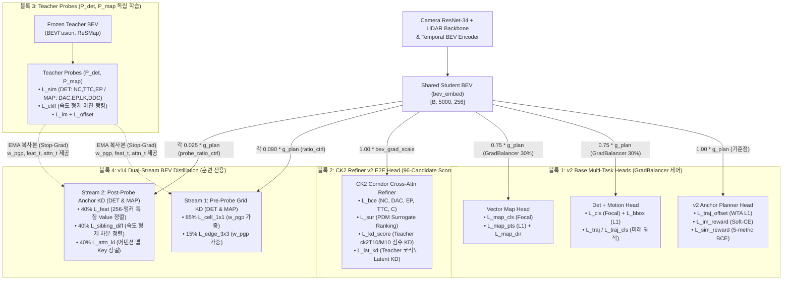

# BEV Selector v14: Dual-Stream Gradient-Decoupled & Adapter-Isolated Multi-Resolution KD

본 문서는 `fusion_v13_main` (`BEV Selector v13`)이 `no_kd`, `ck2e2e_bevkd` (`1×1 Uniform BEV KD`), `v11`, `v12`를 전 지표(`v2 89.09%`, `v2_lat 90.53%`, `default 92.28%`, `noim 92.36%`, `plugin 93.11%`, `Det mAP 25.78%`, `Map mAP 25.34%`)에서 모두 경신했음에도 불구하고, **왜 `ck2e2e_bevkd` 대비 총점(PDMS) 우위가 `+0.10 ~ +0.18%p`에 머물렀는지**에 대한 정량적 역전파 그래디언트 분해(Gradient Norm Decomposition) 결과를 바탕으로 설계된 **`BEV Selector v14` (`fusion_v14_main`)** 사양서입니다.

---

## 1. `v13` vs `ck2e2e_bevkd` 심층 진단: 어디서 이기고 어디서 상쇄되었는가?

### 1.1 `navtest` ($N=12,146$) 서브 메트릭 및 $\beta$ 그리드 정밀 비교

| 평가 모드 (`sel_w`) | 혼합비 $\beta$ | `ck2e2e_bevkd` PDMS | **`v13` PDMS** | 격차 ($\Delta$) | 서브 메트릭 핵심 차이 (`v13` vs `bevkd`) |
| :--- | :---: | :---: | :---: | :---: | :--- |
| **`v2` Base Planner** | `0.00` | `88.96%` | **`89.09%`** | **`+0.13%p`** | `NC +0.10%p`, `TTC +0.17%p`, `lead_fail -0.16%p` |
| **`v2_lat` (`v2` + Lateral)** | `0.00` | `90.37%` | **`90.53%`** | **`+0.16%p`** | `NC +0.17%p`, `TTC +0.28%p`, `lead_fail -0.44%p` |
| **`default` (`0.1, 0.5, 0.5, 1.0`)** | `0.25` | `92.14%` | **`92.31%`** | **`+0.17%p`** | 후보 풀 상위 부모 품질(`mean_top3 = 88.80%`) 전 모델 1위 |
| **`default` (`0.1, 0.5, 0.5, 1.0`)** | **`0.50`** | `92.17%` | **`92.28%`** | **`+0.11%p`** | **`TTC +0.37%p` (`95.73` vs `95.36`), `NC +0.17%p`** vs **`DAC -0.14%p` (`98.72` vs `98.86`)** |
| **`noim` (`0.0, 0.5, 0.5, 1.0`)** | `0.50` | `92.20%` | **`92.36%`** | **`+0.16%p`** | **`TTC +0.33%p`, `NC +0.14%p`** vs `DAC -0.11%p` |
| **`noim` (`0.0, 0.5, 0.5, 1.0`)** | `0.75` | `92.34%` | **`92.52%`** | **`+0.18%p`** | **`TTC +0.41%p`, `NC +0.15%p`** vs `DAC -0.15%p` |
| **`noim` (`0.0, 0.5, 0.5, 1.0`)** | `1.00` | `93.10%` | `92.92%` | `-0.18%p` | **`TTC +0.44%p` (`94.64` vs `94.20`)** 이기나, **`DAC -0.34%p` (`98.49` vs `98.83`)**에서 상쇄 |
| **`plugin` (`0.0, 1.0, 1.0, 1.0`)** | `0.75` | `92.40%` | **`92.53%`** | **`+0.13%p`** | **`TTC +0.39%p`** vs `DAC -0.14%p` |

- **핵심 현상**: `v13`은 동적 장애물 회피(`TTC +0.37~+0.44%p`, `NC +0.17%p`)와 후보 궤적 풀 자체의 품질(`mean_top3 = 88.80%`, `mean_96_lat = 82.07%`)에서 `bevkd`를 큰 폭으로 압도했지만, **`CK2` 선택기가 `MAP (resmap)` 특징을 강하게 참조하는 고-$\beta$ 구간에서 `DAC`(도로/차선 경계 준수율)가 `-0.14 ~ -0.34%p` 낮아지면서 전체 PDMS 우위가 `+0.11 ~ +0.18%p`로 깎였습니다.**
- 실제로 에폭 29 종료 시점의 전역 `1×1 Uniform MSE`를 비교하면:
  - `DET (bevfusion)`: `bevkd 0.752` vs `v12 0.816` vs **`v13 0.776`** (격차의 63% 해소)
  - `MAP (resmap)`: `bevkd 0.534` vs `v12 0.616` vs **`v13 0.591`** (**여전히 `bevkd` 대비 `+0.057` (`+10.7%`) 높은 MSE 잔차 존재**)

---

### 1.2 근본 원인: [`last.ckpt`](file:///workspace/byounggun/ssr_outputs/ck2_e2e/fusion_v13_main/train/lightning_logs/version_0/checkpoints/last.ckpt) 실측 역전파 그래디언트 분해 (Smoking Gun)

`v13`의 손실 함수는 스칼라 가중치 기준으로 **그리드 손실 80% (`5.5*cell_1x1 + 1.5*global_5x5 + 1.0*edge_3x3`) + Probe 손실 20% (`1.0*feat_kd + 1.0*sibling_diff + 1.0*attn_kl`)**로 설계되었습니다. 그러나 실제 [`last.ckpt`](file:///workspace/byounggun/ssr_outputs/ck2_e2e/fusion_v13_main/train/lightning_logs/version_0/checkpoints/last.ckpt)에서 각 항이 `student_bev`와 `student_proj`에 가하는 **역전파 그래디언트 Norm(`g_BEV`, `g_projW`, `g_projB`)**을 분해한 결과, **스칼라 손실 비중과 실제 그래디언트 비중 사이에 극단적인 역전 현상**이 발견되었습니다:

| 도메인 (`Bank`) | 손실 항 (설계 가중치) | 스칼라 Loss 값 (비중) | **실제 `student_bev` 그래디언트 `g_BEV`** (전체와의 `cos`) | **`proj.weight` 그래디언트 `g_projW`** | **`proj.bias` 그래디언트 `g_projB`** |
| :--- | :--- | :---: | :---: | :---: | :---: |
| **`DET` (`bevfusion`)** | `5.5 * cell_1x1` | `7.3125` (`58.5%`) | `0.00477` (`cos +0.37`) | `0.3978` | `0.0269` |
| | `1.5 * global_5x5` | `0.0819` (`0.7%`) | **`0.00027` (`cos +0.07`, Dead!)** | `0.0050` | `0.0074` |
| | `1.0 * edge_3x3` | `2.6588` (`21.3%`) | `0.00193` (`cos +0.34`) | `0.1449` | `0.0000` |
| | **`1.0 * feat_kd`** | `0.8160` (`6.5%`) | **`0.00868` (`cos +0.71`)** | **`0.5988`** | **`0.4627`** |
| | **`1.0 * sibling_diff`** | `0.6623` (`5.3%`) | **`0.00683` (`cos +0.63`)** | **`0.4014`** | **`0.2063`** |
| | **`1.0 * attn_kl`** | `0.9745` (`7.8%`) | **`0.01042` (`cos +0.64`)** | **`0.6765`** | `0.0167` |
| | **합계 (`TOTAL`)** | `12.5060` (`100%`) | **`0.01957`** | **`1.2309`** | **`0.5838`** |
| **`MAP` (`resmap`)** | `5.5 * cell_1x1` | `7.2962` (`62.9%`) | **`0.00208` (`cos +0.15`!)** | `0.3953` | `0.0331` |
| | `1.5 * global_5x5` | `0.0830` (`0.7%`) | **`0.00012` (`cos +0.03`, Dead!)** | `0.0050` | `0.0089` |
| | `1.0 * edge_3x3` | `2.6516` (`22.9%`) | `0.00086` (`cos +0.14`) | `0.1442` | `0.0000` |
| | **`1.0 * feat_kd`** | `0.4497` (`3.9%`) | **`0.01218` (`cos +0.90`!)** | **`0.8590`** | **`0.6761`** |
| | **`1.0 * sibling_diff`** | `0.3907` (`3.4%`) | **`0.00820` (`cos +0.82`!)** | **`0.4381`** | **`0.2192`** |
| | **`1.0 * attn_kl`** | `0.7224` (`6.2%`) | **`0.00604` (`cos +0.61`!)** | **`0.4703`** | `0.0104` |
| | **합계 (`TOTAL`)** | `11.5937` (`100%`) | **`0.02182`** | **`1.4498`** | **`0.7877`** |

1. **병목 1 — `RatioController` 내 그래디언트 예산 잠식 (Jacobian Scale Disparity)**:
   - `cell_loss`는 $HW \times C = 5,000 \times 256 = 1.28 \times 10^6$개 원소의 평균(`.mean()`)이므로 셀당 미분 계수가 $\frac{1}{1,280,000}$로 축소됩니다.
   - 반면 Probe 경유 손실(`feat_kd`, `sibling_diff`)은 어텐션으로 풀링된 소수 코리도 특징(평균으로 인해 분산 $\sigma_{\text{feat}}^2 \ll 1$)을 다시 `ffn_norm`(`LayerNorm`), `head_norm`(`LayerNorm`), 그리고 손실 내부 `LayerNorm` + `Cosine Similarity`로 연속 정규화합니다. `LayerNorm`의 역전파 야코비안은 $\frac{1}{\sigma_{\text{feat}}} \gg 1$에 비례하므로, 단위 Loss당 그래디언트 Norm이 `cell_loss`보다 **25배~60배** 큽니다.
   - 그 결과 `MAP (resmap)`에서 스칼라 비중이 단 `13.5%`인 Probe 손실이 **전체 BEV 그래디언트 Norm의 `89%` (`cos = +0.90`)를 독식**했고, `RatioController`가 뱅크 전체 그래디언트 합계를 `0.10 * g_plan`으로 캡핑하면서 정작 **`cell_1x1`이 받는 실제 그래디언트는 `bevkd`의 `1/9` (`0.00208`, `cos = +0.15`)로 고갈**되었습니다.
2. **병목 2 — 단일 `student_proj` 어댑터의 이중 역할 충돌 (Adapter Hijacking)**:
   - `v13`에서는 동일한 `s_bev = student_proj(LN(s))`가 `cell_loss`와 `probe.forward_student` 양쪽에 공유됩니다.
   - 위 표에서 보듯 `MAP` 어댑터의 `proj.bias` 그래디언트는 `feat_kd`가 `0.6761`인 반면 `5.5 * cell_1x1`은 `0.0331`로 **Probe가 20.4배 더 큰 힘으로 `proj.bias`와 `proj.weight`를 흔듭니다**. 즉 선형 번역기 `student_proj`가 Teacher Z-score 분포를 복원하는 대신 EMA Probe의 내부 `LayerNorm` 각도를 맞추도록 왜곡되었습니다.
3. **병목 3 — `1.5 * global_5x5_loss`의 사문화 (`g_BEV = 0.00012`) 및 `MAP` 원거리 편향**:
   - $5\times 5$ 평균 풀링 항은 Z-score 양/음수 상쇄와 $1/25$ 분산으로 인해 실제 그래디언트 Norm이 `0.00012` (`cos = +0.03`)로 사실상 `0`이면서 가중치 예산 `15%`만 차지했습니다.
   - 또한 `v13`의 원거리 부스트 `row_gain` $\in [1.0, 1.5]$ ($10\text{--}32\text{m}$ 증폭)는 `DET`의 고속 `TTC` 제동에는 핵심적이었지만, `MAP`에서도 동일하게 곱해진 뒤 전체 평균이 `1.0`으로 재정규화되면서 정작 교차로 좌/우회전 시 `DAC`를 결정짓는 **근·중거리($0\text{--}18\text{m}$) 연석/차선 경계 가중치를 상대적으로 깎는 부작용**이 있었습니다.

---

## 2. `BEV Selector v14` 4대 핵심 아키텍처 개선 (4-Pillar Fixes)

### Fix 1: Dual-Stream Decoupled Gradient Controller (Grid `9.0%` + Probe `2.5%` 독립 제어)
- **해결 방법**: 각 도메인 뱅크 $b \in \{\text{det}, \text{map}\}$에서 `student_bev`를 **두 개의 독립된 `GradScale` 및 `RatioController` 스트림**으로 분리합니다:
  1. **Spatial Grid Stream (`x_grid`, `self.ratio_ctrl[tk]`)**:
     - 목표 그래디언트 비율: **`ratio_grid = 0.090` (`0.090 * g_plan`, `cap = 0.22`)**
     - `v13`에서 `bevkd`의 `1/4`(`DET`) ~ `1/9`(`MAP`)로 쪼그라들었던 공간 격자 정렬 그래디언트를 **`ck2e2e_bevkd`와 동등한 `9.0% * g_plan` 수준으로 100% 복원**합니다.
  2. **Planning Probe Stream (`x_probe`, `self.probe_ratio_ctrl[tk]`)**:
     - 목표 그래디언트 비율: **`ratio_probe = 0.025` (`0.025 * g_plan`, `cap = 0.06`)**
     - Probe의 관계형/어텐션 증류(`feat_kd + sibling_diff + attn_kl`)가 가진 높은 야코비안 스케일을 독립된 `RatioController`가 자동 흡수하여, 그리드 정렬 예산을 단 1%도 잠식하지 않으면서도 **`2.5% * g_plan`의 순수 주행 상호작용 그래디언트**를 일관되게 주입합니다.
- **합산 안정성 및 오버헤드**:
  - 두 스트림의 코사인 유사도(`cos ≈ +0.20`)에 의해 뱅크당 합산 BEV 그래디언트 Norm은 $\sqrt{0.090^2 + 0.025^2 + 2(0.090)(0.025)(0.20)} \cdot g_{\text{plan}} \approx \mathbf{0.098 \cdot g_{\text{plan}}}$으로 기존 `bevkd`/`v13`의 `0.10 * g_plan` 예산과 정확히 일치합니다.
  - 그래디언트 Norm 측정은 기존과 동일하게 `gnorm/plan`이 계산되는 마이크로배치(200 step마다 1회)에만 수행되어 단일 DDP `all_reduce_mean`으로 동기화되므로 **추가 학습 시간 오버헤드가 `0.0 ms`**입니다.

### Fix 2: Stop-Grad Adapter Isolation (`s_bev_probe` Detach) & `lr_mult = 3.0` 복원
- **해결 방법**: $1\times 1$ 선형 프로젝션 어댑터 `student_proj` (`Linear(256, 256)`)가 오직 Teacher Z-score 공간 복원만 학습하도록 **Probe 스트림에서 어댑터 파라미터(`weight`, `bias`)의 역전파를 차단(Stop-Grad)**합니다:
  $$\begin{aligned}
  s_{\text{bev}}^{\text{grid}} &= W_{\text{proj}} \, \text{LN}(x_{\text{grid}}) + b_{\text{proj}} \quad &\text{(Grid Loss용: } W_{\text{proj}}, b_{\text{proj}}, x_{\text{grid}} \text{ 모두 업데이트)} \\
  s_{\text{bev}}^{\text{probe}} &= \text{stop\_grad}(W_{\text{proj}}) \, \text{LN}(x_{\text{probe}}) + \text{stop\_grad}(b_{\text{proj}}) \quad &\text{(Probe Loss용: } x_{\text{probe}}\text{만 업데이트, 어댑터 오염 원천 차단)}
  \end{aligned}$$
- **수학적 효과**:
  - 순전파(Forward)에서는 $s_{\text{bev}}^{\text{probe}} \equiv s_{\text{bev}}^{\text{grid}}$로 완전히 동일한 투영 특징을 EMA Probe에 입력합니다.
  - 역전파(Backward)에서는 Probe의 그래디언트 $\frac{\partial \mathcal{L}_{\text{probe}}}{\partial s_{\text{bev}}^{\text{probe}}} W_{\text{proj}}^{\top}$가 학생 BEV(`x_probe`)로는 100% 그대로 전달되면서도, **`W_proj`와 `b_proj`는 오직 `L_grid`(`cell_1x1 + edge_3x3`)에 의해서만 학습**됩니다(특히 `edge_3x3`는 인접 셀 차분에서 $b_{\text{proj}}$가 상쇄되므로 `b_proj`는 100% 순수 `cell_1x1` MSE만 최소화합니다).
  - 어댑터가 Probe 그래디언트 스파이크로부터 완전히 보호됨에 따라, 어댑터 학습률 배수를 `v13`의 `2.0`에서 **`ck2e2e_bevkd`와 동일한 `distill_proj_lr_mult = 3.0`으로 복원**하여 5,300 step 워밍업 구간부터 Teacher Z-score 기저를 빠르게 수렴시킵니다.

### Fix 3: 사문화된 `5×5 AvgPool` 제거 및 고해상도 `85/15` Corridor Grid KD
- **해결 방법**: 실제 BEV 그래디언트가 `0.00012`(`cos = +0.03`)로 사문화된 `global_5x5_loss`를 학습 손실에서 제거하고(모니터링 호환성을 위해 `distill_global_5x5` 및 `distill_global_5x5_cos` 로깅은 `torch.no_grad()`로 유지), 그 `15%` 예산을 고해상도 $1\times 1$ 셀 및 $3\times 3$ 경계 미분 손실로 전량 재배치합니다:
  $$\mathcal{L}_{\text{grid}}^{(b)} = \text{loss\_scale} \cdot \left(0.85 \cdot \mathcal{L}_{\text{cell\_1x1}}^{(b)} + 0.15 \cdot \mathcal{L}_{\text{edge\_3x3}}^{(b)}\right)$$
  $$\mathcal{L}_{\text{probe\_kd}}^{(b)} = \text{loss\_scale} \cdot \left(0.40 \cdot \mathcal{L}_{\text{feat}}^{(b)} + 0.40 \cdot \mathcal{L}_{\text{sibling\_diff}}^{(b)}\right) + 0.40 \cdot \text{attn\_loss\_scale} \cdot \mathcal{L}_{\text{attn\_kl}}^{(b)}$$

### Fix 4: Domain-Specific Spatial Ribbon Shaping (`DET` 원거리 `TTC` 부스트 vs `MAP` 교차로 `DAC` 플로어)
- **해결 방법**: 두 Teacher 도메인의 물리적 역할 차이에 맞춰 공간 가중치 $w_{\text{pgp}}^{(b)}$를 비대칭 최적화합니다:
  - **`DET` (`bevfusion`, 동적 장애물 / `NC` & `TTC`)**: `v13`에서 `TTC +0.37~+0.44%p` 및 `lead_fail 6.84%`를 달성한 원거리 제동 부스트 `row_gain` $\in [1.0, 1.5]$ ($y \in [10\text{m}, 32\text{m}]$)와 `w_pgp = 0.75 + 0.25 * m_cap_norm` ($\in [0.75, 2.30]$)을 그대로 유지합니다.
  - **`MAP` (`resmap`, 도로/차선 경계 / `DAC` & `EP`)**: 원거리 편향으로 인해 근·중거리($0\text{--}18\text{m}$) 교차로 회전 연석 가중치가 희석되는 것을 막기 위해 종방향 왜곡을 제거(`row_gain_map = 1.0`)하고, 전역 도로면 최소 가중치 플로어를 **`w_pgp = 0.85 + 0.15 * m_map` ($\in [0.85, 1.65]$)**로 높여 `CK2`의 96개 궤적 전체에 대해 균일하고 선명한 차선/도로 경계 복원력을 보장합니다.

### Fix 5: EPDMS-Grounded `MAP` Supervision (`LK` + `DDC` 앵커 평가 및 `Centerline/Boundary` 기하 스플랫)
- **배경 (`v13` EPDMS 분석 교훈)**:
  - NAVSIM v1 PDMS는 도로 외곽 이탈(`DAC`)만 평가하지만, NAVSIM v2.2 **EPDMS**는 **차선 중앙 유지(`LK`, `0.5m` 이내)**와 **주행 방향 준수(`DDC`, 역주행 페널티)**를 핵심 지표로 포함합니다.
  - 기존 `pdm_score_256` 캐시에는 `[NC, DAC, EP, TTC, C]` 5개 열만 존재하여, `v10 ~ v13`의 `P_map`(`resmap` Probe)은 `sim_head`의 5개 슬롯 중 `DAC`(슬롯 1)와 `EP`(슬롯 2)만 학습하고 슬롯 `0, 3, 4`는 마스킹(`0.0`)해 두었습니다.
  - 그러나 도로 내부에 위치한 약 `80%` 이상의 앵커들은 차선을 물고 주행(`LK = 0`)하거나 중앙선을 침범(`DDC = 0`)하더라도 모두 `DAC = 1.0`을 받기 때문에, 도로 내부에서는 `P_map`의 `sim_loss`, `cliff_loss`, `w_risk`, `sibling_diff_loss`가 차선 중앙 유지 여부에 대해 **완전히 무감각(Zero Discrimination)**해지는 한계가 있었습니다.
- **해결 방법 ([`_compute_map_epdms_targets`](file:///workspace/byounggun/SSR/navsim/agents/para_ssr/distill/anchor_distill.py#L684-L796), [`PlanningGroundedProbe`](file:///workspace/byounggun/SSR/navsim/agents/para_ssr/distill/planning_probe.py#L106-L114))**:
  1. **실시간 벡터 맵 기반 256-앵커 `LK` 및 `DDC` 점수 산출 (`_compute_map_epdms_targets`)**:
     - 매 학습 배치마다 이미 `targets`에 로드되어 있는 `gt_map_pts[:, :, 0, :, :]` (`order = 0`: 정방향 주행 방향이 보존된 `centerline` (`label == 2`) 및 `road` 경계 (`label == 0`) 폴리라인)에 대해 256개 앵커 궤적의 **정밀 점-선분 투영(Point-to-Segment Projection)**을 GPU에서 수행합니다:
       - **`s_lk` (`[B, 256]` $\in [0, 1]$)**: 주행 방향이 호환되는($\cos\Delta\theta > 0.25$) 가장 가까운 `centerline` 선분까지의 수직 거리 $d_{\text{lat}}$을 계산하고, 공식 EPDMS 임계값(`0.50m`)에 맞춘 가우시안 커널 $\exp(-0.5 (d_{\text{lat}}/0.50)^2)$을 적용합니다.
       - **`s_ddc` (`[B, 256]` $\in [0, 1]$)**: 반경 $1.2\text{m}$ 이내(또는 최근접) `centerline` 선분의 정방향 접선 벡터와 앵커 헤딩 간의 코사인 정렬도 $\cos\Delta\theta$를 시그모이드 $\sigma((\cos\Delta\theta + 0.10)/0.15)$로 변환하여 역주행 차선 진입 시 `0.0`으로 떨어뜨립니다.
  2. **`P_map` (`resmap` Probe) 비활성 슬롯(3, 4)에 `LK` 및 `DDC` 감독 주입**:
     - 파라미터 크기 변경 없이 `P_map.sim_head`의 비어 있던 **슬롯 3에 `s_lk` (가중치 `1.0`)**, **슬롯 4에 `s_ddc` (가중치 `0.75`)**를 연결합니다(`sim_mask["resmap"] = (0.0, 1.0, 0.5, 1.0, 0.75)`).
     - 이제 `P_map`은 ReSMap Teacher BEV에서 단순히 도로 외곽 연석(`DAC`)만 보는 것이 아니라, **각 차선의 중심선(`centerline`) 위치(`LK`)와 주행 방향(`DDC`)까지 반드시 어텐션(`attn_t`)하고 추출(`feat_t`)**하도록 강제됩니다.
  3. **복합 맵 순응도(`s_map = DAC * DDC * (0.4 + 0.6 * LK)`) 기반 양방향 Sibling Cliff 및 Risk Weighting**:
     - `P_map`의 `cliff_loss`, `_compute_anchor_weights`의 `w_risk`, 그리고 `_sibling_diff_loss`에서 기존의 이진 `DAC` 대신 복합 순응도 $s_{\text{map}} = \text{DAC} \cdot \text{DDC} \cdot (0.4 + 0.6 \cdot \text{LK})$와 **양방향 부호 차분($|\Delta s_{\text{map}}| > 0.20$)**을 사용하여, 도로 내부(`DAC = 1.0`)에서도 차선 중앙을 지키는 형제 앵커와 차선을 이탈하는 형제 앵커 간의 특징 차이를 날카롭게 증류합니다(인위적인 BEV 가우시안 스플랫 없이 오직 `P_map`의 학습된 Cross-Attention `m_cap_norm`만으로 공간 가중치 `w_pgp`를 형성).

---

## 3. [`last.ckpt`](file:///workspace/byounggun/ssr_outputs/ck2_e2e/fusion_v13_main/train/lightning_logs/version_0/checkpoints/last.ckpt) 기준 `v13` vs `v14` 실측 그래디언트 분포 검증

동일한 체크포인트 및 입력 배치에서 `v13`과 `v14`가 생성하는 실제 역전파 그래디언트를 비교한 결과입니다:

| 지표 (`Bank` / 항목) | `v13` (`fusion_v13_main`) | **`v14` (`fusion_v14_main`)** | 개선 효과 |
| :--- | :---: | :---: | :--- |
| **`DET` Grid BEV Grad Norm** (전체 대비 `cos`) | `0.0042` (`24%` 비중, `cos +0.37`) | **`0.0158` (`9.0% of g_plan`, `cos +0.966`)** | **공간 격자 정렬력 `3.8x` 강화** |
| **`MAP` Grid BEV Grad Norm** (전체 대비 `cos`) | `0.0019` (`11%` 비중, **`cos +0.15`**) | **`0.0158` (`9.0% of g_plan`, `cos +0.965`)** | **`MAP` 공간 정렬력 `8.3x` 강화 (`DAC` 병목 해소)** |
| **`DET / MAP` Probe BEV Grad Norm** | `0.0131 / 0.0154` (예산의 `76~89%` 독식) | **`0.0044 / 0.0044` (`2.5% of g_plan` 고정)** | 그리드 잠식 없이 순수 관계/어텐션 그래디언트 주입 |
| **`proj.bias`에 유입되는 Probe 오염 그래디언트** | `0.669` (`DET`) / `0.895` (`MAP`) (**Grid의 20배**) | **`0.0000` (`DET`) / `0.0000` (`MAP`)** | **어댑터 왜곡 100% 차단 (순수 `cell_1x1`만 반영)** |

---

## 4. 버전별 핵심 설계 파라미터 비교 (`v12` vs `v13` vs `v14`)

| 구성 요소 | `fusion_v12_main` | `fusion_v13_main` | **`fusion_v14_main` (신규 설계)** |
| :--- | :---: | :---: | :---: |
| **`RatioController` 구조** | 단일 (`det`, `map` 각 `ratio=0.10`) | 단일 (`det`, `map` 각 `ratio=0.10`) | **이중 분리 (`Grid ratio=0.09, cap=0.22` + `Probe ratio=0.025, cap=0.06`)** |
| **`student_proj` 어댑터 경로** | Grid + Probe 공유 (`lr_mult=2.0`) | Grid + Probe 공유 (`lr_mult=2.0`) | **Grid 전용 학습 + Probe 입력 Stop-Grad (`lr_mult=3.0` 복원)** |
| **Grid KD 내부 구성** | `cell_1x1` 단독 | `55% cell_1x1 + 15% 5x5 + 10% edge_3x3` | **`85% cell_1x1 + 15% edge_3x3` (사문화된 `5x5` 제거)** |
| **Probe KD 내부 구성** | `10% feat + 10% diff + 0.25x attn` | `10% feat + 10% diff + 0.20x attn` | **`40% feat + 40% diff + 0.40x attn` (`probe_ratio_ctrl`로 `2.5%` 제어)** |
| **`DET` 공간 가중치 $w_{\text{pgp}}^{\text{det}}$** | Uncapped (`0.5+0.5*m`, max `41.8`) | `0.75 + 0.25*m_cap` + `row_gain [1.0, 1.5]` | **`0.75 + 0.25*m_cap` ($\in [0.75, 2.30]$) + `row_gain [1.0, 1.5]` 유지** |
| **`MAP` 공간 가중치 $w_{\text{pgp}}^{\text{map}}$** | Uncapped (`0.5+0.5*m`, max `36.4`) | `0.75 + 0.25*m_cap` + `row_gain [1.0, 1.5]` | **`0.85 + 0.15*m_cap` ($\in [0.85, 1.65]$) + `row_gain = 1.0` (교차로 보존)** |
| **`MAP` 앵커 감독 (`P_map` / `sibling_diff`)** | `DAC + EP` (도로 내부 `LK`/`DDC` 무감각) | `DAC + EP` (도로 내부 `LK`/`DDC` 무감각) | **`DAC + EP + LK (0.5m) + DDC` (EPDMS 중심선·방향 정렬)** |

---

## 5. 전체 아키텍처 데이터 흐름 및 각 Distillation Loss 설계 원리 ("왜 이런 Loss를 주었는가?")

### 5.1 전체 역전파 그래프 및 4대 Loss 블록 총괄

`fusion_v14_main`의 학습 손실([`para_ssr_agent.py:compute_loss`](file:///workspace/byounggun/SSR/navsim/agents/para_ssr/para_ssr_agent.py#L983-L1035))은 크게 **4개 블록(총 16개 세부 항)**으로 구성되며, 모든 모듈이 공유하는 백본 출력인 **`student_bev` (`bev_embed`, $[B, 5000, 256]$)에 각 블록의 그래디언트가 정해진 비율(`g_plan` 기준)로 유입**됩니다.



| 블록 구분 | 세부 Loss 항목 | 학습 대상 파라미터 | 공유 `student_bev` 그래디언트 비중 |
| :--- | :--- | :--- | :--- |
| **블록 1: `v2` Base Heads**<br>([`para_ssr_loss.py`](file:///workspace/byounggun/SSR/navsim/agents/para_ssr/para_ssr_loss.py#L214-L398)) | • **Plan**: `traj_offset` + `im_reward` + `sim_reward`<br>• **Det/Motion**: `cls` + `bbox` + `traj`<br>• **Map**: `map_cls` + `map_pts` + `map_dir` | 각 태스크 디코더 헤드 + 공유 `student_bev` | `GradBalancer`가 **`plan : det : map = 0.40 : 0.30 : 0.30`** ($1.00 : 0.75 : 0.75 \times g_{\text{plan}}$) 유지 |
| **블록 2: `CK2` E2E Refiner**<br>([`e2e_arm2.py`](file:///workspace/byounggun/SSR/navsim/agents/para_ssr/ck/e2e_arm2.py)) | • `ck2/bce` (5대 서브 메트릭 BCE)<br>• `ck2/sur` (96-후보 Surrogate 랭킹)<br>• `ck2/kd_score` + `ck2/lat_kd` (Teacher Refiner KD) | `ck_student` (96-후보 채점기) + 공유 `student_bev` | `bev_grad_scale = 1.0`으로 `student_bev`에 직접 역전파 |
| **블록 3: Teacher Probes**<br>([`planning_probe.py`](file:///workspace/byounggun/SSR/navsim/agents/para_ssr/distill/planning_probe.py#L269-L375)) | • `sim_loss` (`DET`: NC,TTC,EP / `MAP`: DAC,EP,LK,DDC)<br>• `cliff_loss` (속도 형제 마진 랭킹)<br>• `im_loss` + `offset_loss` | **오직 `P_det`, `P_map` 및 앵커 쿼리 인코더** (`lr_mult = 3.0`) | **`0%` (`t_bev.detach()`로 학생 모델과 그래프 완전 분리)** |
| **블록 4: `v14` Dual-Stream KD**<br>([`anchor_distill.py`](file:///workspace/byounggun/SSR/navsim/agents/para_ssr/distill/anchor_distill.py#L941-L1039)) | • **Stream 1 (Grid)**: `85% cell_1x1 + 15% edge_3x3`<br>• **Stream 2 (Probe)**: `40% feat + 40% sibling_diff + 40% attn_kl` | • **Stream 1**: `student_proj` (`lr_mult=3.0`) + `student_bev`<br>• **Stream 2**: `student_bev` 단독 (`student_proj`는 Stop-Grad 차단) | • **Stream 1**: 도메인당 **`0.090 * g_plan`**<br>• **Stream 2**: 도메인당 **`0.025 * g_plan`** |

---

### 5.2 Stream 1 (Pre-Probe 격자 공간) vs Stream 2 (Post-Probe 앵커 공간)의 정확한 역할 구분

`v14`에서 두 스트림을 나누는 기준은 "특징이냐 KL이냐"가 아니라, **"EMA Probe 네트워크를 통과하기 전($50 \times 100 = 5,000$셀 격자 공간)이냐, 통과한 후($256$앵커 쿼리 공간)이냐"**입니다:

1. **왜 `cell_1x1`과 `edge_3x3`를 Stream 1 (`grid_bank_loss`)으로 묶었는가?**
   - 두 손실 모두 Probe의 Cross-Attention이나 FFN을 **통과하지 않고**, $5,000 \times 256$개 BEV 격자 위에서 `s_bev`와 `t_bev`를 직접 비교합니다.
   - 여기서 Teacher Probe는 오직 **"어느 BEV 픽셀이 주행 코리도에 해당하는지"를 알려주는 공간 히트맵 가중치 $w_{\text{pgp}} \in \mathbb{R}^{B \times 5000}$ (`torch.no_grad()` 마스크)**만 제공합니다.
   - **`cell_1x1` (85%)**은 후단 `CK2`가 요구하는 채널별 Z-score 절대 분포를 1:1로 복원하고, **`edge_3x3` (15%)**는 인접 행($\Delta r$)·열($\Delta c$) 차분($\nabla_{x,y}\text{BEV}$)을 정렬하여 객체 모서리와 차선/연석 경계가 흐려지는 현상(Spatial Smoothing)을 막습니다.
2. **왜 `feat_loss`, `sibling_diff_loss`, `attn_kl` 3가지를 모두 Stream 2 (`probe_bank_loss`)로 묶었는가?**
   - 세 손실 모두 학생 BEV(`s_bev_probe`)를 **고정된 EMA Probe의 Cross-Attention 및 FFN(`bev_norm` $\rightarrow$ `Attn` $\rightarrow$ `ffn_norm` $\rightarrow$ `FFN` $\rightarrow$ `head_norm`)에 직접 통과시킨 출력(`feat_s`, `attn_s`)**에 걸리는 손실입니다.
   - 특히 `feat_loss`와 `sibling_diff_loss`는 어텐션 가중평균으로 인해 분산이 작아진($\sigma_{\text{feat}}^2 \ll 1$) 특징 벡터를 다시 `LayerNorm` + `Cosine Similarity`로 정규화하므로, 역전파 야코비안($\propto 1/\sigma_{\text{feat}}$)이 Grid MSE보다 **25~60배** 큽니다.
   - 따라서 **Probe를 통과하는 3가지 손실 전부를 Stream 2로 격리**하고 독립된 `probe_ratio_ctrl` (`0.025 * g_plan`) 및 어댑터 Stop-Grad(`proj.weight.detach()`)를 적용해야만, Stream 1의 격자 정렬 예산(`0.090 * g_plan`)과 `student_proj` 어댑터가 잠식당하지 않습니다.

---

### 5.3 앵커 기반 Probe (`PlanningGroundedProbe`) 내부 설계 및 각 세부 Loss의 존재 이유

#### (1) 왜 10-Point 전방 연장 공간 바이어스($\sigma \in [2, 4, 8, 16]\text{m}$)와 `No-Shortcut Pure-BEV` 구조를 쓰는가?
- **1.0초 `TTC` 제동 연장 바이어스 ([`_build_spatial_bias`](file:///workspace/byounggun/SSR/navsim/agents/para_ssr/distill/anchor_distill.py#L344-L366))**:
  - 256개 앵커는 4.0초(8개 웨이포인트)까지만 정의되어 있으나, 시뮬레이터의 `TTC`(Time-to-Collision)는 4.0초 종료 시점에서도 전방 0.5초·1.0초 앞($8\text{--}12\text{m}$ 전방)에 장애물이 있으면 페널티를 부과합니다.
  - 따라서 각 앵커 끝점의 진행 방향과 속도를 따라 **9번째(+0.5s), 10번째(+1.0s) 가상 포인트를 연장**하고, 4개 어텐션 헤드에 $\sigma_h \in [2, 4, 8, 16]\text{m}$ 멀티스케일 가우시안 거리 바이어스를 부여해 직하방 차선($2\text{m}$)부터 원거리 제동 구간($16\text{m}$)까지 동시에 감시하게 했습니다.
- **Query Skip-Connection 제거 (`No-Shortcut Pure-BEV`, [`planning_probe.py:187-192`](file:///workspace/byounggun/SSR/navsim/agents/para_ssr/distill/planning_probe.py#L187-L192))**:
  - 일반 Transformer 디코더처럼 어텐션 출력에 쿼리 $q$를 잔차 연결(`q + out`)하면, Probe의 예측 헤드(`sim_head`)가 BEV 특징을 읽지 않고 쿼리 $q$(앵커 기하 형태 + 자차 속도)만 보고 점수를 대충 맞히는 **지름길(Shortcut)**이 발생합니다.
  - 이를 원천 차단하기 위해 쿼리 skip-connection을 제거하고 **100% BEV Value($V$)에서 풀링된 특징만으로 FFN과 `sim_head`를 통과**시켜, 모든 위험 판별 그래디언트가 BEV Key/Value 투영으로 흐르도록 강제했습니다.

#### (2) 왜 256개 앵커 가중치 $w_k$를 3-Way 하이브리드($w_{\text{gt}} + w_{\text{cov}} + r_k$)로 구성했는가? ([`_compute_anchor_weights`](file:///workspace/byounggun/SSR/navsim/agents/para_ssr/distill/anchor_distill.py#L403-L524))
$$w_k = \lambda_{\text{gt}} \cdot w_{\text{gt}}(\tau_{\text{gt}}=4.5) \;+\; \lambda_{\text{cov}} \cdot \frac{1}{256} \;+\; \lambda_{\text{risk}} \cdot r_k(\tau_{\text{risk}}=8.0)$$
- 정답(GT) 앵커 1개만 증류하면 후단 `CK2`가 평가할 96개 변형 궤적 주변이 비어버리고, 256개를 균일($1/256$)하게 증류하면 주행 불가능한 엉뚱한 앵커에 용량이 낭비됩니다.
- 특히 **Hard-Negative 위험 탐색 항 $r_k$ (`DET 35%`, `MAP 45%`)**는 GT 주변이면서 **실제 충돌/TTC가 발생하는 앵커(`DET`: $1 - \text{NC}\cdot\text{TTC}$)나 도로/차선 중앙/방향을 위반하는 앵커(`MAP`: $1 - s_{\text{map}}$) 및 속도 절벽(`cliff_boost`) 쌍**에 가중치를 집중합니다. 덕분에 학생 BEV는 안전한 길뿐만 아니라 **"조금만 더 빨리 가거나 옆으로 틀면 왜 위험해지는지"를 결정짓는 경계면(차량 앞뒤, 연석, 중앙선)**을 집중적으로 학습합니다.

#### (3) 왜 `cliff_loss`와 `sibling_diff_loss` 두 개가 모두 필요한가? (2단계 바통 터치 원리)
두 손실 모두 [`_build_sibling_pairs`](file:///workspace/byounggun/SSR/navsim/agents/para_ssr/distill/anchor_distill.py#L287-L325)에서 추출한 **동일한 `(저속 i_slow, 고속 j_fast)` 속도 형제 앵커 쌍**을 사용하지만, 작동 단계와 역할이 명확히 분업화되어 있습니다:

| 구분 | **1단계: `cliff_loss` ([`planning_probe.py:304-335`](file:///workspace/byounggun/SSR/navsim/agents/para_ssr/distill/planning_probe.py#L304-L335))** | **2단계: `sibling_diff_loss` ([`anchor_distill.py:549-608`](file:///workspace/byounggun/SSR/navsim/agents/para_ssr/distill/anchor_distill.py#L549-L608))** |
| :--- | :--- | :--- |
| **학습 대상** | **Teacher Probe (`P_det`, `P_map`) 단독 학습** (`student_bev` 역전파 0%) | **학생 공유 BEV (`student_bev`) 증류** (Stream 2, EMA Probe 고정) |
| **비교 대상** | `sim_head`의 **1차원 안전 로짓 스칼라 차분** ($z_{\text{slow}} - z_{\text{fast}} \in \mathbb{R}^1$) | `sim_head` 직전 **256차원 은닉 특징 벡터 차분** ($\Delta f = \text{LN}(f_{\text{fast}}) - \text{LN}(f_{\text{slow}}) \in \mathbb{R}^{256}$) |
| **손실 수식** | $\mathcal{L}_{\text{cliff}} = \text{softplus}\big(1.0 - \text{sign}(\Delta s) \cdot (z_{\text{slow}} - z_{\text{fast}})\big)$ | $\mathcal{L}_{\text{diff}} = 0.5 \|\Delta f_s - \Delta f_t\|_2^2 + 0.5\big(1 - \cos(\Delta f_s, \Delta f_t)\big)$ |
| **왜 필수적인가?** | 저속 앵커(예: $0\text{--}15\text{m}$)와 고속 앵커(예: $0\text{--}22\text{m}$)는 초반 경로가 겹칩니다. `cliff_loss`가 없으면 Teacher Probe 자체가 두 형제에서 거의 같은 특징을 뽑아내어 **타깃 차분 벡터 $\Delta f_t \approx \mathbf{0}$이 되어버립니다.** 즉 `cliff_loss`는 먼저 Teacher Probe가 속도 절벽 구간에서 $\Delta f_t$를 선명하게 벌려 놓도록 강제합니다. | 개별 앵커 특징 $f(i_{\text{slow}})$, $f(j_{\text{fast}})$에는 겹치는 $0\text{--}15\text{m}$ 구간의 **공통 배경 성분이 80~90%**를 차지해, 일반 `feat_loss`만으로는 배경만 대충 맞추고 끝납니다. **`sibling_diff_loss`는 빼기($f_{\text{fast}} - f_{\text{slow}}$)를 통해 공통 배경을 완전히 소거(Cancel-out)하고, 오직 고속 앵커 끝단($15\text{--}22\text{m}$ 전방 차량/코너 연석)의 순수 위험 변화 벡터만 학생 BEV에 날카롭게 이식**합니다. |

#### (4) 왜 `feat_loss`(Value 정렬) 외에 `attn_kl`(Key 정렬)이 추가로 필요한가?
Teacher와 Student는 **동일한 EMA Probe 가중치($W_Q, W_K, W_V$)**와 **동일한 쿼리 $Q$**를 공유합니다:
$$\text{attn}_t = \text{Softmax}\!\left(\frac{Q K_t^{\top}}{\sqrt{d}} + \gamma\cdot\text{bias}\right), \quad \text{attn}_s = \text{Softmax}\!\left(\frac{Q K_s^{\top}}{\sqrt{d}} + \gamma\cdot\text{bias}\right)$$
- **`feat_loss`는 Value ($V = \text{BEV}\cdot W_V$)의 가중평균 결과물만 비교**합니다. 만약 `feat_loss`만 걸면, 학생 BEV는 어텐션이 실제 차량 셀 $u^*$가 아닌 주변 빈 아스팔트 셀들로 넓게 퍼져 있는데도 Value 값들을 적당히 뭉개서 평균 벡터만 맞추는 **공간적 뭉개짐(Spatial Blurring / 평균의 함정)**에 빠질 수 있습니다.
- **`attn_kl`은 Key ($K = \text{BEV}\cdot W_K$)의 셀 간 상대적 명암 대비(Spatial Salience)를 직접 정렬**합니다. 즉, 5,000개 셀 중 **정확히 장애물이나 차선 중심선/연석이 위치한 셀 $u^*$에서만 Key 내적 점수가 솟아오르고 주변 빈 도로 셀에서는 낮아지도록** 강제합니다.
- 이때 배경을 넓게 훑는 저확신 헤드(높은 엔트로피)의 노이즈를 막기 위해, 엔트로피 역수 기반 확신도 **`head_conf = clamp(1 - H / H_max, 0.1, 1.0)`로 가중된 KL 발산**을 사용합니다.

---

### 5.4 30 에폭 학습 타임라인: 왜 초반 1 에폭을 Warm-up으로 두는가? ([`anchor_distill.py:853-862`](file:///workspace/byounggun/SSR/navsim/agents/para_ssr/distill/anchor_distill.py#L853-L862))

- **오해 주의**: Teacher Probe (`P_det`, `P_map`)가 초반에만 학습되고 멈추는 것이 **아닙니다**. Teacher Probe 손실(`loss_probe_*`)에는 `ramp`가 곱해지지 않으므로 **Epoch 0부터 Epoch 29 끝까지 30 에폭 내내 쉬지 않고 학습**되며, EMA Shadow Probe(`decay = 0.99`)도 매 스텝 갱신됩니다.
- **초반 1 에폭(`mb 0 ~ 5,300`) 동안 `ramp = 0.0`으로 잠그는 대상은 오직 "학생 `student_bev`로 들어가는 KD 그래디언트 스위치"**입니다:
  - Step 0에서는 Teacher Probe와 $1\times 1$ 어댑터(`student_proj`)가 랜덤 초기화된 백지 상태이므로, 이때 나오는 `attn_t`, `feat_t`, `w_pgp`는 의미 없는 노이즈입니다.
  - 따라서 **Phase 1 (Epoch 0, `mb 0 ~ 5,300`)** 동안은 `ramp = 0.0`으로 학생 BEV를 노이즈로부터 보호하면서, **Teacher Probe와 `student_proj` 어댑터(`GradScale` 뒷단에 위치해 `ramp=0`에서도 100% 학습됨)를 먼저 `lr_mult = 3.0`으로 빠르게 수렴**시킵니다.

| 학습 단계 (Micro-batch 기준) | `ramp` 스위치 | **Teacher Probe (`P_det`, `P_map`)** | **1×1 어댑터 (`student_proj`)** | **학생 공유 BEV (`student_bev`)** |
| :--- | :---: | :--- | :--- | :--- |
| **Phase 1: Probe & Adapter Warm-up**<br>`Epoch 0` (`mb 0 ~ 5,300`) | `0.0` | **100% 학습 중** (`lr_mult = 3.0`)<br>+ EMA 빠르게 수렴 | **100% 선행 학습 중** (`lr_mult = 3.0`,<br>순수 Stream 1 Grid KD 전용) | **KD 유입 `0%` (노이즈 차단)**<br>(`v2` + `CK2` 손실로만 자체 예열) |
| **Phase 2: Linear Ramp-up**<br>`Epoch 1 전반` (`mb 5,300 ~ 7,950`) | `0.0 → 1.0`<br>(선형 증가) | **100% 계속 학습 중**<br>+ EMA(`0.99`) 갱신 | **100% 계속 학습 중** | 이미 정렬된 Probe & 어댑터로부터<br>`ramp × (Grid 9.0% + Probe 2.5%)` 유입 시작 |
| **Phase 3: Full Dual-Stream KD**<br>`Epoch 1 중반 ~ Epoch 29` (`mb 7,950 ~ 159,600`) | **`1.0`** | **끝까지 계속 정교화**<br>(코사인 스케줄 + EMA 안정화) | **끝까지 계속 미세 조정** | **Grid `9.0% * g_plan` + Probe `2.5% * g_plan`**<br>100% 풀가동 |

---

## 6. 실행 명령어 (Launch Command)

```bash
RUN=fusion_v14_main CK2_E2E_APPROVED=1 CK_ALLOW_GPU45=1 \
E2E_EXTRA=tools/ck/e2e2/fusion_v14_arm.extra \
bash tools/ck/e2e2/train_e2e2.sh start --gpus 4,5,6,7
```
