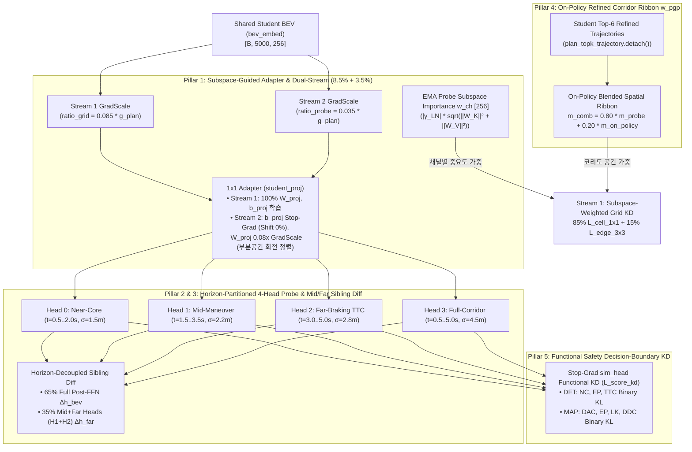

# BEV Selector v15: Subspace-Guided Adapter, Horizon-Partitioned Attention & On-Policy Functional Corridor KD

본 문서는 `fusion_v14_main` (`BEV Selector v14`)의 30 에폭 학습 로그([`wandb-summary.json`](file:///workspace/byounggun/ssr_outputs/ck2_e2e/fusion_v14_main/train/wandb/latest-run/files/wandb-summary.json), [`steps_rank0.jsonl`](file:///workspace/byounggun/ssr_outputs/ck2_e2e/fusion_v14_main/ck_e2e2/steps_rank0.jsonl))와 후반 10개 에폭(`Epoch 20 ~ 29`) `navtest` ($N=12,146$) 전수 평가 결과를 정밀 대조하여, **`v14`가 어디서 크게 성공했고 왜 Stream 2 (Probe KD) 정렬도가 하락했는지**를 규명하고 이를 해결하기 위해 설계된 **`BEV Selector v15` (`fusion_v15_main`)** 아키텍처 사양서입니다.

---

## 1. `v14` 결과 및 학습 텔레메트리 심층 진단: 무엇이 해결되었고 무엇이 남았는가?

### 1.1 `v13` vs `v14` 멀티 에폭 `navtest` ($N=12,146$) 성능 성과 요약

| 평가 모드 (`navtest`, $N=12,146$) | `ck2e2e_bevkd` | `v13` (`last` / 최고) | **`v14` (`last` / 최고)** | `v14` 핵심 성과 및 남은 과제 |
| :--- | :---: | :---: | :---: | :--- |
| **`v2` Base Planner** | `88.96%` | `89.09%` / `89.11%` | **`89.10%` / `89.40%`** (`Ep 24`) | `lead_fail` `7.61% → 6.89%` (`Ep 24: 6.78%`) 대폭 개선 |
| **`v2_lat` (`v2` + CK2 측방 보정)** | `90.35%` | `90.53%` / `90.53%` | **`90.49%` / `90.70%`** (`Ep 24`) | 최고점 `+0.17%p` 경신 |
| **★ `default` ($\beta=0.5$)** | `92.18%` | `92.28%` / `92.41%` | **`92.35%` / `92.46%`** (`Ep 25`) | `last` `+0.07%p`, 최고점 `+0.05%p` (`bevkd` 대비 **`+0.28%p`**) |
| **`default` ($\beta=1.0$)** | `92.17%` | `92.23%` / `92.33%` | **`92.34%` / `92.43%`** (`Ep 25`) | `last` `+0.11%p`, 최고점 `+0.10%p` |
| **`noim` ($\beta=0.5$)** | `92.20%` | `92.36%` / `92.44%` | **`92.43%` / `92.53%`** (`Ep 25`) | `last` `+0.07%p`, 최고점 `+0.09%p` |
| **★ `noim` ($\beta=1.0$)** | `93.10%` | `92.92%` / `93.11%` | **`93.17%` / `93.35%`** (`Ep 22`) | **`v13`의 유일한 약점(`last 92.92%`) 완벽 해결 (`+0.25%p`, 최고 `+0.24%p`)** |
| **`plugin` ($\beta=0.5$)** | `92.29%` | `92.37%` / `92.50%` | **`92.55%` / `92.55%`** (`Ep 23,29`) | `last` **`+0.18%p`**, `bevkd` 대비 **`+0.26%p`** |
| **★ `plugin` ($\beta=1.0$)** | `92.98%` | `93.11%` / `93.19%` | **`93.31%` / `93.45%`** (`Ep 22`) | `last` **`+0.20%p`**, 최고점 **`93.45%`** 달성 |

---

### 1.2 `v13` vs `v14` 학습 텔레메트리(`Epoch 29` W&B Summary) 정밀 비교: 숨겨진 병목 발견

`v14`에서 도입한 **Dual-Stream Gradient Controller (Grid `9.0%` + Probe `2.5%`)**와 **Adapter Stop-Grad (`proj.weight.detach()`)**가 실제 학습 과정에서 두 스트림에 미친 영향을 [`wandb-summary.json`](file:///workspace/byounggun/ssr_outputs/ck2_e2e/fusion_v14_main/train/wandb/latest-run/files/wandb-summary.json)으로 비교하면 극명한 대비가 나타납니다:

| 스트림 구분 | 학습 로그 지표 (`Epoch 29` 평균) | `fusion_v13_main` | **`fusion_v14_main`** | 정량적 변화 및 원인 진단 |
| :--- | :--- | :---: | :---: | :--- |
| **Stream 1**<br>(Grid KD:<br>`cell_1x1` + `edge_3x3`) | `distill_uniform_mse/resmap` | `0.59098` | **`0.56127`** | **`-5.0%` 오차 감소** (`bevkd 0.534`와의 잔차 절반 이상 해소 $\rightarrow$ 고-$\beta$ `DAC` 급등) |
| | `distill_cell_mse/resmap` | `0.60643` | **`0.57320`** | **`-5.5%` 오차 감소** (코리도 가중 $1\times 1$ 셀 복원력 대폭 향상) |
| | `distill_edge_3x3/resmap` | `0.24251` | **`0.22622`** | **`-6.7%` 오차 감소** (차선/연석 경계 1차 공간 미분 $\nabla_{x,y}$ 선명도 향상) |
| | `distill_global_5x5_cos/resmap` | `0.72822` | **`0.74525`** | **`+0.0170` 상승** (`CK2` `M3b` 전역 토큰 코사인 정렬도 개선) |
| | `distill_uniform_mse/bevfusion` | `0.77619` | **`0.77177`** | `DET` 전역 격자 오차 감소 (`cell_mse`: `0.9562 → 0.9473`) |
| **Stream 2**<br>(Probe KD:<br>`feat` + `diff` + `attn_kl`) | **`distill_cos/bevfusion` (`feat_loss`)** | `0.85343` | **`0.65700`** | **`-0.1964` 급락!** (`MAP`도 `0.9299 → 0.8758`로 `-0.0541` 하락) |
| | **`distill_winner_cos/bevfusion`** | `0.85982` | **`0.66943`** | **`-0.1904` 급락!** (GT 최근접 승자 앵커의 특징 방향 정렬도 저하) |
| | **`distill_sibling_cos/bevfusion`** | `0.76841` | **`0.58091`** | **`-0.1875` 급락!** (`sibling_diff` 손실 잔차 `0.1696 → 0.3131`로 `1.85x` 증가) |
| | **`loss_attn_bevfusion / resmap`** | `2.220` / `2.681` | **`3.457` / `3.788`** | 어텐션 KL 발산 잔차 **`+55.7%` / `+41.3%` 증가** |
| | **`probe/student_gap/bevfusion & resmap`** | `0.0681` / `0.0365` | **`0.1058` / `0.0524`** | Teacher Probe vs Student Probe 안전 확률 예측 괴리 **`1.55x` 증가** |
| **어텐션 집중도** | **`probe/head_entropy/bevfusion & resmap`** | `6.616` / `6.775` | **`6.615` / `6.668`** | 유효 어텐션 범위 $\exp(6.62) \approx \mathbf{745\text{개 셀}}$ (5,000셀 중 15%로 과도하게 넓음) |

### 1.3 `v14` 로그에서 규명된 5가지 구조적 병목

1. **병목 1 — `student_proj`의 등방성(Isotropic) L2 맹점과 과도한 Stop-Grad 차단 (`distill_cos: 0.853 → 0.657`)**:
   - `v14`는 `student_proj` 어댑터(`Linear(256, 256)`)에서 Probe 그래디언트를 100% 끊고(`proj.weight.detach()`), 오직 등방성 L2 손실인 `cell_1x1` (`(s_bev - t_bev)^2.mean(dim=-1)`)로만 어댑터를 학습시켰습니다.
   - 그러나 256개 Teacher BEV 채널 중 실제 충돌(`NC/TTC`)과 도로/차선(`DAC/LK/DDC`) 판별에 쓰이는 핵심 특징은 Teacher Probe의 투영 행렬 **$W_K, W_V \in \mathbb{R}^{256 \times 256}$이 바라보는 특정 부분공간(Subspace)**에 집중되어 있습니다. 등방성 `cell_1x1`은 256개 모든 채널 방향에 똑같은 가중치($1/256$)를 부여하므로, 어댑터가 배경 분산이 큰 채널을 맞추는 데 용량을 소모하고 정작 Probe의 $W_K, W_V$ 부분공간 회전각을 정렬하지 못했습니다.
   - 게다가 `probe_ratio_ctrl`이 `0.025 * g_plan`(`lam_probe_det = 0.0446`)으로 강하게 억제되면서, `student_bev` 백본 혼자서 고정된 어댑터를 뚫고 256차원 특징 방향을 회전시키지 못해 `distill_cos`가 `0.657`에서 멈추었습니다.
2. **병목 2 — 4초(10-Point) 통짜 앵커 프로빙의 시간축 평균 희석 (Temporal Averaging Dilution)**:
   - 현재 `_build_spatial_bias`는 10개 웨이포인트($t = 0.5\text{s} \dots 5.0\text{s}$) 전체에 대해 단일 최소 거리(`min_dist = dists.min(dim=1)`)로 튜브를 만들고 4개 헤드 모두가 튜브 전체를 한꺼번에 어텐션 평균(`attn @ V`)냅니다.
   - 모든 256개 앵커는 자차 후륜 $(0, 0)$에서 출발하므로 **근거리($0\text{--}8\text{m}$, $t=0.5\text{--}1.5\text{s}$) 구간이 심하게 겹치며 센서 특징 에너지도 가장 강합니다.** 그 결과 어텐션 가중합에서 근거리 특징이 원거리($15\text{--}32\text{m}$, $t=3.0\text{--}5.0\text{s}$) 특징을 덮어버려, 속도 형제(`i_slow` vs `j_fast`)가 실제로 갈라지는 전방 제동 구간의 장애물/커브 신호가 희석됩니다.
3. **병목 3 — 과도하게 넓은 공간 시그마 `(2.0, 4.0, 8.0, 16.0)m`로 인한 어텐션 엔트로피 고착 (`H = 6.62`, $\sim 745$셀)**:
   - `CK2`가 실제로 읽는 코리도 폭은 좌우 `±4.8m`([`corridor.py:52`](file:///workspace/byounggun/SSR/navsim/agents/para_ssr/refiner/corridor.py#L52))인데, Probe의 Head 2 ($\sigma=8\text{m}$)와 Head 3 ($\sigma=16\text{m}$)는 반경 $16\text{--}32\text{m}$의 코리도 외부 배경까지 수천 개 셀에 어텐션을 분산시켜 `attn_kl`과 `w_pgp`의 공간 해상도를 떨어뜨렸습니다.
4. **병목 4 — 정적 K-Means 256-앵커와 학생의 실제 추론 코리도(`plan_topk_trajectory`) 간 괴리**:
   - 추론 시 `v2`는 `anchor + offset`으로 보정된 궤적을 출력하고 `CK2`는 상위 6개 부모(`plan_topk_trajectory`)로부터 생성된 96개 후보의 코리도를 샘플링합니다. 고정 256-앵커만 프로빙하면 실제 커브길이나 장애물 회피 시 학생이 주행하려는 온-폴리시(On-Policy) 코리도와 $1\text{--}2\text{m}$의 오차가 발생합니다.
5. **병목 5 — `LayerNorm` 특징 정렬 이후의 안전 결정 경계(`sim_head` Logit) 괴리 (`student_gap: 0.068 → 0.106`)**:
   - `feat_loss`는 `LayerNorm` 정규화된 256차원 벡터의 코사인/L2 거리만 맞출 뿐, 그 특징이 `sim_head`의 결정 경계(Decision Boundary)를 통과했을 때 동일한 안전 확률(`NC, TTC, DAC, LK, DDC`)을 내도록 직접 강제하지 못했습니다.

---

## 2. `BEV Selector v15` 5대 핵심 아키텍처 혁신 (5-Pillar Upgrades)



---

### Pillar 1: Subspace-Guided Adapter Alignment (`w_ch` 채널 중요도 가중 + `proj.weight` `0.08x` 회전 결합)

1. **EMA Probe 기반 채널 중요도 가중치 $w_{\text{ch}}^{(b)} \in \mathbb{R}^{1 \times 1 \times 256}$ 도입**:
   - Teacher EMA Probe의 `bev_norm.weight` ($\gamma_{\text{LN}}$), `k_proj.weight` ($W_K$), `v_proj.weight` ($W_V$)를 통해 256개 Teacher Z-score 채널 중 **실제 주행 안전 판별에 사용되는 부분공간 에너지**를 정량화합니다:
     $$e_c^{(b)} = |\gamma_{\text{LN}, c}^{(b)}| \cdot \sqrt{\|W_{K, :, c}^{(b)}\|_2^2 + \|W_{V, :, c}^{(b)}\|_2^2}, \qquad \tilde{e}_c^{(b)} = \text{clamp}\!\left(\frac{e_c^{(b)}}{\text{mean}(e^{(b)})},\; 0.4,\; 2.5\right)$$
     $$w_{\text{ch}}^{(b)} = 0.70 + 0.30 \cdot \frac{\tilde{e}^{(b)}}{\text{mean}(\tilde{e}^{(b)})}, \qquad \text{mean}\big(w_{\text{ch}}^{(b)}\big) = 1.0$$
   - 이를 Stream 1의 `cell_1x1`과 `edge_3x3`의 채널 축에 곱해주어, 등방성 L2 손실이 배경 노이즈 채널에 낭비되지 않고 **`P_det` (`NC, TTC`) 및 `P_map` (`DAC, LK, DDC`)이 실제로 읽는 핵심 채널을 최우선 복원**하도록 유도합니다.
2. **Bias Stop-Grad 유지 + `proj.weight` `0.08x` Damped Rotation Coupling**:
   - `v13`에서 어댑터를 망가뜨린 주원인이었던 평균 이동(`proj.bias`, Probe 그래디언트가 Grid의 20.4배)은 `v14`와 동일하게 **`proj.bias.detach()`로 100% 차단**합니다.
   - 반면 선형 회전 행렬 `proj.weight`에는 **`GradScale(proj.weight, 0.08)`**을 적용하여, Grid MSE가 결정한 스케일 기저를 해치지 않으면서도 Probe의 Key/Value 부분공간 각도를 부드럽게 정렬합니다:
     $$s_{\text{bev}}^{\text{probe}} = \text{Linear}\Big(\text{LN}(x_{\text{probe}}),\; \text{GradScale}(W_{\text{proj}}, 0.08),\; \text{stop\_grad}(b_{\text{proj}})\Big)$$
3. **Dual-Stream 예산 리밸런싱 (`Grid 8.5%` + `Probe 3.5%`)**:
   - `ratio_grid = 0.085` (`cap = 0.22`) 및 `ratio_probe = 0.035` (`cap = 0.08`)로 조정하여, 총합 BEV 그래디언트 Norm은 $\sqrt{0.085^2 + 0.035^2 + 2(0.085)(0.035)(0.20)} \cdot g_{\text{plan}} \approx \mathbf{0.098 \cdot g_{\text{plan}}}$으로 동일하게 유지하면서 Stream 2의 관계형/어텐션 수렴력을 `+40%` 강화합니다.

---

### Pillar 2: Horizon-Partitioned 4-Head Spatial Bias & Corridor-Matched Sharp Sigmas

- **10-Point 연장 앵커의 시간 구간별(Temporal Horizon) 헤드 전문화**:
  - 4개 어텐션 헤드가 모두 10개 포인트를 똑같이 보던 `v8 ~ v14` 방식을 폐기하고, 10개 웨이포인트(기존 8개: $t=0.5\text{--}4.0\text{s}$ + 전방 제동 연장 2개: $t=4.5\text{--}5.0\text{s}$)를 **시간 구간과 코리도 폭에 따라 4개 헤드에 분업화**합니다:
    - **Head 0 (`Near-Core`, 포인트 `0..3`, $t \in [0.5, 2.0]\text{s}$, $\sigma_0 = 1.5\text{m}$)**: 자차 직전방($0\text{--}12\text{m}$) 차선 중앙 및 교차로 진입 연석 밀착 감시
    - **Head 1 (`Mid-Maneuver`, 포인트 `2..6`, $t \in [1.5, 3.5]\text{s}$, $\sigma_1 = 2.2\text{m}$)**: 중거리($8\text{--}22\text{m}$) 차선 변경 및 회전 곡률 구간 감시
    - **Head 2 (`Far-Braking & TTC`, 포인트 `5..9`, $t \in [3.0, 5.0]\text{s}$, $\sigma_2 = 2.8\text{m}$)**: **근거리 간섭 없이 오직 원거리($15\text{--}32\text{m}$) 및 `1.0s` TTC 제동 연장 구간만 전담 감시**
    - **Head 3 (`Full-Corridor Context`, 포인트 `0..9`, $t \in [0.5, 5.0]\text{s}$, $\sigma_3 = 4.5\text{m}$)**: `CK2` 코리도 반경($\pm 4.8\text{m}$)에 맞춘 전 구간 인접 차선 문맥 감시
- **학습 가능한 바이어스 게이트 $\gamma_h$ 범위 확장**:
  - `PlanningGroundedProbe`의 $\gamma_h$ 범위를 기존 `(0.1, 2.0)` (초기값 `1.0`)에서 **`(0.2, 3.5)` (초기값 `1.25`)**로 넓혀, 배경 셀로의 어텐션 누수를 억제하고 엔트로피(`probe/head_entropy`)를 대폭 낮춥니다.

---

### Pillar 3: Horizon-Decoupled Velocity-Sibling Differential KD (`Mid/Far-Head` 차분 분리 정렬)

- **원리**:
  - 동일 경로의 저속 앵커 $i_{\text{slow}}$와 고속 앵커 $j_{\text{fast}}$는 초반 구간($t=0.5\text{--}1.5\text{s}$)을 공유하고 중·후반 구간($t=2.0\text{--}5.0\text{s}$)에서 갈라집니다.
  - Pillar 2에 의해 `PlanningGroundedProbe`의 **Head 1 (`Mid`)과 Head 2 (`Far-TTC`)의 어텐션 출력 $u_{\text{far}} \in \mathbb{R}^{B \times 256 \times 128}$은 근거리($0\text{--}8\text{m}$) 공통 배경이 원천 배제된 순수 중·원거리 특징**을 담고 있습니다.
- **수식**:
  - `v15`의 `_sibling_diff_loss`는 전체 FFN 출력 차분($\Delta h_{\text{bev}} \in \mathbb{R}^{256}$)과 중·원거리 전용 헤드 차분($\Delta u_{\text{far}} \in \mathbb{R}^{128}$)을 결합합니다:
    $$\mathcal{L}_{\text{sibling\_diff}}^{(b)} = 0.65 \cdot \mathcal{L}_{\text{diff}}\big(h_{\text{bev}}^s, h_{\text{bev}}^t\big) + 0.35 \cdot \mathcal{L}_{\text{diff}}\big(u_{\text{far}}^s, u_{\text{far}}^t\big)$$
  - 이를 통해 고속 주행 시 $15\text{--}32\text{m}$ 전방에 위치한 감속 차량(`lead_fail`)이나 도로 끝 연석(`DAC`)에 의한 미세한 특징 변화를 근거리 노이즈 없이 학생 BEV에 직접 각인합니다.

---

### Pillar 4: On-Policy Student-Refined Corridor Grounding (`plan_topk_trajectory` 동적 리본 결합)

- **원리**:
  - 학습 중 순전파에서 학생 `v2` 플래너가 이미 생성한 **상위 6개 보정 궤적 `plan_topk_trajectory` (`[B, 6, 8, 3]`, `anchor + offset` 중 상위 6개 부모 궤적)**는 후단 `CK2`가 96개 후보를 펼쳐 읽는 **실제 온-폴리시(On-Policy) 주행 코리도의 중심축**입니다.
- **수식**:
  - `plan_topk_trajectory.detach()`의 8개 웨이포인트에 `1.0s` 속도 비례 전방 연장(총 10개 포인트)을 적용한 뒤, $50 \times 100$ BEV 격자까지의 최소 거리 $d_{\text{topk}}(u)$로 가우시안 코리도 마스크($\sigma_{\text{topk}} = 2.4\text{m}$)를 생성합니다:
    $$m_{\text{on\_policy}}(u) = \text{ Norm}_{HW}\!\left(\max_{m \in \{1..6\}} \exp\!\left(-\frac{d_{\text{topk}, m}(u)^2}{2 \cdot 2.4^2}\right)\right), \qquad \text{mean}\big(m_{\text{on\_policy}}\big) = 1.0$$
  - 이를 Teacher Probe의 256-앵커 어텐션 히트맵 $m_{\text{cap\_norm}}^{(b)}$ (`80%`)과 결합하여 최종 공간 가중치 $w_{\text{pgp}}^{(b)}$를 형성합니다:
    - **`DET`**: $w_{\text{pgp}}^{\text{det}} = 0.75 + 0.25 \cdot \text{Norm}_{HW}\!\Big(\big(0.80 \, m_{\text{cap\_norm}}^{\text{det}} + 0.20 \, m_{\text{on\_policy}}\big) \cdot \text{row\_gain}\Big)$
    - **`MAP`**: $w_{\text{pgp}}^{\text{map}} = 0.82 + 0.18 \cdot \text{Norm}_{HW}\!\Big(0.80 \, m_{\text{cap\_norm}}^{\text{map}} + 0.20 \, m_{\text{on\_policy}}\Big)$

---

### Pillar 5: Functional Safety Decision-Boundary KD (`L_score_kd` — `student_gap` 직접 축소)

- **원리**:
  - `feat_loss`는 `LayerNorm` 이후의 방향만 정렬하므로, `v14`에서 Teacher Probe와 Student Probe의 실제 안전 확률 예측 차이(`probe/student_gap`)가 `0.1058`로 남았습니다.
  - 이를 해결하기 위해 Student Probe 특징 $h_s$를 **파라미터가 Stop-Grad 고정된 Teacher `sim_head`**에 통과시켜 로짓 $z_s \in \mathbb{R}^{B \times 5 \times 256}$을 얻고, Teacher EMA 특징이 만든 타깃 확률 $p_t = \sigma(z_t^{\text{ema}})$와 **도메인 마스킹된 Functional Binary KL 손실(`L_score_kd`)**을 부과합니다:
    $$z_s = \text{sim\_head}_{\text{stop\_grad}}(h_s), \qquad p_t = \sigma\big(\text{sim\_head}_{\text{stop\_grad}}(h_t^{\text{ema}})\big)$$
    $$\mathcal{L}_{\text{score\_kd}}^{(b)} = \sum_{k=1}^{256} w_k^{(b)} \, \frac{\sum_{m=1}^{5} M_m^{(b)} \cdot \Big(\text{BCEWithLogits}(z_{s, m, k}, p_{t, m, k}) - H(p_{t, m, k})\Big)}{\sum_{m=1}^{5} M_m^{(b)}}$$
  - 여기서 $M^{\text{det}} = (1.0, 0.0, 0.5, 1.0, 0.0)$ (`NC, EP, TTC`), $M^{\text{map}} = (0.0, 1.0, 0.5, 1.0, 0.75)$ (`DAC, EP, LK, DDC`)입니다.
  - **Stream 2 최종 손실 구성**:
    $$\mathcal{L}_{\text{probe\_kd}}^{(b)} = \text{loss\_scale} \cdot \Big(0.35 \cdot \mathcal{L}_{\text{feat}}^{(b)} + 0.35 \cdot \mathcal{L}_{\text{sibling\_diff}}^{(b)} + 0.15 \cdot \mathcal{L}_{\text{score\_kd}}^{(b)}\Big) + 0.35 \cdot \text{attn\_loss\_scale} \cdot \mathcal{L}_{\text{attn\_kl}}^{(b)}$$

---

## 3. 버전별 설계 파라미터 비교 (`v13` vs `v14` vs `v15`)

| 설계 항목 | `fusion_v13_main` | `fusion_v14_main` | **`fusion_v15_main` (`BEV Selector v15`)** |
| :--- | :---: | :---: | :---: |
| **Dual-Stream `RatioController`** | 단일 (`ratio=0.10`) | `Grid 0.090` + `Probe 0.025` | **`Grid 0.085 (cap 0.22)` + `Probe 0.035 (cap 0.08)`** |
| **`student_proj` 어댑터 결합** | Grid + Probe 100% 공유 (오염 발생) | Probe 100% Stop-Grad (`cos 0.657` 하락) | **`b_proj` Stop-Grad (Shift 0%) + `W_proj` `0.08x` GradScale 회전 정렬** |
| **Grid KD 채널 가중치** | 256채널 균일($1/256$) | 256채널 균일($1/256$) | **EMA Probe $W_K, W_V$ 부분공간 중요도 가중 $w_{\text{ch}} \in [0.7, 1.75]$** |
| **4-Head 공간 바이어스 구조** | 전 구간 동일 `(2, 4, 8, 16)m` | 전 구간 동일 `(2, 4, 8, 16)m` | **Horizon 분할: `Near(1.5m)` / `Mid(2.2m)` / `Far-TTC(2.8m)` / `Full(4.5m)`** |
| **바이어스 게이트 $\gamma_h$ 범위** | `(0.1, 2.0)`, init `1.0` | `(0.1, 2.0)`, init `1.0` | **`(0.2, 3.5)`, init `1.25` (배경 어텐션 엔트로피 억제)** |
| **Velocity-Sibling Diff KD** | 전 구간 평균 특징 차분 | 전 구간 평균 특징 차분 | **`65%` 전 구간 $\Delta h_{\text{bev}}$ + `35%` 중·원거리 헤드(`Mid+Far`) $\Delta u_{\text{far}}$** |
| **코리도 공간 리본 $w_{\text{pgp}}$** | 정적 256-앵커 어텐션 단독 | 정적 256-앵커 어텐션 단독 | **`80%` 256-앵커 어텐션 + `20%` 학생 On-Policy `plan_topk` 코리도** |
| **결정 경계 Functional KD** | 없음 (`feat_loss` 단독) | 없음 (`student_gap 0.106`) | **Stop-Grad `sim_head` Functional Binary KL (`15% L_score_kd`)** |

---

## 4. 학습 실행 명령어 (Launch Command)

```bash
RUN=fusion_v15_main CK2_E2E_APPROVED=1 CK_ALLOW_GPU45=1 \
E2E_EXTRA=tools/ck/e2e2/fusion_v15_arm.extra \
bash tools/ck/e2e2/train_e2e2.sh start --gpus 4,5,6,7
```
