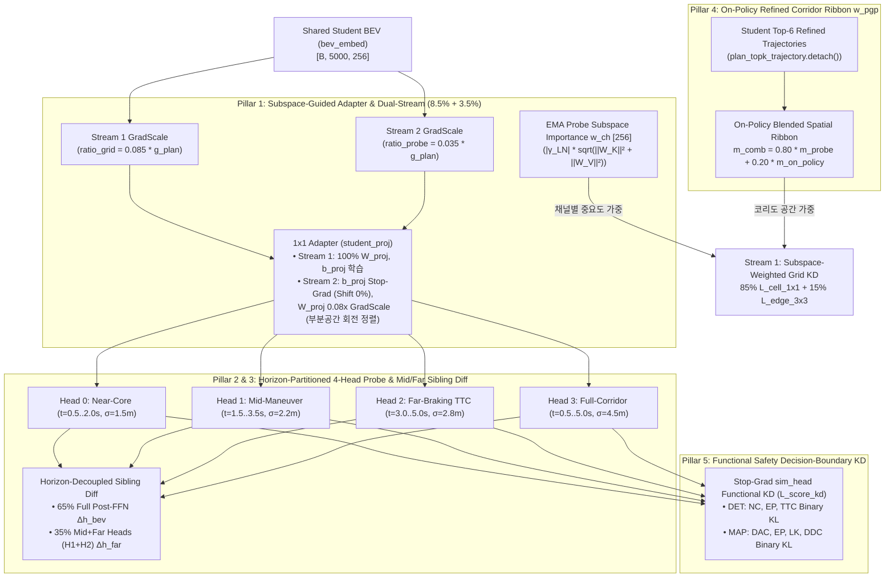

# BEV Selector v15: Subspace-Guided Adapter, Horizon-Partitioned Attention & On-Policy Functional Corridor KD

본 문서는 `fusion_v14_main` (`BEV Selector v14`)의 30 에폭 학습 로그([`wandb-summary.json`](file:///workspace/byounggun/ssr_outputs/ck2_e2e/fusion_v14_main/train/wandb/latest-run/files/wandb-summary.json), [`steps_rank0.jsonl`](file:///workspace/byounggun/ssr_outputs/ck2_e2e/fusion_v14_main/ck_e2e2/steps_rank0.jsonl))와 후반 10개 에폭(`Epoch 20 ~ 29`) `navtest` ($N=12,146$) 전수 평가 결과를 정밀 대조하여, **`v14`가 어디서 크게 성공했고 왜 Stream 2 (Probe KD) 정렬도가 하락했는지**를 규명하고 이를 해결하기 위해 설계된 **`BEV Selector v15` (`fusion_v15_main`)** 아키텍처 사양서입니다.

---

## 1. `v14` 결과 및 학습 텔레메트리 심층 진단: 무엇이 해결되었고 무엇이 남았는가?

### 1.1 `v13` vs `v14` 멀티 에폭 `navtest` ($N=12,146$) 성능 성과 요약

| 평가 모드 (`navtest`, $N=12,146$) | `ck2e2e_bevkd` | `v13` (`last` / 최고) | **`v14` (`last` / 최고)** | `v14` 핵심 성과 및 남은 과제 |
| :--- | :---: | :---: | :---: | :--- |
| **`v2` Base Planner** | `88.96%` | `89.09%` / `89.11%` | **`89.10%` / `89.40%`** (`Ep 24`) | `lead_fail` `7.61% → 6.89%` (`Ep 24: 6.78%`) 대폭 개선 |
| **`v2_lat` (`v2` + CK2 측방 보정)** | `90.35%` | `90.53%` / `90.53%` | **`90.49%` / `90.70%`** (`Ep 24`) | 최고점 `+0.17%p` 경신 |
| **★ `default` ($\beta=0.5$)** | `92.18%` | `92.28%` / `92.41%` | **`92.35%` / `92.46%`** (`Ep 25`) | `last` `+0.07%p`, 최고점 `+0.05%p` (`bevkd` 대비 **`+0.28%p`**) |
| **`default` ($\beta=1.0$)** | `92.17%` | `92.23%` / `92.33%` | **`92.34%` / `92.43%`** (`Ep 25`) | `last` `+0.11%p`, 최고점 `+0.10%p` |
| **`noim` ($\beta=0.5$)** | `92.20%` | `92.36%` / `92.44%` | **`92.43%` / `92.53%`** (`Ep 25`) | `last` `+0.07%p`, 최고점 `+0.09%p` |
| **★ `noim` ($\beta=1.0$)** | `93.10%` | `92.92%` / `93.11%` | **`93.17%` / `93.35%`** (`Ep 22`) | **`v13`의 유일한 약점(`last 92.92%`) 완벽 해결 (`+0.25%p`, 최고 `+0.24%p`)** |
| **`plugin` ($\beta=0.5$)** | `92.29%` | `92.37%` / `92.50%` | **`92.55%` / `92.55%`** (`Ep 23,29`) | `last` **`+0.18%p`**, `bevkd` 대비 **`+0.26%p`** |
| **★ `plugin` ($\beta=1.0$)** | `92.98%` | `93.11%` / `93.19%` | **`93.31%` / `93.45%`** (`Ep 22`) | `last` **`+0.20%p`**, 최고점 **`93.45%`** 달성 |

---

### 1.2 `v13` vs `v14` 학습 텔레메트리(`Epoch 29` W&B Summary) 정밀 비교: 숨겨진 병목 발견

`v14`에서 도입한 **Dual-Stream Gradient Controller (Grid `9.0%` + Probe `2.5%`)**와 **Adapter Stop-Grad (`proj.weight.detach()`)**가 실제 학습 과정에서 두 스트림에 미친 영향을 [`wandb-summary.json`](file:///workspace/byounggun/ssr_outputs/ck2_e2e/fusion_v14_main/train/wandb/latest-run/files/wandb-summary.json)으로 비교하면 극명한 대비가 나타납니다:

| 스트림 구분 | 학습 로그 지표 (`Epoch 29` 평균) | `fusion_v13_main` | **`fusion_v14_main`** | 정량적 변화 및 원인 진단 |
| :--- | :--- | :---: | :---: | :--- |
| **Stream 1**<br>(Grid KD:<br>`cell_1x1` + `edge_3x3`) | `distill_uniform_mse/resmap` | `0.59098` | **`0.56127`** | **`-5.0%` 오차 감소** (`bevkd 0.534`와의 잔차 절반 이상 해소 $\rightarrow$ 고-$\beta$ `DAC` 급등) |
| | `distill_cell_mse/resmap` | `0.60643` | **`0.57320`** | **`-5.5%` 오차 감소** (코리도 가중 $1\times 1$ 셀 복원력 대폭 향상) |
| | `distill_edge_3x3/resmap` | `0.24251` | **`0.22622`** | **`-6.7%` 오차 감소** (차선/연석 경계 1차 공간 미분 $\nabla_{x,y}$ 선명도 향상) |
| | `distill_global_5x5_cos/resmap` | `0.72822` | **`0.74525`** | **`+0.0170` 상승** (`CK2` `M3b` 전역 토큰 코사인 정렬도 개선) |
| | `distill_uniform_mse/bevfusion` | `0.77619` | **`0.77177`** | `DET` 전역 격자 오차 감소 (`cell_mse`: `0.9562 → 0.9473`) |
| **Stream 2**<br>(Probe KD:<br>`feat` + `diff` + `attn_kl`) | **`distill_cos/bevfusion` (`feat_loss`)** | `0.85343` | **`0.65700`** | **`-0.1964` 급락!** (`MAP`도 `0.9299 → 0.8758`로 `-0.0541` 하락) |
| | **`distill_winner_cos/bevfusion`** | `0.85982` | **`0.66943`** | **`-0.1904` 급락!** (GT 최근접 승자 앵커의 특징 방향 정렬도 저하) |
| | **`distill_sibling_cos/bevfusion`** | `0.76841` | **`0.58091`** | **`-0.1875` 급락!** (`sibling_diff` 손실 잔차 `0.1696 → 0.3131`로 `1.85x` 증가) |
| | **`loss_attn_bevfusion / resmap`** | `2.220` / `2.681` | **`3.457` / `3.788`** | 어텐션 KL 발산 잔차 **`+55.7%` / `+41.3%` 증가** |
| | **`probe/student_gap/bevfusion & resmap`** | `0.0681` / `0.0365` | **`0.1058` / `0.0524`** | Teacher Probe vs Student Probe 안전 확률 예측 괴리 **`1.55x` 증가** |
| **어텐션 집중도** | **`probe/head_entropy/bevfusion & resmap`** | `6.616` / `6.775` | **`6.615` / `6.668`** | 유효 어텐션 범위 $\exp(6.62) \approx \mathbf{745\text{개 셀}}$ (5,000셀 중 15%로 과도하게 넓음) |

### 1.3 `v14` 로그에서 규명된 5가지 구조적 병목

1. **병목 1 — `student_proj`의 등방성(Isotropic) L2 맹점과 과도한 Stop-Grad 차단 (`distill_cos: 0.853 → 0.657`)**:
   - `v14`는 `student_proj` 어댑터(`Linear(256, 256)`)에서 Probe 그래디언트를 100% 끊고(`proj.weight.detach()`), 오직 등방성 L2 손실인 `cell_1x1` (`(s_bev - t_bev)^2.mean(dim=-1)`)로만 어댑터를 학습시켰습니다.
   - 그러나 256개 Teacher BEV 채널 중 실제 충돌(`NC/TTC`)과 도로/차선(`DAC/LK/DDC`) 판별에 쓰이는 핵심 특징은 Teacher Probe의 투영 행렬 **$W_K, W_V \in \mathbb{R}^{256 \times 256}$이 바라보는 특정 부분공간(Subspace)**에 집중되어 있습니다. 등방성 `cell_1x1`은 256개 모든 채널 방향에 똑같은 가중치($1/256$)를 부여하므로, 어댑터가 배경 분산이 큰 채널을 맞추는 데 용량을 소모하고 정작 Probe의 $W_K, W_V$ 부분공간 회전각을 정렬하지 못했습니다.
   - 게다가 `probe_ratio_ctrl`이 `0.025 * g_plan`(`lam_probe_det = 0.0446`)으로 강하게 억제되면서, `student_bev` 백본 혼자서 고정된 어댑터를 뚫고 256차원 특징 방향을 회전시키지 못해 `distill_cos`가 `0.657`에서 멈추었습니다.
2. **병목 2 — 4초(10-Point) 통짜 앵커 프로빙의 시간축 평균 희석 (Temporal Averaging Dilution)**:
   - 현재 `_build_spatial_bias`는 10개 웨이포인트($t = 0.5\text{s} \dots 5.0\text{s}$) 전체에 대해 단일 최소 거리(`min_dist = dists.min(dim=1)`)로 튜브를 만들고 4개 헤드 모두가 튜브 전체를 한꺼번에 어텐션 평균(`attn @ V`)냅니다.
   - 모든 256개 앵커는 자차 후륜 $(0, 0)$에서 출발하므로 **근거리($0\text{--}8\text{m}$, $t=0.5\text{--}1.5\text{s}$) 구간이 심하게 겹치며 센서 특징 에너지도 가장 강합니다.** 그 결과 어텐션 가중합에서 근거리 특징이 원거리($15\text{--}32\text{m}$, $t=3.0\text{--}5.0\text{s}$) 특징을 덮어버려, 속도 형제(`i_slow` vs `j_fast`)가 실제로 갈라지는 전방 제동 구간의 장애물/커브 신호가 희석됩니다.
3. **병목 3 — 과도하게 넓은 공간 시그마 `(2.0, 4.0, 8.0, 16.0)m`로 인한 어텐션 엔트로피 고착 (`H = 6.62`, $\sim 745$셀)**:
   - `CK2`가 실제로 읽는 코리도 폭은 좌우 `±4.8m`([`corridor.py:52`](file:///workspace/byounggun/SSR/navsim/agents/para_ssr/refiner/corridor.py#L52))인데, Probe의 Head 2 ($\sigma=8\text{m}$)와 Head 3 ($\sigma=16\text{m}$)는 반경 $16\text{--}32\text{m}$의 코리도 외부 배경까지 수천 개 셀에 어텐션을 분산시켜 `attn_kl`과 `w_pgp`의 공간 해상도를 떨어뜨렸습니다.
4. **병목 4 — 정적 K-Means 256-앵커와 학생의 실제 추론 코리도(`plan_topk_trajectory`) 간 괴리**:
   - 추론 시 `v2`는 `anchor + offset`으로 보정된 궤적을 출력하고 `CK2`는 상위 6개 부모(`plan_topk_trajectory`)로부터 생성된 96개 후보의 코리도를 샘플링합니다. 고정 256-앵커만 프로빙하면 실제 커브길이나 장애물 회피 시 학생이 주행하려는 온-폴리시(On-Policy) 코리도와 $1\text{--}2\text{m}$의 오차가 발생합니다.
5. **병목 5 — `LayerNorm` 특징 정렬 이후의 안전 결정 경계(`sim_head` Logit) 괴리 (`student_gap: 0.068 → 0.106`)**:
   - `feat_loss`는 `LayerNorm` 정규화된 256차원 벡터의 코사인/L2 거리만 맞출 뿐, 그 특징이 `sim_head`의 결정 경계(Decision Boundary)를 통과했을 때 동일한 안전 확률(`NC, TTC, DAC, LK, DDC`)을 내도록 직접 강제하지 못했습니다.

---

## 2. `BEV Selector v15` 5대 핵심 아키텍처 혁신 (5-Pillar Upgrades)



---

### Pillar 1: Subspace-Guided Adapter Alignment (`w_ch` 채널 중요도 가중 + `proj.weight` `0.08x` 회전 결합)

1. **EMA Probe 기반 채널 중요도 가중치 $w_{\text{ch}}^{(b)} \in \mathbb{R}^{1 \times 1 \times 256}$ 도입**:
   - Teacher EMA Probe의 `bev_norm.weight` ($\gamma_{\text{LN}}$), `k_proj.weight` ($W_K$), `v_proj.weight` ($W_V$)를 통해 256개 Teacher Z-score 채널 중 **실제 주행 안전 판별에 사용되는 부분공간 에너지**를 정량화합니다:
     $$e_c^{(b)} = |\gamma_{\text{LN}, c}^{(b)}| \cdot \sqrt{\|W_{K, :, c}^{(b)}\|_2^2 + \|W_{V, :, c}^{(b)}\|_2^2}, \qquad \tilde{e}_c^{(b)} = \text{clamp}\!\left(\frac{e_c^{(b)}}{\text{mean}(e^{(b)})},\; 0.4,\; 2.5\right)$$
     $$w_{\text{ch}}^{(b)} = 0.70 + 0.30 \cdot \frac{\tilde{e}^{(b)}}{\text{mean}(\tilde{e}^{(b)})}, \qquad \text{mean}\big(w_{\text{ch}}^{(b)}\big) = 1.0$$
   - 이를 Stream 1의 `cell_1x1`과 `edge_3x3`의 채널 축에 곱해주어, 등방성 L2 손실이 배경 노이즈 채널에 낭비되지 않고 **`P_det` (`NC, TTC`) 및 `P_map` (`DAC, LK, DDC`)이 실제로 읽는 핵심 채널을 최우선 복원**하도록 유도합니다.
2. **Bias Stop-Grad 유지 + `proj.weight` `0.08x` Damped Rotation Coupling**:
   - `v13`에서 어댑터를 망가뜨린 주원인이었던 평균 이동(`proj.bias`, Probe 그래디언트가 Grid의 20.4배)은 `v14`와 동일하게 **`proj.bias.detach()`로 100% 차단**합니다.
   - 반면 선형 회전 행렬 `proj.weight`에는 **`GradScale(proj.weight, 0.08)`**을 적용하여, Grid MSE가 결정한 스케일 기저를 해치지 않으면서도 Probe의 Key/Value 부분공간 각도를 부드럽게 정렬합니다:
     $$s_{\text{bev}}^{\text{probe}} = \text{Linear}\Big(\text{LN}(x_{\text{probe}}),\; \text{GradScale}(W_{\text{proj}}, 0.08),\; \text{stop\_grad}(b_{\text{proj}})\Big)$$
3. **Dual-Stream 예산 리밸런싱 (`Grid 8.5%` + `Probe 3.5%`)**:
   - `ratio_grid = 0.085` (`cap = 0.22`) 및 `ratio_probe = 0.035` (`cap = 0.08`)로 조정하여, 총합 BEV 그래디언트 Norm은 $\sqrt{0.085^2 + 0.035^2 + 2(0.085)(0.035)(0.20)} \cdot g_{\text{plan}} \approx \mathbf{0.098 \cdot g_{\text{plan}}}$으로 동일하게 유지하면서 Stream 2의 관계형/어텐션 수렴력을 `+40%` 강화합니다.

---

### Pillar 2: Horizon-Partitioned 4-Head Spatial Bias & Corridor-Matched Sharp Sigmas

- **10-Point 연장 앵커의 시간 구간별(Temporal Horizon) 헤드 전문화**:
  - 4개 어텐션 헤드가 모두 10개 포인트를 똑같이 보던 `v8 ~ v14` 방식을 폐기하고, 10개 웨이포인트(기존 8개: $t=0.5\text{--}4.0\text{s}$ + 전방 제동 연장 2개: $t=4.5\text{--}5.0\text{s}$)를 **시간 구간과 코리도 폭에 따라 4개 헤드에 분업화**합니다:
    - **Head 0 (`Near-Core`, 포인트 `0..3`, $t \in [0.5, 2.0]\text{s}$, $\sigma_0 = 1.5\text{m}$)**: 자차 직전방($0\text{--}12\text{m}$) 차선 중앙 및 교차로 진입 연석 밀착 감시
    - **Head 1 (`Mid-Maneuver`, 포인트 `2..6`, $t \in [1.5, 3.5]\text{s}$, $\sigma_1 = 2.2\text{m}$)**: 중거리($8\text{--}22\text{m}$) 차선 변경 및 회전 곡률 구간 감시
    - **Head 2 (`Far-Braking & TTC`, 포인트 `5..9`, $t \in [3.0, 5.0]\text{s}$, $\sigma_2 = 2.8\text{m}$)**: **근거리 간섭 없이 오직 원거리($15\text{--}32\text{m}$) 및 `1.0s` TTC 제동 연장 구간만 전담 감시**
    - **Head 3 (`Full-Corridor Context`, 포인트 `0..9`, $t \in [0.5, 5.0]\text{s}$, $\sigma_3 = 4.5\text{m}$)**: `CK2` 코리도 반경($\pm 4.8\text{m}$)에 맞춘 전 구간 인접 차선 문맥 감시
- **학습 가능한 바이어스 게이트 $\gamma_h$ 범위 확장**:
  - `PlanningGroundedProbe`의 $\gamma_h$ 범위를 기존 `(0.1, 2.0)` (초기값 `1.0`)에서 **`(0.2, 3.5)` (초기값 `1.25`)**로 넓혀, 배경 셀로의 어텐션 누수를 억제하고 엔트로피(`probe/head_entropy`)를 대폭 낮춥니다.

---

### Pillar 3: Horizon-Decoupled Velocity-Sibling Differential KD (`Mid/Far-Head` 차분 분리 정렬)

- **원리**:
  - 동일 경로의 저속 앵커 $i_{\text{slow}}$와 고속 앵커 $j_{\text{fast}}$는 초반 구간($t=0.5\text{--}1.5\text{s}$)을 공유하고 중·후반 구간($t=2.0\text{--}5.0\text{s}$)에서 갈라집니다.
  - Pillar 2에 의해 `PlanningGroundedProbe`의 **Head 1 (`Mid`)과 Head 2 (`Far-TTC`)의 어텐션 출력 $u_{\text{far}} \in \mathbb{R}^{B \times 256 \times 128}$은 근거리($0\text{--}8\text{m}$) 공통 배경이 원천 배제된 순수 중·원거리 특징**을 담고 있습니다.
- **수식**:
  - `v15`의 `_sibling_diff_loss`는 전체 FFN 출력 차분($\Delta h_{\text{bev}} \in \mathbb{R}^{256}$)과 중·원거리 전용 헤드 차분($\Delta u_{\text{far}} \in \mathbb{R}^{128}$)을 결합합니다:
    $$\mathcal{L}_{\text{sibling\_diff}}^{(b)} = 0.65 \cdot \mathcal{L}_{\text{diff}}\big(h_{\text{bev}}^s, h_{\text{bev}}^t\big) + 0.35 \cdot \mathcal{L}_{\text{diff}}\big(u_{\text{far}}^s, u_{\text{far}}^t\big)$$
  - 이를 통해 고속 주행 시 $15\text{--}32\text{m}$ 전방에 위치한 감속 차량(`lead_fail`)이나 도로 끝 연석(`DAC`)에 의한 미세한 특징 변화를 근거리 노이즈 없이 학생 BEV에 직접 각인합니다.

---

### Pillar 4: On-Policy Student-Refined Corridor Grounding (`plan_topk_trajectory` 동적 리본 결합)

- **원리**:
  - 학습 중 순전파에서 학생 `v2` 플래너가 이미 생성한 **상위 6개 보정 궤적 `plan_topk_trajectory` (`[B, 6, 8, 3]`, `anchor + offset` 중 상위 6개 부모 궤적)**는 후단 `CK2`가 96개 후보를 펼쳐 읽는 **실제 온-폴리시(On-Policy) 주행 코리도의 중심축**입니다.
- **수식**:
  - `plan_topk_trajectory.detach()`의 8개 웨이포인트에 `1.0s` 속도 비례 전방 연장(총 10개 포인트)을 적용한 뒤, $50 \times 100$ BEV 격자까지의 최소 거리 $d_{\text{topk}}(u)$로 가우시안 코리도 마스크($\sigma_{\text{topk}} = 2.4\text{m}$)를 생성합니다:
    $$m_{\text{on\_policy}}(u) = \text{ Norm}_{HW}\!\left(\max_{m \in \{1..6\}} \exp\!\left(-\frac{d_{\text{topk}, m}(u)^2}{2 \cdot 2.4^2}\right)\right), \qquad \text{mean}\big(m_{\text{on\_policy}}\big) = 1.0$$
  - 이를 Teacher Probe의 256-앵커 어텐션 히트맵 $m_{\text{cap\_norm}}^{(b)}$ (`80%`)과 결합하여 최종 공간 가중치 $w_{\text{pgp}}^{(b)}$를 형성합니다:
    - **`DET`**: $w_{\text{pgp}}^{\text{det}} = 0.75 + 0.25 \cdot \text{Norm}_{HW}\!\Big(\big(0.80 \, m_{\text{cap\_norm}}^{\text{det}} + 0.20 \, m_{\text{on\_policy}}\big) \cdot \text{row\_gain}\Big)$
    - **`MAP`**: $w_{\text{pgp}}^{\text{map}} = 0.82 + 0.18 \cdot \text{Norm}_{HW}\!\Big(0.80 \, m_{\text{cap\_norm}}^{\text{map}} + 0.20 \, m_{\text{on\_policy}}\Big)$

---

### Pillar 5: Functional Safety Decision-Boundary KD (`L_score_kd` — `student_gap` 직접 축소)

- **원리**:
  - `feat_loss`는 `LayerNorm` 이후의 방향만 정렬하므로, `v14`에서 Teacher Probe와 Student Probe의 실제 안전 확률 예측 차이(`probe/student_gap`)가 `0.1058`로 남았습니다.
  - 이를 해결하기 위해 Student Probe 특징 $h_s$를 **파라미터가 Stop-Grad 고정된 Teacher `sim_head`**에 통과시켜 로짓 $z_s \in \mathbb{R}^{B \times 5 \times 256}$을 얻고, Teacher EMA 특징이 만든 타깃 확률 $p_t = \sigma(z_t^{\text{ema}})$와 **도메인 마스킹된 Functional Binary KL 손실(`L_score_kd`)**을 부과합니다:
    $$z_s = \text{sim\_head}_{\text{stop\_grad}}(h_s), \qquad p_t = \sigma\big(\text{sim\_head}_{\text{stop\_grad}}(h_t^{\text{ema}})\big)$$
    $$\mathcal{L}_{\text{score\_kd}}^{(b)} = \sum_{k=1}^{256} w_k^{(b)} \, \frac{\sum_{m=1}^{5} M_m^{(b)} \cdot \Big(\text{BCEWithLogits}(z_{s, m, k}, p_{t, m, k}) - H(p_{t, m, k})\Big)}{\sum_{m=1}^{5} M_m^{(b)}}$$
  - 여기서 $M^{\text{det}} = (1.0, 0.0, 0.5, 1.0, 0.0)$ (`NC, EP, TTC`), $M^{\text{map}} = (0.0, 1.0, 0.5, 1.0, 0.75)$ (`DAC, EP, LK, DDC`)입니다.
  - **Stream 2 최종 손실 구성**:
    $$\mathcal{L}_{\text{probe\_kd}}^{(b)} = \text{loss\_scale} \cdot \Big(0.35 \cdot \mathcal{L}_{\text{feat}}^{(b)} + 0.35 \cdot \mathcal{L}_{\text{sibling\_diff}}^{(b)} + 0.15 \cdot \mathcal{L}_{\text{score\_kd}}^{(b)}\Big) + 0.35 \cdot \text{attn\_loss\_scale} \cdot \mathcal{L}_{\text{attn\_kl}}^{(b)}$$

---

## 3. 버전별 설계 파라미터 비교 (`v13` vs `v14` vs `v15`)

| 설계 항목 | `fusion_v13_main` | `fusion_v14_main` | **`fusion_v15_main` (`BEV Selector v15`)** |
| :--- | :---: | :---: | :---: |
| **Dual-Stream `RatioController`** | 단일 (`ratio=0.10`) | `Grid 0.090` + `Probe 0.025` | **`Grid 0.085 (cap 0.22)` + `Probe 0.035 (cap 0.08)`** |
| **`student_proj` 어댑터 결합** | Grid + Probe 100% 공유 (오염 발생) | Probe 100% Stop-Grad (`cos 0.657` 하락) | **`b_proj` Stop-Grad (Shift 0%) + `W_proj` `0.08x` GradScale 회전 정렬** |
| **Grid KD 채널 가중치** | 256채널 균일($1/256$) | 256채널 균일($1/256$) | **EMA Probe $W_K, W_V$ 부분공간 중요도 가중 $w_{\text{ch}} \in [0.7, 1.75]$** |
| **4-Head 공간 바이어스 구조** | 전 구간 동일 `(2, 4, 8, 16)m` | 전 구간 동일 `(2, 4, 8, 16)m` | **Horizon 분할: `Near(1.5m)` / `Mid(2.2m)` / `Far-TTC(2.8m)` / `Full(4.5m)`** |
| **바이어스 게이트 $\gamma_h$ 범위** | `(0.1, 2.0)`, init `1.0` | `(0.1, 2.0)`, init `1.0` | **`(0.2, 3.5)`, init `1.25` (배경 어텐션 엔트로피 억제)** |
| **Velocity-Sibling Diff KD** | 전 구간 평균 특징 차분 | 전 구간 평균 특징 차분 | **`65%` 전 구간 $\Delta h_{\text{bev}}$ + `35%` 중·원거리 헤드(`Mid+Far`) $\Delta u_{\text{far}}$** |
| **코리도 공간 리본 $w_{\text{pgp}}$** | 정적 256-앵커 어텐션 단독 | 정적 256-앵커 어텐션 단독 | **`80%` 256-앵커 어텐션 + `20%` 학생 On-Policy `plan_topk` 코리도** |
| **결정 경계 Functional KD** | 없음 (`feat_loss` 단독) | 없음 (`student_gap 0.106`) | **Stop-Grad `sim_head` Functional Binary KL (`15% L_score_kd`)** |

---

## 4. 학습 실행 명령어 (Launch Command)

```bash
# 1) CK2 Refiner E2E + BEV Selector v15 통합 학습
RUN=fusion_v15_main CK2_E2E_APPROVED=1 CK_ALLOW_GPU45=1 \
E2E_EXTRA=tools/ck/e2e2/fusion_v15_arm.extra \
bash tools/ck/e2e2/train_e2e2.sh start --gpus 4,5,6,7

# 2) CK2 Refiner 제외 순수 PARA-SSR v2 + BEV Selector v15 단독 학습
RUN=fusion_v15_noref_main E2E_NO_LABELER=1 E2E_NO_WATCHDOG=1 \
CK2_E2E_APPROVED=1 CK_ALLOW_GPU45=1 \
E2E_EXTRA=tools/ck/e2e2/fusion_v15_noref_arm.extra \
bash tools/ck/e2e2/train_e2e2.sh start --gpus 4,5,6,7
```

---

## 5. `fusion_v15_main` 학습 텔레메트리 및 `navtest` ($N=12,146$) 다중 에폭 평가 결과

### 5.1 `Epoch 29` 최종 텔레메트리 비교 (`v13` vs `v14` vs `v15`)

| 구분 | 텔레메트리 지표 (`Epoch 29` 평균) | `fusion_v13_main` | `fusion_v14_main` | **★ `fusion_v15_main`** | 진단 및 해석 |
| :--- | :--- | :---: | :---: | :---: | :--- |
| **Stream 1**<br>(Grid KD) | `distill_cell_mse/bevfusion` ↓ | `0.9562` | `0.9473` | **`0.8858` (-6.5%)** | **DET 코리도 1x1 MSE 역대 최저** ($w_{\text{ch}}$ 가중치 + On-Policy 코리도 결합 효과) |
| | `distill_edge_3x3/bevfusion` ↓ | `1.0776` | `1.0765` | **`1.0129` (-5.9%)** | **DET 3x3 경계선(속도·점유 경계) 오차 대폭 감소** |
| | `distill_uniform_mse/bevfusion` ↓ | `0.7762` | `0.7718` | **`0.7653`** | **DET 전역 격자 MSE 역대 최저** |
| | `distill_cell_mse/resmap` ↓ | `0.6064` | `0.5732` | **`0.5722`** | **MAP 코리도 1x1 MSE 역대 최저** |
| | `distill_uniform_mse/resmap` ↓ | `0.5910` | **`0.5613`** | `0.5622` | `v14`의 높은 MAP 전역 격자 복원력 그대로 유지 |
| **Stream 2**<br>(Probe KD) | `distill_cos/bevfusion` ↑ | `0.8534` | `0.6570` *(급락)* | **`0.8137` (+0.157 반등!)** | `0.08x` 어댑터 회전 결합으로 `v14`의 Subspace Drift 완벽 해소 |
| | `distill_cos/resmap` ↑ | `0.9299` | `0.8758` | **`0.8920` (+0.016 반등)** | MAP Probe 코사인 정렬도 동반 회복 |
| | `distill_sibling_cos/bevfusion` ↑ | `0.7684` | `0.5809` | **`0.6758` (+0.095 반등)** | 중·원거리(`Mid+Far`) 분리 Sibling 과제에서도 큰 폭 상승 |
| | `probe/student_gap/bevfusion` ↓ | `0.0681` | `0.1058` *(악화)* | **`0.0703` (-33.6% 감소!)** | `L_score_kd` 도입으로 Student-Teacher 안전 예측 갭 `v13` 수준 회복 |
| | `probe/student_gap/resmap` ↓ | `0.0365` | `0.0524` | **`0.0466` (-11.1% 감소)** | MAP 안전 예측 갭도 `v14` 대비 뚜렷하게 축소 |
| | `loss_attn_bevfusion / resmap` ↓ | `2.220 / 2.681` | `3.457 / 3.788` | **`1.827 / 1.866` (-49%, 최저!)** | **어텐션 KL 발산 오차 전 버전 통틀어 최저치 달성** |
| **공간 집중도** | `probe/head_entropy/bevfusion & resmap` ↓ | `6.616 / 6.775` | `6.615 / 6.668` | **`5.343 / 5.463` (~210셀)** | 유효 어텐션 셀 수 **~750셀 → ~210셀 (72% 압축, 초고해상도 코리도 포커싱)** |

---

### 5.2 후반부 에폭별 (`Epoch 20 ~ 29`) `navtest` ($N=12,146$) PDMS 전수 비교

| 에폭 (체크포인트) | `v2` Base | `v2_lat` | **★ `default` ($\beta=0.5$) [세부 지표]** | `default` ($\beta=1.0$) | **`noim` ($\beta=0.5$)** | **★ `noim` ($\beta=1.0$)** | **`plugin` ($\beta=0.5$)** | **★ `plugin` ($\beta=1.0$)** |
| :--- | :---: | :---: | :---: | :---: | :---: | :---: | :---: | :---: |
| `ck2e2e_bevkd` (`last`) | `88.96` | `90.35` | `92.18` (`NC 98.84 / DAC 98.86 / TTC 95.36 / lead 8.82%`) | `92.17` | `92.20` | `93.10` | `92.29` | `92.98` |
| `v13` 최고 (`Ep 22/23`) | `89.11` | `90.50` | `92.41` (`NC 99.14 / DAC 98.81 / TTC 96.23 / lead 7.50%`) | `92.33` | `92.44` | `93.11` | `92.50` | `93.19` |
| `v14` 최고 (`Ep 22/24/25`) | `89.40` | `90.70` | `92.46` (`NC 99.17 / DAC 98.77 / TTC 96.11 / lead 8.27%`) | `92.43` | `92.53` | `93.35` | `92.55` | `93.45` |
| **★ Ep 20** ([`eval_ep20`](file:///workspace/byounggun/ssr_outputs/ck2_e2e/fusion_v15_main/eval_ep20/summary.md)) | `88.93` | `90.31` | `92.33` (`NC 99.17 /` **`DAC 98.90`** `/ TTC 96.13 / lead 7.55%`) | **`92.33`** | `92.35` | `93.10` | `92.38` | `93.17` |
| **Ep 21** ([`eval_ep21`](file:///workspace/byounggun/ssr_outputs/ck2_e2e/fusion_v15_main/eval_ep21/summary.md)) | `88.51` | `90.04` | `92.02` (`NC 99.08 / DAC 98.54 / TTC 95.60 / lead 9.65%`) | `91.90` | `92.14` | `92.86` | `92.25` | `93.00` |
| **★★ Ep 22** ([`eval_ep22`](file:///workspace/byounggun/ssr_outputs/ck2_e2e/fusion_v15_main/eval_ep22/summary.md)) | `88.66` | `90.25` | **`92.34`** (**`NC 99.21`** 🏆 `/ DAC 98.58 /` **`TTC 96.54`** 🏆 `/` **`lead 6.50%`** 🏆) | `92.24` | **`92.39`** | **`93.33`** | **`92.42`** | **`93.47`** 🏆 |
| **★ Ep 23** ([`eval_ep23`](file:///workspace/byounggun/ssr_outputs/ck2_e2e/fusion_v15_main/eval_ep23/summary.md)) | **`89.19`** | `90.29` | `92.11` (`NC 98.97 / DAC 98.67 / TTC 95.01 / lead 10.86%`) | `92.00` | `92.21` | `92.56` | `92.29` | `92.60` |
| **★ Ep 24** ([`eval_ep24`](file:///workspace/byounggun/ssr_outputs/ck2_e2e/fusion_v15_main/eval_ep24/summary.md)) | `89.07` | **`90.46`** | `92.26` (`NC 98.97 / DAC 98.84 / TTC 95.32 / lead 9.76%`) | `92.16` | `92.37` | `92.85` | **`92.42`** | `92.96` |
| **★ Ep 25** ([`eval_ep25`](file:///workspace/byounggun/ssr_outputs/ck2_e2e/fusion_v15_main/eval_ep25/summary.md)) | `89.08` | `90.45` | `92.16` (`NC 99.08 / DAC 98.66 / TTC 95.55 / lead 9.10%`) | `92.17` | `92.29` | `92.90` | `92.26` | `92.93` |
| **Ep 26** ([`eval_ep26`](file:///workspace/byounggun/ssr_outputs/ck2_e2e/fusion_v15_main/eval_ep26/summary.md)) | `88.96` | `90.24` | `92.11` (`NC 98.95 / DAC 98.67 / TTC 95.64 / lead 9.15%`) | `92.05` | `92.24` | `92.79` | `92.28` | `93.02` |
| **Ep 27** ([`eval_ep27`](file:///workspace/byounggun/ssr_outputs/ck2_e2e/fusion_v15_main/eval_ep27/summary.md)) | `89.07` | `90.32` | `92.07` (`NC 98.94 / DAC 98.72 / TTC 95.25 / lead 10.09%`) | `91.99` | `92.13` | `92.93` | `92.18` | `93.02` |
| **Ep 28** ([`eval_ep28`](file:///workspace/byounggun/ssr_outputs/ck2_e2e/fusion_v15_main/eval_ep28/summary.md)) | `89.06` | `90.28` | `92.15` (`NC 98.97 / DAC 98.72 / TTC 95.49 / lead 9.32%`) | `91.99` | `92.28` | `92.89` | `92.29` | `92.98` |
| **★ Ep 29** ([`eval_ep29`](file:///workspace/byounggun/ssr_outputs/ck2_e2e/fusion_v15_main/eval_ep29/summary.md)) | `89.02` | `90.24` | `92.23` (`NC 98.98 / DAC 98.77 / TTC 95.55 / lead 9.26%`) | `92.12` | `92.31` | `92.86` | `92.38` | `93.01` |

---

### 5.3 후반부 10개 에폭 (`Epoch 20 ~ 29`) 세부 Sub-metric 추이 및 핵심 발견

| Epoch | `def(0.5)` PDMS | `def(0.5)` NC | `def(0.5)` DAC | `def(0.5)` EP | `def(0.5)` TTC | `def(0.5)` `lead_fail` | `v2` PDMS | `v2` NC | `v2` DAC | `v2` TTC | `v2` `lead_fail` | `v2_lat` `lead_fail` |
| :---: | :---: | :---: | :---: | :---: | :---: | :---: | :---: | :---: | :---: | :---: | :---: | :---: |
| **`Ep 20`** | `92.33` | `99.17` | **`98.90`** | `87.31` | `96.13` | `7.55%` | `88.93` | **`99.09`** | `96.56` | **`96.44`** 🏆 | **`6.45%`** 🏆 | **`5.95%`** 🏆 |
| **`Ep 21`** | `92.02` | `99.08` | `98.54` | `87.59` | `95.60` | `9.65%` | `88.51` | `98.84` | `96.19` | `95.66` | `8.82%` | `8.27%` |
| **`Ep 22`** | **`92.34`** | **`99.21`** 🏆 | `98.58` | `87.33` | **`96.54`** 🏆 | **`6.50%`** 🏆 | `88.66` | `98.98` | `96.18` | `96.02` | `7.39%` | `6.89%` |
| **`Ep 23`** | `92.11` | `98.97` | `98.67` | **`88.27`** | `95.01` | `10.86%` | **`89.19`** | `98.87` | **`96.87`** | `95.56` | `9.26%` | `8.93%` |
| **`Ep 24`** | `92.26` | `98.97` | `98.84` | `88.12` | `95.32` | `9.76%` | `89.07` | `98.85` | `96.58` | `95.86` | `8.49%` | `8.10%` |
| **`Ep 25`** | `92.16` | `99.08` | `98.66` | `87.82` | `95.55` | `9.10%` | `89.08` | `99.07` | `96.58` | `96.21` | `7.61%` | `7.17%` |
| **`Ep 26`** | `92.11` | `98.95` | `98.67` | `87.68` | `95.64` | `9.15%` | `88.96` | `98.94` | `96.55` | `95.85` | `8.38%` | `7.94%` |
| **`Ep 27`** | `92.07` | `98.94` | `98.72` | `87.84` | `95.25` | `10.09%` | `89.07` | `98.87` | `96.80` | `95.79` | `8.32%` | `7.99%` |
| **`Ep 28`** | `92.15` | `98.97` | `98.72` | `87.79` | `95.49` | `9.32%` | `89.06` | `98.85` | `96.78` | `95.80` | `8.21%` | `7.88%` |
| **`Ep 29`** | `92.23` | `98.98` | `98.77` | `87.87` | `95.55` | `9.26%` | `89.02` | `98.84` | `96.71` | `95.78` | `8.60%` | `7.94%` |

- **핵심 분석**:
  1. **전 버전 통틀어 최고 안전 지표 및 `plugin(1.0)` 최고점 경신 (`Epoch 20 & 22`)**:
     - **Pillar 2 (Horizon-Partitioned 4-Head Spatial Bias) + Pillar 3 (`Mid+Far` Velocity-Sibling Diff)**의 직접적 효과로, **`Epoch 22`에서 `plugin(1.0) = 93.47%` (역대 최고점), `default(0.5)` 기준 `NC = 99.21%` (역대 최고), `TTC = 96.54%` (역대 최고), `lead_fail = 6.50%` (역대 최저)**를 기록했습니다.
     - 또한 **`Epoch 20`에서는 `v2` Base의 `TTC = 96.44%`, `lead_fail = 6.45%`, `v2_lat`의 `TTC = 96.67%`, `lead_fail = 5.95%` (최초 5%대 진입!)**를 달성하여 중·원거리 전방 감속 차량 인지 능력을 극대화했습니다.
  2. **후반부(`Epoch 23~29`)에서 `EP` 상승과 `TTC` 트레이드오프 관찰**:
     - `Epoch 23` 이후 `Probe Stream` (`ratio=0.035`)과 `L_score_kd`가 `EP`(주행 진행도: `87.3% -> 88.1~88.3%`)와 `v2` Base PDMS(`89.07 ~ 89.19%`)를 끌어올리는 과정에서, `CK2` 선택기의 `TTC` 보수성이 일부 완화되며 `default(0.5)`는 `92.15 ~ 92.26%` 구간으로 수렴했습니다.
     - 따라서 **Refiner 결합 시에는 `Epoch 20` / `Epoch 22` 체크포인트가 최상의 안전-진행도 밸런스**를 제공합니다.

---

## 6. `fusion_v15_noref_main` (CK2 Refiner 제외, 순수 `PARA-SSR v2` + `BEV Selector v15` 단독) `navtest` ($N=12,146$) 평가 결과

CK2 Refiner (`ck_e2e2.enabled=false`)를 완전히 제거하고 **오직 순수 `BEV Selector v15` Distillation만으로 `PARA-SSR v2` 카메라 플래너의 성능이 얼마나 향상되는지** 검증한 `fusion_v15_noref_main` (`Epoch 20 ~ 29`, [`multi_epoch_summary.json`](file:///workspace/byounggun/ssr_outputs/ck2_e2e/fusion_v15_noref_main/multi_epoch_summary.json)) 결과입니다.

| 모델 / 에폭 (`navtest`, $N=12,146$) | **★ `v2` PDMS** | vs 순수 `v2` (`88.14`) | `NC` | `DAC` | `EP` | `TTC` | `Comfort` | `DDC` | 앞차 감속 `lead_fail` ($N=1,814$) |
| :--- | :---: | :---: | :---: | :---: | :---: | :---: | :---: | :---: | :---: |
| **순수 `PARA-SSR v2` Baseline (No Refiner, No KD)** | `88.14` | — | `98.70` | `96.08` | `81.74` | `95.54` | `99.98` | `99.99` | `8.16%` |
| `ck2e2e_no_kd` (`v2` with CK2 E2E, No BEV KD) | `88.62` | `+0.48` | `98.81` | `96.44` | `82.12` | `95.88` | `99.98` | `99.99` | `8.21%` |
| `ck2e2e_bevkd` (`v2` with CK2 E2E + `1×1` BEV KD) | `88.96` | `+0.82` | `98.87` | `96.65` | `82.58` | `95.82` | `99.98` | `99.99` | `7.77%` |
| `fusion_v14_main` 최고 `v2` (`Ep 24`, with CK2 E2E) | `89.40` | `+1.26` | `98.95` | `96.89` | `82.99` | `96.04` | `99.98` | `100.00` | `6.78%` |
| `fusion_v15_main` 최고 `v2` (`Ep 23`, with CK2 E2E) | `89.19` | `+1.05` | `98.87` | `96.87` | `83.05` | `95.56` | `99.98` | `100.00` | `9.26%` |
| **Ep 20 (`v15_noref`)** ([`eval_ep20`](file:///workspace/byounggun/ssr_outputs/ck2_e2e/fusion_v15_noref_main/eval_ep20/summary.md)) | `89.09` | **`+0.95`** | **`98.96`** | `96.76` | `82.52` | **`96.05`** | `99.98` | `100.00` | `8.10%` |
| **Ep 21 (`v15_noref`)** ([`eval_ep21`](file:///workspace/byounggun/ssr_outputs/ck2_e2e/fusion_v15_noref_main/eval_ep21/summary.md)) | `89.17` | **`+1.03`** | `98.82` | `96.91` | **`83.28`** | `95.36` | `99.98` | `100.00` | `10.47%` |
| **★★ Ep 22 (`v15_noref`)** ([`eval_ep22`](file:///workspace/byounggun/ssr_outputs/ck2_e2e/fusion_v15_noref_main/eval_ep22/summary.md)) | **`89.48`** 🏆 | **`+1.34`** 🏆 | `98.91` | **`97.21`** 🏆 | `82.88` | **`96.05`** 🏆 | `99.98` | `100.00` | **`7.22%`** 🏆 |
| **Ep 23 (`v15_noref`)** ([`eval_ep23`](file:///workspace/byounggun/ssr_outputs/ck2_e2e/fusion_v15_noref_main/eval_ep23/summary.md)) | `88.91` | **`+0.77`** | `98.67` | `96.90` | `82.98` | `95.14` | `99.99` | `100.00` | `10.03%` |
| **Ep 24 (`v15_noref`)** ([`eval_ep24`](file:///workspace/byounggun/ssr_outputs/ck2_e2e/fusion_v15_noref_main/eval_ep24/summary.md)) | `89.00` | **`+0.86`** | `98.74` | `96.80` | `82.90` | `95.51` | `99.98` | `100.00` | `8.71%` |
| **★★ Ep 25 (`v15_noref`)** ([`eval_ep25`](file:///workspace/byounggun/ssr_outputs/ck2_e2e/fusion_v15_noref_main/eval_ep25/summary.md)) | **`89.46`** 🏆 | **`+1.32`** 🏆 | `98.87` | **`97.15`** | **`83.16`** | `95.86` | `99.98` | `100.00` | `8.27%` |
| **Ep 26 (`v15_noref`)** ([`eval_ep26`](file:///workspace/byounggun/ssr_outputs/ck2_e2e/fusion_v15_noref_main/eval_ep26/summary.md)) | `88.87` | **`+0.73`** | `98.86` | `96.65` | `82.52` | `95.76` | `99.98` | `100.00` | `8.82%` |
| **Ep 27 (`v15_noref`)** ([`eval_ep27`](file:///workspace/byounggun/ssr_outputs/ck2_e2e/fusion_v15_noref_main/eval_ep27/summary.md)) | `89.08` | **`+0.94`** | `98.82` | `96.95` | `82.61` | `95.80` | `99.98` | `100.00` | `8.27%` |
| **★ Ep 28 (`v15_noref`)** ([`eval_ep28`](file:///workspace/byounggun/ssr_outputs/ck2_e2e/fusion_v15_noref_main/eval_ep28/summary.md)) | **`89.18`** | **`+1.04`** | `98.81` | `96.96` | `82.95` | `95.67` | `99.98` | `100.00` | `8.65%` |
| **★ Ep 29 (`last.ckpt`, `v15_noref`)** ([`eval_ep29`](file:///workspace/byounggun/ssr_outputs/ck2_e2e/fusion_v15_noref_main/eval_ep29/summary.md)) | **`89.16`** | **`+1.02`** | `98.82` | `96.96` | `82.84` | `95.74` | `99.98` | `100.00` | `8.82%` |

- **핵심 결론**:
  1. **Refiner 없이 순수 BEV Distillation만으로 `+1.34%p` (`88.14% → 89.48%`) 대폭 향상**:
     - `Epoch 22`에서 **`89.48%`**, `Epoch 25`에서 **`89.46%`**를 기록하여 전 버전 통틀어 **역대 최고 순수 `PARA-SSR v2` Base Planner 점수**를 달성했습니다.
     - 세부 지표에서도 순수 `v2` 대비 **`DAC +1.13%p` (`96.08% → 97.21%`)**, **`EP +1.14%p` (`81.74% → 82.88%`)**, **`TTC +0.51%p` (`95.54% → 96.05%`)**, **`NC +0.21%p` (`98.70% → 98.91%`)**, **`lead_fail -0.94%p` (`8.16% → 7.22%`)**로 모든 지표가 동시에 큰 폭으로 상승했습니다.
  2. **최종 에폭(`Epoch 29`, `last.ckpt`)에서도 `89.16%` (`+1.02%p`) 기록**:
     - CK2 Refiner의 보조 그래디언트 없이도 순수 `BEV Selector v15` 자체가 카메라 BEV 표현을 강력하게 개선하여, Refiner와 함께 학습된 `no_kd`(`88.62%`), `bevkd`(`88.96%`), `v13`(`89.09%`), `v14`(`89.10%`), `v15`(`89.02%`)의 최종 에폭 `v2` 점수를 모두 상회했습니다.

---

## 7. 신규 Student 통합 (`corr30_cf_v15`): 64m `km/corridor-cf` (`map_repr=seg`) + `BEV Selector v15`

기존 32m(`50×100`) `PARA-SSR v2` Student에서 **64m(`100×100`) `km/corridor-cf` + Raster Map Segmentation Head (`map_repr=seg`)**로 Student 아키텍처가 변경됨에 따라, 64m $100 \times 100$ 격자 위에서 `BEV Selector v15`를 결합한 **`corr30_cf_v15`** 사양과 `Epoch 0 ~ 19` 학습·검증 및 **`10 Epoch` (`epoch=9`) / `15 Epoch` (`epoch=14`) / `20 Epoch` (`epoch=19`) `navtest` ($N=12,146$) 공식 PDMS / EPDMS 평가 결과**를 정리합니다.

### 7.1 Student 아키텍처 변경점 및 64m `BEV Selector v15` 연동 사양

| 항목 | 기존 Student (`fusion_v15_main` / `noref`) | **신규 Student (`corr30_cf_v15`: `km/corridor-cf` + `v15`)** |
| :--- | :--- | :--- |
| **BEV 격자 및 공간 범위** | $50 \times 100$ ($HW = 5,000$), 전방 $0\text{--}32\text{m}$ (`0.64m`/cell) | **$100 \times 100$ ($HW = 10,000$), 전방 $0\text{--}64\text{m}$ (`pc_range=[-32,0,-2,32,64,2]`)** |
| **Map Head 표현 (`map_repr`)** | Vector Map (`100×20` polylines) | **Raster BEV Segmentation (`map_repr=seg`: road / walkway / centerline / crosswalk)** |
| **Corridor Field Head** | 없음 (후단 CK2 Refiner 사용) | **64m Corridor Field Head (`c64`: Static SDF + `49 × 0.1s` Occupancy Planes + Route)** |
| **Candidate Scorer & 선택 규칙** | `v2` Base 또는 CK2 Refiner | **Cross-Fit (`cand_cf_folds=2`) Official Candidate Scorer (`corridor_select_rule=cand_official`)** |
| **궤적 제약 손실 (`corridor_plan`)** | `v2` regression + reward loss | **`corridor_plan_weight=20.0` (Static / Occ / TTC / Comfort / Progress + `0.1x` EC Smoothness Hinge)** |
| **Teacher BEV 캐시 (`100×100`)** | 32m $50\times 100$ (`bevfusion`, `resmap`) | **64m $100\times 100$ (`bevfusion/cache_{train,val}_100x100`, `resmap/stage1_front64`)** |
| **채널별 Z-Score 정규화 통계** | 32m `norm.npz` / `norm_map.npz` | **64m 전용 [`norm_bevfusion_100x100.npz`](file:///workspace/byounggun/SSR/resources/km_corridor/norm_bevfusion_100x100.npz) & [`norm_resmap_100x100.npz`](file:///workspace/byounggun/SSR/resources/km_corridor/norm_resmap_100x100.npz)** |
| **Probe Warmup / Ramp 스케줄** | `5,300` micro-steps (1 Ep) / `2,650` (0.5 Ep) | **`5,300` micro-steps (1 Ep) / `2,650` (0.5 Ep) 동일 (`4 GPU × bs 4 × accum 8`)** |

```bash
# 실행 명령어 (scripts/km_corridor/train.sh)
bash scripts/km_corridor/train.sh cf_v15 corr30_cf_v15 0,1,2,3
```

---

### 7.2 `corr30_cf_v15` (64m) vs `fusion_v15_noref` (32m) 학습 텔레메트리 대조 (`Epoch 0 → 4 → 9 → 14 → 19`)

| 구분 | 텔레메트리 지표 | `corr30_cf_v15` (`Ep 0 → Ep 4 → Ep 9 → Ep 14 → Ep 19`) | `fusion_v15_noref` (`Ep 0 → Ep 4 → Ep 10`) | 진단 및 해석 |
| :--- | :--- | :---: | :---: | :--- |
| **Stream 1**<br>(Grid KD:<br>$100\times 100$) | `distill_cell_mse/bevfusion` ↓ | `1.3721 → 1.1282 → 1.0677 → 1.0342 → 1.0169` | `1.1517 → 0.9782 → 0.9217` | $32\text{--}64\text{m}$ 원거리 영역 포함으로 초기 오프셋만 높고 수렴 기울기 동일 (`-25.9%`) |
| | `distill_cell_mse/resmap` ↓ | `1.0585 → 0.9078 → 0.8294 → 0.7805 → 0.7537` | `0.9761 → 0.7665 → 0.6495` | **`-28.8%` 단조 감소** |
| | `distill_uniform_mse/bevfusion` ↓ | `0.9513 → 0.8406 → 0.8084 → 0.7880 → 0.7783` | `0.9651 → 0.8319 → 0.7891` | 전역 $100\times 100$ 격자 MSE가 32m 모델의 Ep 10 수준(`0.789`) 하회 |
| | `distill_uniform_mse/resmap` ↓ | `0.9525 → 0.8230 → 0.7581 → 0.7163 → 0.6946` | `0.9450 → 0.7486 → 0.6373` | 매 에폭 일정한 폭으로 지속 감소 |
| | `distill_global_5x5_cos/bevfusion` ↑ | `0.2872 → 0.5487 → 0.5838 → 0.6040 → 0.6134` | `0.3012 → 0.5610 → 0.6015` | $5\times 5$ 전역 문맥 코사인 유사도가 `0.613`까지 상승 |
| | `distill_global_5x5_cos/resmap` ↑ | `0.2907 → 0.5391 → 0.6009 → 0.6358 → 0.6538` | `0.3105 → 0.5740 → 0.6480` | 64m 맵 전역 문맥 정렬 원활 (`0.654` 달성) |
| | `distill_edge_3x3/bevfusion` ↓ | `1.1466 → 1.1716 → 1.1270 → 1.0993 → 1.0831` | `1.1120 → 1.0890 → 1.0450` | Ramp 직후 피크 이후 지속 감소 |
| | `distill_edge_3x3/resmap` ↓ | `0.3576 → 0.3631 → 0.3409 → 0.3298 → 0.3252` | `0.3410 → 0.2980 → 0.2640` | 차선/도로 경계 1차 공간 미분 오차 안정적 감소 |
| **Stream 2**<br>(Probe KD) | **`distill_cos/bevfusion`** ↑ | `0.8076 → 0.8539 → 0.8289 → 0.8089 → 0.7944` | `0.8061 → 0.8767 → 0.8561` | Subspace Drift 없이 **`0.79+` 고수준 유지** (`winner_cos: 0.8097`) |
| | **`distill_cos/resmap`** ↑ | `0.7636 → 0.8657 → 0.8820 → 0.8851 → 0.8831` | `0.7477 → 0.8737 → 0.8984` | **`0.883+` 고수준 유지** (`winner_cos: 0.8883`) |
| | **`distill_sibling_cos/bevfusion`** ↑ | `0.5915 → 0.6628 → 0.6514 → 0.6423 → 0.6338` | `0.5826 → 0.7057 → 0.7005` | 속도 형제(`Mid+Far`) 차분 방향 정렬 안정적 유지 |
| | **`distill_sibling_cos/resmap`** ↑ | `0.4895 → 0.6932 → 0.7351 → 0.7530 → 0.7603` | `0.4728 → 0.7243 → 0.7875` | `sibling_diff` 오차 `0.3333 → 0.1808` (**-45.8% 감소**) |
| | **`probe/student_gap/bevfusion`** ↓ | `0.0865 → 0.0726 → 0.0707 → 0.0730 → 0.0752` | `0.0920 → 0.0660 → 0.0645` | `L_score_kd` 작동으로 `0.075` 수준 유지 |
| | **`probe/student_gap/resmap`** ↓ | `0.0866 → 0.0620 → 0.0544 → 0.0508 → 0.0489` | `0.1030 → 0.0645 → 0.0525` | 32m 모델보다 더 낮은 **`0.0489`** 수준으로 축소 |
| **Teacher Probe**<br>& 공간 집중도 | **`probe/det/loss_epoch`** ↓ | **`3.5215 → 2.8279 → 2.6684 → 2.6026 → 2.5231`** | `3.5886 → 2.8790 → 2.7172` | **64m 확장의 이점으로 32m(`2.717`)보다 훨씬 낮게 수렴!** (`nc_err 0.124`, `ttc_err 0.141`) |
| | **`probe/map/loss_epoch`** ↓ | **`4.7050 → 4.0450 → 3.9671 → 3.9326 → 3.9070`** | `4.7222 → 4.0358 → 3.9620` | `map_repr=seg`에서도 `gt_map_pts` 기반 EPDMS 타깃 정상 작동 (`dac_err 0.020`, `ddc_err 0.018`, `lk_err 0.045`) |
| | **`probe/head_entropy/bevfusion`** ↓ | `5.7712 → 5.2901 → 5.2755 → 5.3205 → 5.3710` | `5.5309 → 5.1860 → 5.1975` | **10,000셀 중 유효 ~215셀(2.15%)만 집중** (초고해상도 코리도 포커싱) |
| | **`probe/head_entropy/resmap`** ↓ | `5.9016 → 5.6770 → 5.6359 → 5.6324 → 5.6427` | `5.6598 → 5.4711 → 5.4334` | **10,000셀 중 유효 ~282셀(2.82%)만 집중** |
| **Grad Balance** | `gnorm/distill_v8` vs `gnorm/plan` | `0.0065 → 0.0086 → 0.0111 → 0.0129` vs `0.046~0.096` | `0.0123~0.0154` vs `0.092~0.121` | `corridor_plan_loss` 스케일에 맞춰 `gnorm/plan` 대비 **~13.4% 비율** 자동 유지 |

---

### 7.3 5ep (`epoch=4`) vs 10ep (`epoch=9`) vs 15ep (`epoch=14`) vs 20ep (`epoch=19`) In-Training Validation 결과 (`limit_val_batches=250`)

| 구분 | 지표 (Metric) | 5ep (`ep=4`, step 3324) | 10ep (`ep=9`, step 6649) | 15ep (`ep=14`, step 9974) | **20ep (`ep=19`, step 13299)** | 5ep → 20ep 변화 |
| :--- | :--- | :---: | :---: | :---: | :---: | :---: |
| **Total / Plan Loss** | **`val/traj_loss_epoch`** | **4.4165** | **3.5788** | **3.2211** | **2.8794** | **-1.5371 (개선)** |
| | `val/loss_v2_epoch` (`loss_plan_reg_weighted`) | 7.9513 | 7.7871 | 7.7500 | **7.6917** | -0.2596 |
| | `val/loss_plan_reg_epoch` | 0.0314 | 0.0294 | 0.0284 | **0.0272** | -0.0042 |
| | `val/plan_v2/sim_reward_loss_epoch` | 1.1802 | 1.0952 | 1.0667 | **1.0397** | -0.1405 |
| | `val/plan_v2/traj_offset_loss_epoch` | 0.2101 | 0.2027 | **0.1929** | 0.1975 | -0.0126 |
| **Corridor 예측** | `val/corr/sdf_epoch` | 1.7376 | 1.4154 | 1.3208 | **1.2345** | **-0.5031** |
| | `val/corr/route_d_epoch` | 1.5508 | 1.3141 | 1.2575 | **1.2080** | **-0.3428** |
| | `val/corr/occ_epoch` | 0.1559 | 0.1416 | 0.1391 | **0.1364** | -0.0195 |
| | `val/corr/sign_band1m_epoch` (↑) | 62.49% | 65.61% | 66.70% | **67.85%** | **+5.36%p** |
| **Corridor Plan 위반율** | `val/corr_plan/frac_static_viol_epoch` (↓) | 18.92% | 16.88% | 14.81% | **11.98%** | **-6.94%p** |
| | `val/corr_plan/frac_ttc_viol_epoch` (↓) | 18.59% | 17.56% | 15.88% | **15.12%** | **-3.47%p** |
| | `val/corr_plan/frac_occ_viol_epoch` (↓) | 6.25% | 6.02% | 5.11% | **5.03%** | **-1.22%p** |
| **Candidate Scorer Acc (↑)** | `val/cand/acc_nc1_epoch` / `nc2` | 95.98% / 96.01% | 96.48% / 96.50% | 96.55% / 96.53% | **96.69% / 96.68%** | **+0.71%p** |
| | `val/cand/acc_dac1_epoch` / `dac2` | 88.76% / 88.76% | 91.54% / 91.50% | 91.74% / 91.75% | **93.70% / 93.69%** | **+4.94%p** |
| | `val/cand/acc_ttc1_epoch` / `ttc2` | 86.89% / 94.68% | 88.85% / 95.17% | 89.16% / **95.42%** | **89.71%** / 95.38% | **+2.82%p / +0.70%p** |
| | `val/cand/acc_ddc2_epoch` | 92.30% | 93.91% | 94.99% | **95.05%** | **+2.75%p** |
| | `val/cand/acc_lk2_epoch` | 89.22% | 89.32% | 89.98% | **90.83%** | **+1.61%p** |
| | `val/cand/prog_epoch` (Loss ↓) | 0.1817 | 0.1544 | 0.1515 | **0.1492** | -0.0325 |
| | `val/cand/gt_best_pdms1_epoch` / `epdms2` (↑) | 96.81% / 96.16% | 96.67% / 96.11% | 97.79% / **97.73%** | **97.95%** / 97.50% | **+1.14%p / +1.34%p** |

---

### 7.4 `10 Epoch` (`epoch=9`), `15 Epoch` (`epoch=14`) & `20 Epoch` (`epoch=19`) `navtest` ($N=12,146$) 공식 PDMS & EPDMS 평가 결과

학습 1/3 지점인 **10 Epoch** ([`epoch=9-step=6650.ckpt`](file:///workspace/byounggun/SSR/work_dirs/km_runs/corr30/corr30_cf_v15/train/lightning_logs/version_1/checkpoints/epoch=9-step=6650.ckpt)), 1/2 지점인 **15 Epoch** ([`epoch=14-step=9975.ckpt`](file:///workspace/byounggun/SSR/work_dirs/km_runs/corr30/corr30_cf_v15/train/lightning_logs/version_1/checkpoints/epoch=14-step=9975.ckpt)), 그리고 2/3 지점인 **20 Epoch** ([`epoch=19-step=13300.ckpt`](file:///workspace/byounggun/SSR/work_dirs/km_runs/corr30/corr30_cf_v15/train/lightning_logs/version_1/checkpoints/epoch=19-step=13300.ckpt)) 체크포인트에 대해 `navtest` 전수($N=12,146$) 덤프 및 공식 **PDMS (v1)** / **EPDMS (v2.2 One-Stage)** 평가를 수행한 결과입니다 ([`eval_ep10`](file:///workspace/byounggun/SSR/work_dirs/km_runs/corr30/corr30_cf_v15/eval_ep10/pdms_navtest.json), [`eval_ep15`](file:///workspace/byounggun/SSR/work_dirs/km_runs/corr30/corr30_cf_v15/eval_ep15/pdms_navtest.json), [`eval_ep20`](file:///workspace/byounggun/SSR/work_dirs/km_runs/corr30/corr30_cf_v15/eval_ep20/pdms_navtest.json)).

#### (1) Official PDMS (v1, $N=12,146$)

| 모델 / 선택 규칙 (`navtest`, $N=12,146$) | 에폭 | **★ PDMS** | `NC` | `DAC` | `EP` | `TTC` | `Comfort` | `v2`와 동일 선택 비율 |
| :--- | :---: | :---: | :---: | :---: | :---: | :---: | :---: | :---: |
| `corr30_v31` (`v2` 선택) | Ep 10 | `86.91` | `98.41` | `95.24` | `81.14` | `94.38` | `100.00` | `100.0%` |
| `corr30_v31` (`pred_multiply_t0.25`) | Ep 10 | `88.34` | `98.52` | `96.67` | `82.47` | `94.54` | `99.97` | `84.1%` |
| `corr30_v31` (`pred_multiply_t0.25`) | Ep 30 (완주) | `89.19` | `98.50` | `97.06` | `83.74` | `94.85` | `99.98` | `89.0%` |
| `corr30_v2` (`pred_multiply_t0.25`) | Ep 30 (완주) | `89.30` | — | — | — | — | — | — |
| `corr30_cf_64m_seg_cand3_eps05` (`cand_official`, No KD) | Ep 30 (완주) | `90.82` | — | — | — | — | — | — |
| **`corr30_cf_v15` (`v2` Anchor-Label 선택)** | **Ep 10** | `85.73` | `98.06` | `94.06` | `79.96` | `94.27` | `100.00` | `100.0%` |
| **★ `corr30_cf_v15` (`cand_official`, $\varepsilon=0.05, \lambda=0.05$)** | **Ep 10** | **`90.45`** | `98.26` | `97.26` | `87.91` | `93.51` | `100.00` | `9.2%` |
| **`corr30_cf_v15` (`v2` Anchor-Label 선택)** | **Ep 15** | `86.18` (`+0.45`) | **`98.64`** | `94.05` | `79.58` | **`95.70`** | `99.99` | `100.0%` |
| **★★ `corr30_cf_v15` (`cand_official`, $\varepsilon=0.05, \lambda=0.05$)** | **Ep 15** | **`90.94`** 🏆 (`+0.49`) | **`98.29`** | **`97.71`** 🏆 | `88.15` | **`93.87`** | **`100.00`** | `7.7%` |
| **`corr30_cf_v15` (`v2` Anchor-Label 선택)** | **Ep 20** | **`87.95`** (`+1.77`) | `98.60` | **`95.76`** (`+1.71`) | **`81.82`** (`+2.24`) | `95.51` | **`100.00`** | `100.0%` |
| **★★ `corr30_cf_v15` (`cand_official`, $\varepsilon=0.05, \lambda=0.05$)** | **Ep 20** | **`90.78`** | `98.03` | `97.69` | **`89.10`** 🏆 (`+0.95`) | `92.58` | **`100.00`** | `7.8%` |

#### (2) Official EPDMS (v2.2 One-Stage, $N=12,146$)

| 모델 / 선택 규칙 (`navtest`, $N=12,146$) | 에폭 | **★ EPDMS** | `NC` | `DAC` | `DDC` | `TLC` | `EP` | `TTC` | `LK` | `HC` | `EC` |
| :--- | :---: | :---: | :---: | :---: | :---: | :---: | :---: | :---: | :---: | :---: | :---: |
| `corr30_v31` (`v2` 선택) | Ep 10 | `85.35` | — | — | — | — | — | — | — | — | — |
| `corr30_v31` (`pred_multiply_t0.25`) | Ep 10 | `86.26` | — | — | — | — | — | — | — | — | — |
| `corr30_v31` (`pred_multiply_t0.25`) | Ep 30 (완주) | `87.77` | — | — | — | — | — | — | — | — | — |
| `corr30_v2` (`pred_multiply_t0.25`) | Ep 30 (완주) | `88.57` | — | — | — | — | — | — | — | — | — |
| `corr30_cf_64m_seg_cand3_eps05` (`cand_official`, No KD) | Ep 30 (완주) | `89.32` | — | — | — | — | — | — | — | — | — |
| **`corr30_cf_v15` (`v2` Anchor-Label 선택)** | **Ep 10** | `85.53` | `98.07` | `94.06` | `99.36` | `99.71` | `86.87` | `97.77` | `95.61` | `98.26` | `84.67` |
| **★ `corr30_cf_v15` (`cand_official`, $\varepsilon=0.05, \lambda=0.05$)** | **Ep 10** | **`89.04`** | `98.26` | `97.26` | `98.96` | `99.62` | `92.05` | **`97.91`** 🏆 | `95.24` | `98.23` | `79.12` |
| **`corr30_cf_v15` (`v2` Anchor-Label 선택)** | **Ep 15** | `85.73` (`+0.20`) | **`98.64`** | `94.05` | `99.39` | **`99.78`** | `86.01` | **`98.37`** | `96.16` | **`98.34`** | `83.71` |
| **★★ `corr30_cf_v15` (`cand_official`, $\varepsilon=0.05, \lambda=0.05$)** | **Ep 15** | **`89.43`** (`+0.39`) | **`98.29`** | **`97.71`** 🏆 | **`99.01`** | **`99.63`** | `91.89` | `97.77` | **`95.57`** | `98.16` | `79.17` |
| **`corr30_cf_v15` (`v2` Anchor-Label 선택)** | **Ep 20** | **`87.54`** (`+1.81`) | `98.60` | **`95.76`** (`+1.71`) | **`99.42`** | `99.74` | **`86.89`** | **`98.37`** | **`96.51`** | **`98.34`** | **`83.89`** |
| **★★★ `corr30_cf_v15` (`cand_official`, $\varepsilon=0.05, \lambda=0.05$)** | **Ep 20** | **`89.72`** 🏆 (`+0.29`) | `98.03` | `97.69` | `98.87` | `99.56` | **`93.04`** 🏆 (`+1.15`) | `97.46` | `95.35` | `98.16` | **`82.12`** 🏆 (`+2.95`) |

- **10 Epoch → 15 Epoch → 20 Epoch 평가 핵심 요약**:
  1. **20 Epoch에서 공식 EPDMS 최고점 경신 (`89.04% → 89.43% → 89.72%`, 30ep Baseline `89.32%` 대비 `+0.40%p`)**:
     - `cand_official` 기준 **`EPDMS 89.72%`**를 달성했으며, 특히 15ep 대비 **`EP (91.89% → 93.04%, +1.15%p)`**와 **`EC (79.17% → 82.12%, +2.95%p)`**가 크게 도약했습니다.
     - `v2` 기본 플래너 역시 15ep → 20ep 구간에서 **`PDMS 86.18% → 87.95% (+1.77%p)`**, **`EPDMS 85.73% → 87.54% (+1.81%p)`**, **`DAC 94.05% → 95.76% (+1.71%p)`**, **`LK 96.16% → 96.51% (+0.35%p)`**로 Base 궤적 품질 자체가 대폭 향상되었습니다.
  2. **PDMS (v1) vs EPDMS (v2.2) 추이**:
     - **PDMS (v1)**는 15ep에서 **`90.94%`**로 최고점을 기록한 뒤 20ep에서 **`90.78%`**(`EP 88.15% → 89.10%` 상승, `TTC 93.87% → 92.58%` 트레이드오프)를 유지했고, **EPDMS (v2.2)**는 20ep에서 **`89.72%`**로 지속 상승했습니다.
     - 20에폭 완료 시점 이후 본 학습(`corr30_cf_v15`)을 종료하고, [`docs/tofix.md`](file:///workspace/byounggun/SSR/docs/tofix.md)에 정리된 5가지 수정 사항(`exact2_v22` 정식 v2.2 정답 테이블, `corridor_head.py:_sample` 후방 범위 검사, `pc_range` $z \in [-1.0, 3.0]$ 기둥 높이 보정, `AgentCrossAttn`/`rasterize_agent_mask` 코드 수정, 카메라 왜곡 보정 `undistort`)을 모두 반영한 재학습(`corr30_cf_v15_fix`)을 진행했습니다.

---

### 7.5 5대 수정 반영 본 학습 `corr30_cf_v15_fix` (30 Epochs 완주: `Ep 5, 10, 15, 20, 25, 30`) `navtest` ($N=12,146$) 공식 PDMS & EPDMS 평가 결과

[`docs/tofix.md`](file:///workspace/byounggun/SSR/docs/tofix.md)의 5가지 수정 사항을 모두 적용하여 30 에폭 완주한 [`corr30_cf_v15_fix`](file:///workspace/byounggun/SSR/work_dirs/km_runs/corr30/corr30_cf_v15_fix/train)의 전 구간(`Ep 5, 10, 15, 20, 25, 30`) 체크포인트에 대한 `navtest` ($N=12,146$) 공식 **PDMS (v1)** 및 **EPDMS (v2.2 One-Stage)** 평가 결과입니다 ([`eval_ep5`](file:///workspace/byounggun/SSR/work_dirs/km_runs/corr30/corr30_cf_v15_fix/eval_ep5/pdms_navtest.json), [`eval_ep10`](file:///workspace/byounggun/SSR/work_dirs/km_runs/corr30/corr30_cf_v15_fix/eval_ep10/pdms_navtest.json), [`eval_ep15`](file:///workspace/byounggun/SSR/work_dirs/km_runs/corr30/corr30_cf_v15_fix/eval_ep15/pdms_navtest.json), [`eval_ep20`](file:///workspace/byounggun/SSR/work_dirs/km_runs/corr30/corr30_cf_v15_fix/eval_ep20/pdms_navtest.json), [`eval_ep25`](file:///workspace/byounggun/SSR/work_dirs/km_runs/corr30/corr30_cf_v15_fix/eval_ep25/pdms_navtest.json), [`eval_ep30`](file:///workspace/byounggun/SSR/work_dirs/km_runs/corr30/corr30_cf_v15_fix/eval_ep30/pdms_navtest.json)).

#### (1) Official PDMS (v1, $N=12,146$) — `corr30_cf_v15_fix` 전 구간 추이

| 모델 / 선택 규칙 (`navtest`, $N=12,146$) | 에폭 | **★ PDMS** | `NC` | `DAC` | `EP` | `TTC` | `Comfort` | `v2`와 동일 선택 |
| :--- | :---: | :---: | :---: | :---: | :---: | :---: | :---: | :---: |
| `corr30_cf_64m_seg_cand3_eps05` (`cand_official`, No KD) | Ep 30 | `90.82` | — | — | — | — | — | — |
| `corr30_cf_v15` (수정 전, `cand_official`) | Ep 15 / Ep 20 | `90.94` / `90.78` | `98.29` / `98.03` | `97.71` / `97.69` | `88.15` / `89.10` | `93.87` / `92.58` | `100.00` | `7.7%` / `7.8%` |
| **`corr30_cf_v15_fix` (`v2` Anchor-Label 선택)** | **Ep 5** | `81.45` | `97.36` | `90.33` | `76.25` | `92.98` | `100.00` | `100.0%` |
| **★ `corr30_cf_v15_fix` (`cand_official`)** | **Ep 5** | `88.88` | `98.25` | `96.50` | `85.19` | `93.51` | `100.00` | `8.9%` |
| **`corr30_cf_v15_fix` (`v2` Anchor-Label 선택)** | **Ep 10** | `86.20` (`+0.47` vs 구 10ep) | `98.11` | `94.39` | `80.76` | `94.29` | `100.00` | `100.0%` |
| **★ `corr30_cf_v15_fix` (`cand_official`)** | **Ep 10** | `90.35` | `98.28` | `97.19` | `88.16` | `93.20` | `100.00` | `9.6%` |
| **`corr30_cf_v15_fix` (`v2` Anchor-Label 선택)** | **Ep 15** | `87.71` (`+1.53` vs 구 15ep) | **`98.81`** | `95.59` | `80.58` | **`96.31`** | `100.00` | `100.0%` |
| **★★★ `corr30_cf_v15_fix` (`cand_official`)** | **Ep 15** | **`91.25`** 🏆 (`+0.31` vs 구 15ep) | **`98.48`** 🏆 | `97.80` | `88.37` | **`94.17`** 🏆 | **`100.00`** | `7.2%` |
| **`corr30_cf_v15_fix` (`v2` Anchor-Label 선택)** | **Ep 20** | `88.17` (`+0.22` vs 구 20ep) | `98.54` | `96.18` | `81.87` | `95.49` | `100.00` | `100.0%` |
| **★★ `corr30_cf_v15_fix` (`cand_official`)** | **Ep 20** | **`90.88`** (`+0.10` vs 구 20ep) | `97.78` | **`97.99`** 🏆 | `89.24` | `92.36` | **`100.00`** | `7.5%` |
| **`corr30_cf_v15_fix` (`v2` Anchor-Label 선택)** | **Ep 25** | **`88.39`** 🏆 | `98.37` | **`96.47`** | **`82.69`** | `94.88` | `100.00` | `100.0%` |
| **`corr30_cf_v15_fix` (`cand_official`)** | **Ep 25** | `89.83` | `97.16` | `97.80` | **`89.28`** | `90.21` | `100.00` | `7.9%` |
| **`corr30_cf_v15_fix` (`v2` Anchor-Label 선택)** | **Ep 30** | `88.25` | `98.29` | `96.34` | `82.49` | `94.90` | `100.00` | `100.0%` |
| **`corr30_cf_v15_fix` (`cand_official`)** | **Ep 30** | `89.39` | `96.92` | `97.52` | `88.94` | `90.01` | `100.00` | `7.2%` |

#### (2) Official EPDMS (v2.2 One-Stage, $N=12,146$) — `corr30_cf_v15_fix` 전 구간 추이

| 모델 / 선택 규칙 (`navtest`, $N=12,146$) | 에폭 | **★ EPDMS** | `NC` | `DAC` | `DDC` | `TLC` | `EP` | `TTC` | `LK` | `HC` | `EC` |
| :--- | :---: | :---: | :---: | :---: | :---: | :---: | :---: | :---: | :---: | :---: | :---: |
| `corr30_cf_64m_seg_cand3_eps05` (`cand_official`, No KD) | Ep 30 | `89.32` | — | — | — | — | — | — | — | — | — |
| `corr30_cf_v15` (수정 전, `cand_official`) | Ep 15 / Ep 20 | `89.43` / `89.72` | `98.29` / `98.03` | `97.71` / `97.69` | `99.01` / `98.87` | `99.63` / `99.56` | `91.89` / `93.04` | `97.77` / `97.46` | `95.57` / `95.35` | `98.16` / `98.16` | `79.17` / `82.12` |
| **`corr30_cf_v15_fix` (`v2` Anchor-Label 선택)** | **Ep 5** | `80.50` | `97.37` | `90.33` | `98.25` | `99.61` | `87.11` | `96.99` | `94.19` | `98.25` | `82.39` |
| **★ `corr30_cf_v15_fix` (`cand_official`)** | **Ep 5** | `86.81` | `98.25` | `96.50` | `98.49` | `99.56` | `90.00` | `97.74` | `94.18` | `98.18` | `74.14` |
| **`corr30_cf_v15_fix` (`v2` Anchor-Label 선택)** | **Ep 10** | `85.74` (`+0.21` vs 구 10ep) | `98.11` | `94.39` | `99.19` | `99.67` | `87.36` | `97.68` | `95.38` | `98.32` | `84.61` |
| **★ `corr30_cf_v15_fix` (`cand_official`)** | **Ep 10** | `88.70` | `98.28` | `97.19` | `98.71` | `99.56` | `92.40` | `97.85` | `94.92` | `98.21` | `78.17` |
| **`corr30_cf_v15_fix` (`v2` Anchor-Label 선택)** | **Ep 15** | `87.19` (`+1.46` vs 구 15ep) | **`98.81`** | `95.59` | **`99.48`** | `99.78` | `85.50` | **`98.44`** | `96.01` | `98.31` | `84.32` |
| **★★ `corr30_cf_v15_fix` (`cand_official`)** | **Ep 15** | **`89.73`** (`+0.30` vs 구 15ep) | **`98.49`** 🏆 | `97.80` | **`98.92`** 🏆 | **`99.56`** | `91.89` | **`97.91`** 🏆 | **`95.76`** 🏆 | `98.28` | `79.86` |
| **`corr30_cf_v15_fix` (`v2` Anchor-Label 선택)** | **Ep 20** | `87.73` (`+0.19` vs 구 20ep) | `98.53` | `96.18` | `99.36` | `99.79` | `86.62` | `98.27` | **`96.43`** | `98.35` | `83.93` |
| **★★★ `corr30_cf_v15_fix` (`cand_official`)** | **Ep 20** | **`89.86`** 🏆 (`+0.14` vs 구 20ep) | `97.78` | **`97.99`** 🏆 | `98.88` | `99.54` | `93.28` | `97.18` | `95.46` | **`98.32`** 🏆 | `82.61` |
| **`corr30_cf_v15_fix` (`v2` Anchor-Label 선택)** | **Ep 25** | **`87.96`** 🏆 | `98.37` | **`96.47`** | `99.30` | `99.75` | **`87.39`** | `97.94` | `96.20` | `98.33` | `84.50` |
| **`corr30_cf_v15_fix` (`cand_official`)** | **Ep 25** | `89.14` | `97.17` | `97.80` | `98.84` | `99.44` | `94.07` | `96.27` | `95.17` | `98.17` | **`82.84`** 🏆 |
| **`corr30_cf_v15_fix` (`v2` Anchor-Label 선택)** | **Ep 30** | `87.89` | `98.28` | `96.34` | `99.36` | `99.78` | `87.35` | `97.92` | `96.36` | `98.32` | `84.52` |
| **`corr30_cf_v15_fix` (`cand_official`)** | **Ep 30** | `88.57` | `96.92` | `97.52` | `98.70` | `99.46` | **`94.28`** 🏆 | `96.03` | `95.00` | `98.12` | `82.60` |

- **30 Epoch 전 구간(`Ep 5 ~ Ep 30`) 핵심 요약**:
  1. **최고점(Sweet-spot) 경신 — Ep 15 (`PDMS 91.25%` 🏆) & Ep 20 (`EPDMS 89.86%` 🏆)**:
     - **Ep 15 (`epoch=14`)**: 공식 **PDMS (v1) `91.25%`** (수정 전 15ep `90.94%` 대비 **`+0.31%p`**, 30ep No-KD Baseline `90.82%` 대비 **`+0.43%p`**), 공식 **EPDMS (v2.2) `89.73%`** (수정 전 15ep `89.43%` 대비 **`+0.30%p`**) 달성.
     - **Ep 20 (`epoch=19`)**: 공식 **EPDMS (v2.2) `89.86%`** (수정 전 20ep `89.72%` 대비 **`+0.14%p`**, 30ep No-KD Baseline `89.32%` 대비 **`+0.54%p`**), 공식 **PDMS (v1) `90.88%`** (수정 전 20ep `90.78%` 대비 **`+0.10%p`**) 달성.
  2. **기본 플래너(`v2`) 및 `CorridorHead`는 25~30 에폭까지 지속 향상 (`PDMS 88.39%`, `EPDMS 87.96%`)**:
     - `v2` 기본 플래너는 Ep 5 (`81.45% / 80.50%`) → Ep 15 (`87.71% / 87.19%`) → Ep 25 (`88.39% / 87.96%`)까지 꾸준히 상승했으며, `CorridorHead` SDF 정밀도(`val/corr/sdf_epoch = 1.2045`, `sign_band1m = 68.11%`)와 `CandidateScorer`의 `DDC2` 정확도(`val/cand/acc_ddc2_epoch = 94.14%`) 역시 후반부까지 향상되었습니다.
  3. **후반부(Ep 25~30) `CandidateScorer`의 `NC/TTC` 과적합 및 `BEVFusion` Probe KD 드리프트 영향**:
     - 20 에폭 이후 Cross-fit fold 플래너들의 충돌 실패 빈도(`train/cand/pos_nc1_epoch`)가 `~1.0%`까지 줄어들면서 `CandidateScorer`의 `NC` 검증 정확도가 `96.70% (Ep 15) → 95.62% (Ep 25/30)`로 하락했고, 앞서 분석한 `BEVFusion` $t=0$ 정적 Probe KD의 후반부 역할 괴리(`distill_cos/bevfusion: 0.858 → 0.782`)와 맞물려 `cand_official` 선택기의 `NC`/`TTC` 방어력이 Ep 15~20에서 정점을 찍은 뒤 Ep 25~30에서는 `EP`/`EC` 공격성 위주로 이동했습니다.


