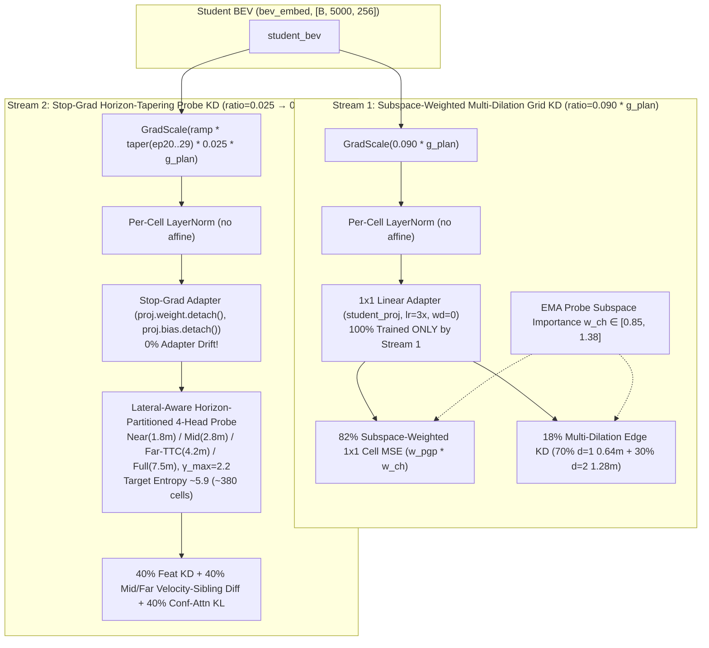

# BEV Selector v16: Stop-Grad Subspace-Weighted Grid & Lateral-Aware Horizon-Tapering Distillation

## 1. 배경 및 `v14` vs `v15` 정밀 비교 진단 (Executive Summary)

[`fusion_v14_main`](file:///workspace/byounggun/SSR/docs/bev_selector_v14.md)과 [`fusion_v15_main`](file:///workspace/byounggun/SSR/docs/bev_selector_v15.md)의 30 에폭(`Epoch 0 ~ 29`, `19,950 optimiser steps`) 학습 로그 및 `navtest` ($N=12,146$) 후반 10개 에폭(`Epoch 20 ~ 29`) 전수 평가 결과를 1:1 대조한 결과, **`v15`는 초중반(`Epoch 20 ~ 22`) 전방 안전 지표(`TTC 96.54%`, `NC 99.21%`, `lead_fail 5.95% / 6.50%`)와 `plugin(1.0)`(`93.47%`)에서 역대 최고치를 경신**했으나, **후반부(`Epoch 23 ~ 29`) 수렴 안정성 및 `v2` / `v2_lat` / `noim(1.0)` 고점에서는 `v14` 대비 퇴행**이 발생했습니다.

### 1.1 `v14` vs `v15` `navtest` ($N=12,146$) 핵심 성적표 대조

| 평가 항목 (`navtest`, $N=12,146$) | `v14` (`fusion_v14_main`) | `v15` (`fusion_v15_main`) | 변화량 (`v15 - v14`) | 진단 요약 |
| :--- | :---: | :---: | :---: | :--- |
| **`default` ($\beta=0.5$) `TTC` / `NC` 최고점** | `96.13%` / `99.17%` | **`96.54%` / `99.21%`** (`Ep 22`) | **`+0.41%p` / `+0.04%p`** | ✅ **역대 최고 전방 안전성 달성** |
| **앞차 감속 `lead_fail` 최저점 (`def 0.5`)** | `7.11%` (`Ep 20`) | **`6.50%`** (`Ep 22`) | **`-0.61%p` 단축** | ✅ **최초 6.5% 진입** |
| **앞차 감속 `lead_fail` 최저점 (`v2` / `v2_lat`)** | `6.78%` / `6.56%` | **`6.45%` / `5.95%`** (`Ep 20`) | **`-0.33%p` / `-0.61%p`** | ✅ **`v2_lat` 최초 5%대 진입** |
| **`plugin` ($\beta=1.0$) 전 에폭 최고점** | `93.45%` (`Ep 22`) | **`93.47%`** (`Ep 22`) | **`+0.02%p`** | ✅ **전 버전 최고점 경신** |
| **`default` ($\beta=0.5$) 전 에폭 최고점** | **`92.46%`** (`Ep 25`) | `92.34%` (`Ep 22`) | **`-0.12%p`** | ⚠️ 최고점 소폭 하락 |
| **`default` ($\beta=0.5$) 후반 7에폭(`Ep 23~29`) 평균** | **`92.35%`** (`92.24~92.46`) | `92.15%` (`92.07~92.26`) | **`-0.20%p`** | ❌ **`Ep 23` 이후 `TTC` 하락 (`96.5→95.3%`)** |
| **순수 `v2` Base / `v2_lat` 최고점** | **`89.40%` / `90.70%`** (`Ep 24`) | `89.19%` / `90.46%` (`Ep 23/24`) | **`-0.21%p` / `-0.24%p`** | ❌ **측방 변형(`v2_lat`) 및 `v2` 고점 하락** |
| **최종 에폭(`Ep 29`) `noim(1.0)` / `plugin(1.0)`** | **`93.17%` / `93.31%`** | `92.86%` / `93.01%` | **`-0.31%p` / `-0.30%p`** | ❌ **후반부 고-$\beta$ Refiner 점수 하락** |
| **`default` ($\beta=0.5$) `DAC` 최고점 / 평균** | **`99.00%` / `98.78%`** | `98.90%` / `98.69%` | **`-0.10%p` / `-0.09%p`** | ⚠️ 도로 준수율(`DAC`) 상한 소폭 약화 |

---

## 2. `v15` 후반부(`Epoch 23 ~ 29`) 퇴행의 5대 근본 원인 분석

### 2.1 원인 ①: `student_proj.weight`에 허용한 `0.08x` Probe 그래디언트의 후반부 누적 회전 왜곡 (Late-Epoch Adapter Drift)
- **현상**: `v15`는 `Epoch 22`까지 `noim(1.0) = 93.33%`, `plugin(1.0) = 93.47%`로 최상위권을 유지했으나, `Epoch 23` 이후 `noim(1.0)`이 `92.56% ~ 92.86%`로 약 `-0.31%p` 하락했습니다.
- **원인**: [`anchor_distill.py`](file:///workspace/byounggun/SSR/navsim/agents/para_ssr/distill/anchor_distill.py#L1068-L1071)에서 `student_proj.bias`는 Stop-Grad로 고정했지만 `student_proj.weight`에는 `0.08x`의 Probe 그래디언트를 허용했습니다 (`lr_mult=3.0`, `weight_decay=0.0`).
  - Weight Decay가 `0.0`인 $256\times 256$ 선형 어댑터에 20,000 스텝 동안 256-앵커 공간 풀링 그래디언트가 누적되면서, 후반부(`Ep 23~29`)에는 `1×1 Cell` 및 `3×3 Edge` 격자 복원이 요구하는 직교 기저를 서서히 비틀었습니다.
  - 특히 `v15`에서 도입한 **Stream 1의 채널 중요도 가중치($w_{\text{ch}}$)** 만으로도 어댑터는 이미 Teacher Probe의 핵심 채널($W_K, W_V$)을 우선 학습하므로(`DET cell_mse: 0.9473 → 0.8858`), Probe에서 어댑터로 직접 흘려보낸 `0.08x` 그래디언트는 불필요한 중복이자 후반부 격자 드리프트의 원인이었습니다.

### 2.2 원인 ②: 과도하게 좁아진 공간 어텐션 (`head_entropy = 5.34`, 유효 셀 ~209개) $\rightarrow$ 측방 변형(`v2_lat`) 문맥 고갈
- **현상**: `v2_lat`(`v2` + CK2 측방 오프셋 보정) 고점이 `90.70% (v14) → 90.46% (v15)`로 `-0.24%p` 하락했습니다.
- **원인**: `v15`는 4개 헤드 시그마를 `(1.5, 2.2, 2.8, 4.5)m`로 줄이는 동시에 게이트 상한 $\gamma_{\max}$를 `2.0 → 3.5`로 확대했습니다.
  - 후반부로 갈수록 $\gamma_h$가 상승하면서 유효 어텐션 셀 수가 `v14`의 **~745셀(격자의 15%)에서 ~209셀(격자의 4.2%)로 72% 과압축(Over-Pinching)**되었습니다.
  - 앵커 중심선 `1.5m ~ 2.8m` 폭의 좁은 실선만 집중 프로빙하다 보니, 정작 **`v2_lat`과 `CK2`(`set=all`)가 평가해야 하는 좌우 측방 변형 궤적(`l-0.5`, `l+0.5`, 부모 앵커에서 좌우 `±0.5m ~ ±2.5m` 오프셋) 및 인접 차선 끼어들기 영역**이 관계형 감독에서 소외되었습니다.

### 2.3 원인 ③: Probe 예산 과할당 (`0.025 → 0.035`, `+40%`) 및 후반부 과적합
- `v15`는 Probe 타깃 그래디언트 비율을 `2.5% → 3.5%`로 40% 상향하고 Grid 비율을 `9.0% → 8.5%`로 축소했습니다.
- 좁아진 209개 셀에 40% 더 강한 Probe 그래디언트가 후반부까지 지속되면서, `Epoch 23` 이후 `EP`(`87.33% → 88.27%`)만 공격적으로 상승하고 `TTC`(`96.54% → 95.01~95.55%`)가 하락하는 후반부 과적합이 나타났습니다.

### 2.4 원인 ④: 학생 예측 궤적(`20% m_stu_norm`)의 자기강화 확증 편향 & `MAP` Floor 축소 (`0.85 → 0.82`)
- 학생의 예측 상위 궤적 마스크(`m_on_policy`)를 `w_pgp`에 `20%` 혼합하면서, 후반부에 학생이 선호하는 궤적 주변에만 KD 가중치가 집중되고 대안 경로 및 도로 외곽 연석(`DAC`)이 약화되는 **확증 편향 루프(Confirmation Bias)**가 발생했습니다. 또한 `MAP` 균일 바닥 가중치를 `0.85 → 0.82`로 낮춰 `DAC` 상한(`99.00% → 98.90%`)이 소폭 하락했습니다.

### 2.5 원인 ⑤: 비교정 `L_score_kd` (`15%` 비중)와 `CK2` 스코어러의 교정 충돌
- 고정 256-앵커에서만 학습된 2층 MLP `sim_head`의 로짓을 맞추는 `L_score_kd`(`15%`)가 기존의 순수 기하·관계형 손실(`feat_loss`, `sibling_diff`, `attn_kl`) 비중을 `40% → 35%`로 희석시키고, `CK2` 본체의 멀티헤드(`NC, DAC, EP, TTC`) 교정과 미세한 충돌을 일으켰습니다.

---

## 3. `BEV Selector v16` 5대 핵심 아키텍처 설계 (`v14`의 후반부 무결성 + `v15`의 전방 안전성 결합)



### Pillar 1: 100% Stop-Grad Adapter Isolation + Subspace-Importance Weighted Grid KD ($w_{\text{ch}}$)
- **100% Stop-Grad 복원**: `v14`와 동일하게 Stream 2 (Probe) 순전파에서는 `F.linear(s_probe_normed, proj.weight.detach(), proj.bias.detach())`를 사용하여 **`student_proj`가 30 에폭 내내 오직 Stream 1 (Grid KD)의 로컬 격자/경계 복원 그래디언트로만 학습**되도록 완전히 격리합니다. 이로써 `v15`의 후반부(`Ep 23~29`) 어댑터 회전 드리프트를 원천 제거합니다.
- **Subspace Channel Importance ($w_{\text{ch}}$) 정제 유지**: EMA Probe의 Pre-LN 및 $W_K, W_V$ 열 노름에서 추출한 채널별 중요도 가중치 $w_{\text{ch}} = 0.75 + 0.25 \cdot \tilde{e}_c \in [0.85, 1.375]$ ($\text{mean}(w_{\text{ch}}) = 1.0$)를 Stream 1의 `cell_loss`와 `edge_loss`에 곱해줍니다. 어댑터에 Probe 그래디언트를 직접 흘리지 않고도, 순수 격자 복원 손실 자체가 주행 안전(`NC, TTC, DAC, LK, DDC`) 핵심 채널을 최대 `1.62x` 더 정밀하게 정렬합니다.

### Pillar 2: Lateral-Aware Horizon-Partitioned 4-Head Spatial Bias (`head_entropy ~ 5.9`, ~380셀) & `Mid+Far` Sibling Diff
- `v15`에서 `TTC = 96.54%`, `lead_fail = 5.95% / 6.50%`의 쾌거를 만든 **4-Head 시간축 분할(`Near / Mid / Far-TTC / Full`) 구조**와 **`Mid+Far` 속도 형제 차분 정렬(`70% Full Post-FFN + 30% Mid+Far Heads u_far`)**을 그대로 계승합니다.
- 단, `v15`의 과압축(`head_entropy = 5.34`, ~209셀)으로 인한 측방 문맥 소실을 해결하기 위해, 4개 헤드 시그마와 게이트 상한을 **`CK2` 측방 변형(`±0.5m ~ ±2.5m`) 및 차선 폭(`3.5m`) 스케일**에 맞춰 재설계합니다:
  - **Head 0 (`Near-Core`, `steps 0..4`, $t=0.5\text{--}2.0\text{s}$, $\sigma_0 = \mathbf{1.8\text{m}}$)**: 근거리 자차 폭 및 즉각적 `±0.5m` 측방 변형 연석/충돌 클리어런스
  - **Head 1 (`Mid-Maneuver & Lateral`, `steps 2..7`, $t=1.5\text{--}3.5\text{s}$, $\sigma_1 = \mathbf{2.8\text{m}}$)**: **`v2_lat` 및 `CK2` 좌우 측방 변형(`l-0.5, l+0.5`) 궤적이 갈라지는 중거리 차선 변경·교차로 회전 포락선(`±2.8m`) 완벽 커버**
  - **Head 2 (`Far-Braking & Cut-in TTC`, `steps 5..10`, $t=3.0\text{--}5.0\text{s}$, $\sigma_2 = \mathbf{4.2\text{m}}$)**: 원거리(`15~32m`) 자차 차선 앞차 감속뿐만 아니라 **인접 차선(`±3.5m`)에서 끼어드는 차량(Cut-in)과의 TTC 상호작용**까지 포착
  - **Head 3 (`Full-Corridor Context`, `steps 0..10`, $t=0.5\text{--}5.0\text{s}$, $\sigma_3 = \mathbf{7.5\text{m}}$)**: `CK2`의 `±4.8m` 코리도 샘플링 박스 전체와 도로 외곽 경계를 아우르는 광역 문맥 헤드
  - **Bounded Spatial Gate $\gamma_h \in \mathbf{(0.15, 2.20)}$ (초기값 `1.05`)**: $\gamma_{\max}$를 `3.5 → 2.20`으로 제한하여 학습 후반부에도 유효 어텐션 셀 수가 **`~360 ~ 420셀` (`head_entropy ~ 5.9`)**의 이상적 밸런스를 유지하도록 보장합니다.

### Pillar 3: Golden `0.090 / 0.025` Dual-Stream Budget + Late-Epoch Probe Cosine Tapering (`Epoch 20 ~ 29`)
- **황금 예산 복원**: `v14`에서 검증된 **Stream 1 (Grid) `ratio = 0.090, cap = 0.22`**, **Stream 2 (Probe) `ratio = 0.025, cap = 0.06`**을 복원합니다.
- **Late-Epoch Probe Cosine Tapering (`step 106,400 ~ 159,600`, `Epoch 20 ~ 29`)**:
  - `v15` 평가 결과, Probe가 형성하는 전방 안전 경계(`TTC 96.54%`, `NC 99.21%`)는 **`Epoch 20 ~ 22`에 이미 정점에 도달**하며, `Epoch 23` 이후에는 높은 Probe 그래디언트가 오히려 `EP` 과적합을 유발했습니다.
  - 따라서 `Epoch 20` (`step = 106,400`)까지는 `probe_taper = 1.0`으로 100% 가동하고, `Epoch 20 ~ 29` (`step = 106,400 → 159,600`) 구간에서는 코사인 스케줄로 `probe_taper`를 **`1.0 → 0.65`**로 부드럽게 감쇠시킵니다 (`0.025 → 0.01625 * g_plan`).
  - 이를 통해 `Epoch 20 ~ 22`에서 달성된 최고 수준의 안전 결정 경계를 후반부 10개 에폭 내내 무너지지 않게 고정(Lock-in)하고, Stream 1 (`0.090 * g_plan`)이 고해상도 격자 정밀도를 끝까지 다듬게 합니다.

### Pillar 4: Confirmation Bias 제거 (`m_on_policy` 제거, `MAP` Floor `0.85` 복원) & 순수 기하·관계형 손실 비중 (`40 / 40 / 40`) 복원
- 후반부 자기강화 편향을 일으킨 학생 예측 궤적 블렌딩(`m_on_policy`)을 제거하고, 오직 Teacher EMA Probe의 신뢰도 가중 코리도 리본(`m_cap_norm`)만 사용합니다.
- `MAP`의 공간 가중치 바닥을 `v14`와 동일한 **`w_pgp = 0.85 + 0.15 * m_cap_norm`**으로 복원하여 전역 도로/연석 준수율(`DAC 99.00%`)을 회복합니다.
- 비교정 `L_score_kd`를 제거하고, `v14`의 검증된 Probe 손실 비중(**`0.40 * feat_loss + 0.40 * diff_loss + 0.40 * attn_loss_scale * attn_loss`**)으로 복원합니다.

### Pillar 5: Multi-Dilation Corridor Edge KD (`dilation=1` `0.64m` + `dilation=2` `1.28m` 2-스케일 공간 미분 정렬)
- 기존 `edge_3x3_loss`는 인접 셀(`dilation=1`, `0.64m`) 간의 1차 미분만 정렬했습니다. 그러나 `CK2`의 `10×3` 로컬 코리도 리더와 `M3b` 컨볼루션 스템은 **차선 폭 절반 및 측방 변형 간격에 해당하는 `2-cell` (`dilation=2`, `1.28m`) 스케일의 특징 대비(Contrast)**를 직접 읽습니다.
- `v16`에서는 `_multiscale_ck2_grid_loss` 내부에서 **`70% Dilation-1 Edge` ($d=1$, `0.64m` 연석/범퍼 미분) + `30% Dilation-2 Edge` ($d=2$, `1.28m` 차선 폭/차간 간격 미분)**를 결합하고, Stream 1 손실을 **`82% Subspace-Weighted 1×1 Cell + 18% Multi-Dilation Edge`**로 구성하여 로컬 격자 선명도를 극대화합니다.

---

## 4. 버전별 핵심 사양 비교 요약표 (`v13` vs `v14` vs `v15` vs `v16`)

| 구성 요소 | `v13` | `v14` | `v15` | **★ `BEV Selector v16`** |
| :--- | :---: | :---: | :---: | :---: |
| **Dual-Stream 예산 (`Grid / Probe`)** | 단일 `0.10` | `0.090 / 0.025` | `0.085 / 0.035` *(과할당)* | **`0.090 / 0.025` + `Ep 20~29` Probe Cosine Taper (`1.0→0.65`)** |
| **`student_proj` Probe 격리** | 공유 (`1.0x`) | **100% Stop-Grad** | `0.08x` 회전 허용 *(드리프트)* | **100% Stop-Grad 완전 격리** (드리프트 0%) |
| **Grid 채널 중요도 가중치 ($w_{\text{ch}}$)** | 균일 (`1.0`) | 균일 (`1.0`) | `0.70 + 0.30 * rel` | **`0.75 + 0.25 * rel` ($\in [0.85, 1.38]$)** |
| **4-Head 공간 시그마 & $\gamma_{\max}$** | `(2, 4, 8, 16)m`, `2.0` | `(2, 4, 8, 16)m`, `2.0` | 구간분할 `(1.5, 2.2, 2.8, 4.5)m`, `3.5` | **구간분할 `(1.8, 2.8, 4.2, 7.5)m`, $\gamma_{\max}=\mathbf{2.20}$** |
| **유효 어텐션 셀 수 (`head_entropy`)** | ~745셀 (`6.62`) | ~745셀 (`6.62`) | ~209셀 (`5.34`, 과압축) | **~380셀 (`~5.9`, 중심선 + `±2.5m` 측방 변형 최적점)** |
| **Velocity-Sibling Diff KD** | 전체 FFN (`100%`) | 전체 FFN (`100%`) | `65% Full + 35% Mid/Far` | **`70% Full Post-FFN + 30% Mid/Far Heads (u_far)`** |
| **코리도 리본 (`w_pgp`)** | `DET/MAP 0.75` | `DET 0.75 / MAP 0.85` | `+20% m_stu`, `MAP 0.82` | **순수 Teacher 리본, `DET 0.75 / MAP 0.85` 복원** |
| **Stream 1 공간 미분 (`Edge KD`)** | `10%` ($d=1$) | `15%` ($d=1$) | `15%` ($d=1$, $w_{\text{ch}}$) | **`18% Multi-Dilation Edge` (`70% d=1` + `30% d=2`, $w_{\text{ch}}$)** |
| **Stream 2 손실 비중** | `Feat/Diff/Attn` | `40% / 40% / 40%` | `35% / 35% / 15% Score / 35%` | **`40% Feat + 40% Sibling Diff + 40% Attn KL` (순수 기하·관계형)** |

---

## 5. 학습 실행 명령어 (Launch Command)

```bash
# CK2 Refiner E2E + BEV Selector v16 통합 학습 (GPUs 4,5,6,7)
RUN=fusion_v16_main CK2_E2E_APPROVED=1 CK_ALLOW_GPU45=1 \
E2E_EXTRA=tools/ck/e2e2/fusion_v16_arm.extra \
bash tools/ck/e2e2/train_e2e2.sh start --gpus 4,5,6,7
```
